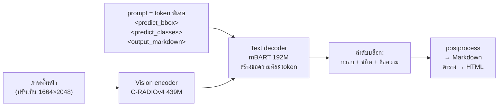
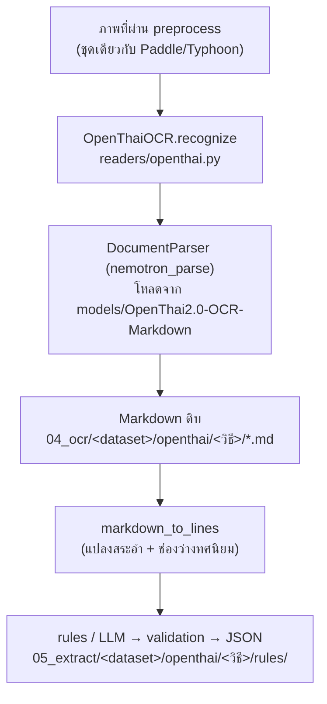

# OpenThai 2.0 OCR Markdown (iApp): ตัวอ่านเอกสารที่ลองแล้ว

เอกสารนี้อธิบายว่า OpenThai OCR คืออะไร ทำงานอย่างไร ต่อเข้ากับโปรเจกต์อย่างไร และสรุปผลที่ **วัดจริงกับสแกน 18 ใบ**
ส่วนที่มาจาก model card ระบุว่า "model card ระบุ" ส่วนที่วัดเองระบุตัวเลขและวิธีรัน

> **สรุปสั้น:** อ่านทั้งหน้าเป็น Markdown (ตารางเป็น HTML) ได้ครบเกือบทุกใบ เร็วกว่า Typhoon ราว 3 เท่าบนเครื่องนี้ (14 วินาที/หน้า เทียบ 45) และใช้ VRAM แค่ ~2.4GB
> แต่ **เมื่อสกัดด้วย rules เดิมได้ `failed` 4 ใบ จาก 18** (Typhoon: 0) เพราะโหมดหน้าเดียว (`single`) บางครั้งทิ้งหรือยุบบล็อกยอดรวมของตาราง
> ผลนี้ **ไม่ใช่คะแนนความแม่นของการอ่าน** (ไม่มี ground truth) rules ถูกจูนมากับรูปแบบ Markdown ของ Typhoon จึงมีอคติเข้าข้างฝั่งนั้น

## 1. คืออะไร

- Thai fine-tune ของ **NVIDIA Nemotron 3.5 Parse** โดย iApp Technology (model card ระบุ): 0.63B พารามิเตอร์
  ตัวเข้ารหัสภาพ 439M (C-RADIOv4-SO400M) + ตัวถอดรหัสข้อความ 192M (mBART 10 ชั้น)
- fine-tune ทั้งโมเดล 1 epoch บนข้อมูล 54,596 แถว ใบอนุญาต OpenMDW-1.1 (ตัวโมเดลต้นทางของ NVIDIA ใช้ใบเดียวกัน)
- ผลคือ **Markdown** ตารางเป็น HTML (`rowspan`/`colspan`) พร้อมกรอบและชนิดของทุกบล็อกตามลำดับการอ่าน (เราใช้แค่ Markdown ตอนนี้)
- ข้อจำกัดที่ model card บอกเอง: ตารางแปลกอาจตกบางแถว, ข้อความตั้งตรงอ่านผิดได้, เลขไทยบางครั้งกลายเป็นเลขอารบิก,
  ลายมืออ่านได้เฉพาะระดับบรรทัด, ตัวพิมพ์ dot-matrix ยังไม่มีชุดทดสอบจริง

## 2. หลักการทำงาน



1. **ภาพทั้งหน้า → encoder** หน้าถูกปรับให้พอดี 1664×2048 แล้วแปลงเป็นเวกเตอร์ภาพ
2. **decoder สร้างข้อความ** โดย prompt เป็น token พิเศษ ไม่ใช่ประโยค (`</s><s><predict_bbox><predict_classes><output_markdown><predict_text_in_pic>`)
   บอกให้ทำนายกรอบ ชนิดบล็อก และเนื้อหาเป็น Markdown ในรอบเดียว เรียงตามลำดับการอ่าน
3. **postprocess** (`nemotron_parse/postprocessing.py` ที่มากับโมเดล) แยกกรอบ/ชนิด/ข้อความออกจากสายอักขระดิบ แล้วต่อเป็น Markdown

ต่างจาก OCR แบบดั้งเดิม (Paddle) ที่ตรวจบรรทัดก่อนแล้วอ่านทีละบรรทัด โมเดลนี้ **อ่านทั้งหน้าในครั้งเดียว** จึงเข้าใจโครงตารางได้
แต่ก็แลกกับความเสี่ยงที่ **บางบล็อกถูกข้ามหรือยุบรวม** โดยไม่มีสัญญาณเตือน (ไม่มี confidence ต่อคำ เหมือน Typhoon)

### โหมดการอ่าน (`openthai.parse_mode`)

| โหมด | ทำอะไร | เวลา/หน้า (วัดเอง) |
|---|---|---|
| `single` (ค่าตั้งต้น) | อ่านหน้าเดียวรอบเดียว | ~14 วินาที (3.9–28.6) |
| `double` | อ่านรอบแรกแล้ว **ตัดเฉพาะบล็อกตาราง/chart มาอ่านซ้ำ** | 33–54 วินาที |
| `triple` | เพิ่มรอบตรวจหากรอบแยกต่างหาก (ยังไม่ได้ลอง) | — |

### 2.1 เลือกภาษาไทย/อังกฤษอย่างไร

**ไม่มีขั้นเลือกภาษา** ตรวจจากโค้ดและโฟลเดอร์โมเดล (`models/OpenThai2.0-OCR-Markdown/`):
- prompt ที่ส่งเข้าโมเดลคือโทเคนพิเศษชุดเดียวคงที่ `</s><s><predict_bbox><predict_classes><output_markdown><predict_text_in_pic>` (`nemotron_parse/inference.py`) ไม่มีโทเคนหรือพารามิเตอร์ระบุภาษา
- `openthai:` ใน `configs/default.yaml` และ `OpenThaiOCR` ไม่มีตัวเลือกภาษา ส่งเข้าแค่ภาพกับโหมด `parse_mode`
- ไม่ได้สลับระหว่าง "OCR ไทย" กับ "OCR อังกฤษ" โมเดลเดียว (ตัวถอดรหัสเดียว) อ่านอักขระที่เห็นในภาพแล้วสร้างข้อความทีละโทเคน ทั้งไทย ละติน และตัวเลข ในผลเดียวกัน model card ระบุว่าฐานของโมเดล (Nemotron Parse) ผ่านการประเมินหลายภาษา (รวมไทย: MOSCAR Thai BoC F1 99.66/99.95 ของ Parse 2.0/3.5 ตามการ์ดของ NVIDIA ไม่ใช่ผลวัดของเรา) ภายในโมเดลตัดสินใจอย่างไรต่อตัวอักษร **ไม่มีเอกสารอธิบายและเรายังไม่ได้ตรวจ**
- ผลที่ตามมา: ภาษาที่อ่านผิดมักเป็นการสะกดผิดไม่ใช่เลือกภาษาผิด เช่น ตัวอักษรไทยบางตัวถูกอ่านเป็นละติน/ตัวเลข ถ้าต้องบังคับภาษา (ไทยด้วยโมเดลหนึ่ง อังกฤษด้วยอีกโมเดล) ต้องเพิ่มตัวอ่านและตัวตัดสินเอง โปรเจกต์นี้ยังไม่ทำ (OXR ใน [archive/oxr.md](archive/oxr.md) อ่านเฉพาะตัวเลข/อังกฤษ เป็นตัวเลือกที่ลองแล้วอยู่นอกสายงานหลัก)
- ที่ **วัดได้** คือสัดส่วนอักขระไทย/ละติน/ตัวเลขในข้อความที่ได้กลับมาของแต่ละส่วน อยู่ใน `.chunks.json` (`script_mix`) ดู [13](03-sections.md#ไฟล์-chunks-ข้อความท่อนนี้มาจากภาพ-section-ไหน) นับจากผลลัพธ์ ไม่ใช่สิ่งที่โมเดลเลือก

## 3. ต่อเข้าโปรเจกต์อย่างไร

ตัวอ่านอยู่ใน `readers/` และใช้ทางเดียวกับทุก engine: ขั้น ocr ของ `sections` เก็บ Markdown ดิบ แล้ว `extract` สกัดจากข้อความดิบนั้น



| ส่วน | รายละเอียด |
|---|---|
| โค้ด | `src/fin_extractor/readers/openthai.py` (ตัวอ่าน), `readers/__init__.py` (`make_reader`, `reader_label`) ใช้ใน `sections/read.py` และ `pipeline.py` |
| backend | `transformers` (ค่าตั้งต้น โหลดในโปรเซส) หรือ `vllm` (เรียก server ที่ `base_url`) ค่า `openthai:` ใน `configs/default.yaml` |
| ไม่ต้อง pip install `nemotron_parse` | โค้ดอ่านผลอยู่ในโฟลเดอร์โมเดล โค้ดเพิ่ม path ให้เอง ต้องมีแค่ torch/transformers/timm/einops/accelerate (`pip install -e ".[openthai]"`) |
| ทำไมใช้ Transformers แทน vLLM | vLLM ไม่รองรับ Windows ตรง ๆ (ต้อง WSL2) และโมเดลเล็กพอสำหรับ GPU 6GB |
| การถอดรหัส | greedy (`temperature=0`, `top_k=1`, `repetition_penalty=1.1`) ตามตัวอย่างของผู้ทำโมเดล ซึ่งระบุว่า sampling ทำให้หน้าเพี้ยนบน Mac |
| prompt | ส่ง `"\n" + prompt` ในโหมด Transformers เพื่อให้ token ตรงกับที่ vLLM server อ่าน (ตามตัวอย่างของ iApp) ยังไม่ได้เทียบผลกับ vLLM จริง |
| ตอบไม่จบ | `GenerationError` (ชน `max_tokens=8744`) → เก็บเท่าที่อ่านได้ และตั้งธง `truncated` เหมือน Typhoon |
| flow หลัก | `python -m fin_extractor sections` ใช้ OpenThai (ค่าตั้งต้น `--engine openthai`) อ่านทีละภาพย่อย (section) แทนทั้งหน้า ผลลง `04_ocr/<dataset>/openthai/<วิธี>/` แล้วสกัดด้วย `extract --engine openthai --llm off` (ดู [03-sections.md](03-sections.md)) ส่วนหัวข้อ 4 ด้านล่างวัดแบบอ่านทั้งหน้า (`page`) |
| ชื่อโฟลเดอร์ผล | `--engine openthai` → `04_ocr/<dataset>/openthai/` และ `05_extract/<dataset>/openthai/` ชื่อ engine ในผลคือ `openthai:OpenThai2.0-OCR-Markdown` |

### การทำความสะอาดข้อความก่อนสกัด (`extraction/rule_extractor.py: markdown_to_lines`)

| ปัญหาที่เห็นในผลจริง | ตัวอย่าง | วิธีแก้ |
|---|---|---|
| สระอำเป็น นิคหิต+า (U+0E4D U+0E32) | `นําส่ง`, `จํากัด` | `normalize_thai` ตัวเดียวกับที่ OCR ใช้ |
| ช่องว่างก่อนทศนิยม | `106,250 .00`, `3,187 .50` | ตัดช่องว่างเมื่อตามด้วยตัวเลข 2 หลัก |

ทั้งสองข้อใช้กับข้อความของทุก engine: ตรวจแล้วว่า **ผลของ Typhoon ไม่เปลี่ยน** (สกัดซ้ำจากข้อความดิบ JSON เหมือนเดิม 18/18)
ข้อความดิบที่เก็บไว้ไม่ถูกแก้ การแปลงทำตอนสกัดเท่านั้น

## 4. ผลวัดบนสแกนจริง 18 ใบ (`data/01_input/finance_doc_scan`)

เครื่อง: RTX 4050 Laptop 6GB, torch 2.11.0+cu128 รันเมื่อ 2026-11-14

| | OpenThai (`single`, GPU) | Typhoon (Ollama, ผลที่เก็บไว้) |
|---|---|---|
| เวลารวม 18 หน้า | 255 วินาที (เฉลี่ย 14) | 814 วินาที (เฉลี่ย 45) |
| ตอบไม่จบ | 0 | 0 |
| VRAM สูงสุด | 2.4GB | ไม่ได้วัด |
| อุณหภูมิ GPU สูงสุด | 73°C | ไม่ได้วัด |
| สกัดด้วย rules: `needs_review` / `failed` | 14 / 4 | 18 / 0 |

เวลาของสองตัววัดคนละวัน ใช้เทียบขนาดเท่านั้น

### สาเหตุของ 4 ใบที่ `failed`

| ไฟล์ | ชนิด | สิ่งที่พบ |
|---|---|---|
| 001307, 001321, 001323 | หนังสือรับรอง 50 ทวิ | ยอดรวม ("รวมเงินที่จ่าย…") **ถูกยุบเป็นแถวสุดท้ายของตารางใหญ่ไม่มีป้าย** (`106,250 .00 \| 3,187 .50`) ส่วนบรรทัดป้ายกลายเป็นหัวข้อ `##` เปล่า rules ต้องการป้ายกับตัวเลขในบรรทัดเดียวกัน จึงหา `total_paid` / `total_tax_withheld` ไม่เจอ |
| 001309 | ใบแจ้งหนี้ | บล็อก "จำนวนเงินทั้งสิ้น" **หายไปจากผลทั้งบล็อก** (`total_amount` ไม่มี) |

ลอง `parse_mode: double` กับ 4 ใบนี้: **001309 ผ่านขั้น `failed`** (ได้ `total_amount` เหลือ `needs_review`)
แต่ **50 ทวิ ทั้งสามใบยังเหมือนเดิม** เวลา/หน้าเพิ่มเป็น 33–54 วินาที จึงยังไม่ได้ตั้งเป็นค่าตั้งต้น

อ่านผิดที่เห็นจริง (ดูไม่ครบทั้ง 18 ใบ): "หกสิบบาทถ้วน" เป็น "หกสิบขาทถ้วน" (001307) และชื่อบริษัท "ยูนิตี้" เป็น "ยนิตี้" (001309)

### ข้อสรุปและสิ่งที่ยังไม่ได้ทำ

- **ยังไม่มีคะแนนความแม่นของการอ่าน** ไม่มี ground truth จึงตอบไม่ได้ว่าใครอ่านถูกกว่า ตัวเลขข้างบนวัดเวลา ทรัพยากร และการผ่านของ rules เท่านั้น
- **ไม่แก้ rules ให้หยิบตัวเลขจากแถวสุดท้ายของตารางก่อนหน้า** เพื่อกู้ 50 ทวิ: ถ้าตารางมีหลายรายการ ยอดที่ได้จะผิดโดยไม่มีสัญญาณเตือน ซึ่งขัดหลักการ "ไม่เดาค่า" ([README](README.md#4-ไม่เดาค่า))
- ยังไม่ได้ลอง `--llm on` กับข้อความของ OpenThai, โหมด `triple` และ backend `vllm`
- ใช้กรอบ (bbox) ของโมเดลยังไม่ได้ ทั้งที่เป็นข้อได้เปรียบเหนือ Typhoon (ไม่มีกรอบ) ที่จะช่วยทำไฮไลต์ในหน้าตรวจของบัญชีได้ ([07](draft-07-handwriting-and-field-confidence.md))

## 5. วิธีใช้

ติดตั้งและดาวน์โหลดโมเดล: ดู [00-setup-and-usage.md](00-setup-and-usage.md) (ตาราง "ส่วนเสริม")

```bash
# อ่านข้อความดิบ (ใช้ GPU) → data/04_ocr/<dataset>/openthai/page/
python -m fin_extractor sections data/01_input/finance_doc_scan --to ocr   # อ่านทีละ section (ห้ามอ่านทั้งหน้า)

# สกัดจากข้อความดิบ ไม่แตะ GPU
python -m fin_extractor extract data/01_input/finance_doc_scan --engine openthai

# ลองโหมดอ่านตารางซ้ำ: ไฟล์ override เล็ก ๆ (deep-merge ทับ default.yaml)
#   openthai:
#     parse_mode: double
python -m fin_extractor --config my.yaml ocr <ไฟล์> --engine openthai --out data/etc/experiments/openthai_double
```

ข้อควรระวัง: รันบน GPU เครื่องนี้เคยค้างกับ Paddle เต็มชุด ตัวนี้เบากว่ามาก (VRAM ~2.4GB, 73°C ตอนรัน 18 ใบ) แต่ยังควรรันทีละโปรเซส

## 6. OpenThai 2.1 (2026-11-18): Markdown และ Text เทียบ 2.0 บน 18 ใบ

iApp ออกสองตัว (อ่าน model card เมื่อ 2026-11-24) ต่อเข้าโปรเจกต์เป็น engine แยก ผลลงโฟลเดอร์ของตัวเอง ไม่ทับผลของ 2.0

| | `--engine openthai21` | `--engine openthai-text` |
|---|---|---|
| ชนิด | VLM ตัวเดียวกับ 2.0 (Nemotron-Parse 0.63B) weights ใหม่ ใช้ `readers/openthai.py` ตัวเดิม | PP-OCRv6-tiny (ตัวตรวจบรรทัด + ตัวอ่าน CTC) ONNX ~9 MB `readers/openthai_text.py` |
| รันบน | GPU (torch) | **CPU** (onnxruntime) |
| ได้อะไร | Markdown + ตาราง HTML | ข้อความทีละบรรทัด + **ความมั่นใจต่อบรรทัด** ไม่มีตาราง |
| model card อ้าง | เอกสารราชการ/ตารางไทยเท่าเดิม (printed Thai 90.2 เทียบ 90.3) ดีขึ้นที่ภาพถ่ายมือถือและหน้าแบบใหม่ · "ำ" เป็น U+0E33 | 12 ชุดพิมพ์ไทยเฉลี่ย 88.2 (2.0 Markdown 90.3) · ลายมือ 10.3 · ตรา/โลโก้ออกเป็นข้อความ |

**ผลบน 18 ใบ** (luma ผังเดียวกับผลเดิมของ 2.0 rules ล้วน **ไม่มีเฉลย**: วัดความครบและความสอดคล้องภายใน ไม่ใช่ความถูก)

| | 2.0 Markdown | 2.1 Markdown | 2.1 Text | Typhoon |
|---|---|---|---|---|
| ฟิลด์ที่ต้องมีแต่หาไม่เจอ (รวม) | **14** | 18 | 24 | 15 |
| check ผ่าน / ไม่ผ่าน | 43 / 10 | 42 / 11 | 33 / 9 | 41 / 13 |
| failed | 2 | 2 | 7 | 1 |
| เวลา | 18 ใบ ~6 นาที (รวมโหลดโมเดลชุดละ 13–17 วินาที) | เท่า 2.0 · VRAM 1.4 GB | **18 ใบ 34 วินาทีบน CPU** | — |

- **2.1 Markdown ≈ 2.0** ตรงกับ model card: ค่าตรงกัน 73 ช่อง ต่างกัน 10 และดีขึ้น/แย่ลงพอ ๆ กัน ดีขึ้น: 1306 ไม่แต่งชื่อผู้ขาย · 1316 วันที่ถูก (2.0 ได้ 2018) · 1308/1309 ได้วันที่ · 1318 ได้ VAT แย่ลง: 1312 ใส่ยอดก่อน VAT เป็น VAT · 1321 ภาษีที่หัก 3,187.00 (ถูก 3,187.50) · 1311 เลขที่หนังสือรับรอง "10-08" (ถูก 005) · 1314 เลขภาษีผู้ขายหาย · วันที่ 1319/1320 หาย **ยังไม่เปลี่ยนค่าตั้งต้น**
- **2.1 Text** ดีกับใบพิมพ์ที่ไม่มีตารางซับซ้อน (1308 1309 1312 1315 1316 ครบเท่าหรือมากกว่า 2.0 · 1312 อ่านเลขภาษีและแถวยอดรวมสะอาด) แต่ **ลายมือพังหมด** (1320/1322 ขาด 5 ช่อง) และ **ไม่มีตาราง**: ข้อความคอลัมน์ซ้าย/ขวาถูกรวมเป็นบรรทัดเดียว (1317 "…ลงวันที่ ยอดเงินสุทธิ 8,025.00" แล้ว "Net Total" ไปอยู่บรรทัดถัดไป) rules จึงจับป้ายกับยอดไม่ได้ ไม่เหมาะเป็นตัวอ่านหลัก แต่น่าใช้เป็นตัวอ่านที่สอง (เร็ว ไม่หลอน มีความมั่นใจต่อบรรทัด = สัญญาณ `model_conf` ที่ draft-09 ต้องการ)
- ตัดสินจริงต้องมีเฉลย: กรอกด้วย `scripts/eval/groundtruth_app.py` แล้ว `scripts/eval/score_groundtruth.py` ให้คะแนนทุก engine ที่มีผลใต้ `05_extract/` พร้อมกัน

```bash
hf download iapp/OpenThai2.1-OCR-Markdown-20261118 --local-dir models/OpenThai2.1-OCR-Markdown-20261118
hf download iapp/OpenThai2.1-OCR-Text-20261118 --local-dir models/OpenThai2.1-OCR-Text-20261118
pip install onnxruntime     # สำหรับ openthai-text เท่านั้น
python -X utf8 -m fin_extractor sections data/01_input/finance_doc_scan --engine openthai-text --from ocr            # CPU ทั้งชุดได้
python -X utf8 -m fin_extractor sections data/01_input/finance_doc_scan --engine openthai21 --from ocr --only 1306 1307 1308   # GPU ทีละชุด
```
