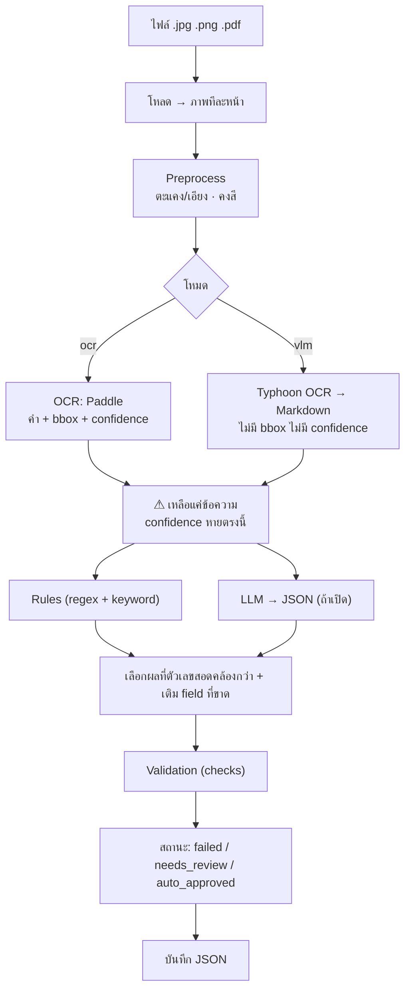
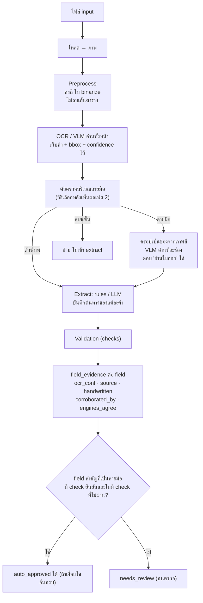

# แผนรองรับลายมือและ confidence รายฟิลด์

เอกสารนี้สรุปภาพรวมระบบ ปัญหาที่พบเมื่อเอกสารเป็นฟอร์มพิมพ์ที่กรอกมือ แผน implement เป็นเฟส
และแนวทางทำ confidence รายฟิลด์ ส่วน flow ปัจจุบันของระบบอยู่ใน [README.md](README.md)

> สถานะ: เป็นแผน ยังไม่ได้ implement ยกเว้นข้อที่ระบุว่า "ทำแล้ว" ในหัวข้อ 4

## 1. ภาพรวมระบบปัจจุบัน

รับภาพหรือ PDF คืน JSON ตาม schema เดียวกันทุกครั้ง โดยตัดสินความน่าเชื่อถือจากการตรวจตัวเลขกันเอง
(checksum เลขภาษี, ผลรวมรายการ, ก่อน VAT + VAT = รวม) ไม่ได้ตัดสินจาก confidence ของ OCR

### Flow ปัจจุบัน



### confidence ตอนนี้ทำงานอย่างไร

| เรื่อง | ความจริงในโค้ด |
|---|---|
| `ocr_confidence` | ค่าเฉลี่ยของ confidence ต่อคำที่ engine รายงาน (`OCRResult.mean_confidence`) VLM ไม่มีค่านี้ จึงเป็น `None` |
| ใช้ตัดสิน status ไหม | ไม่ใช้ แค่รายงานไว้ใน output |
| status ตัดสินจาก | field สำคัญ 5 ตัวครบไหม และผล check ตัวเลข (`validation/scoring.py`) |
| ความหมายของค่า | แต่ละ engine นิยาม confidence ต่างกัน เทียบข้ามกันไม่ได้ และยังไม่ผ่านการ calibrate |

## 2. ปัญหาเมื่อเจอเอกสารลายมือ

เอกสารเป้าหมาย: **ฟอร์มพิมพ์ที่กรอกมือเป็นส่วนใหญ่ มีลายเซ็นบ้าง** ยังไม่มีตัวอย่างจริง

| # | ปัญหา | ที่มา | ความเสี่ยง |
|---|---|---|---|
| P1 | OCR ตัวพิมพ์อ่านลายมือผิดแบบเงียบๆ (confidence อาจสูงทั้งที่ผิด) | Paddle ถูกฝึกกับตัวพิมพ์ | สูง |
| P2 | ขั้น binarize ทำลายลายมือ (ปิดเป็นค่าตั้งต้นแล้ว; `table.py` ที่ตัดเส้นปากกาถูกลบแล้ว) | `binarize.py` | ต่ำ (แก้แล้ว) |
| P3 | ไม่รู้ว่า field ไหนมาจากลายมือ | ไม่มี provenance | สูง |
| P4 | ไม่มีตัวตรวจ/แยกบริเวณลายมือ | ยังไม่มีโค้ด | สูง |
| P5 | อ่านทั้งหน้าด้วย VLM อาจเดาช่องว่างหรืออ่านข้ามช่อง | พฤติกรรมของ VLM | กลาง |
| P6 | field ที่ไม่มี check ยืนยัน (ชื่อ, เลขที่เอกสาร, วันที่) ตรวจความถูกต้องไม่ได้ | `checks.py` | กลาง |
| P7 | ลายเซ็น/ขีดเขียนทับอาจถูกอ่านเป็นข้อความขยะ | ยังไม่มีตัวอย่างยืนยัน | ต่ำ-กลาง |
| P8 | ไม่มีข้อมูลเฉลย จึงตั้งเกณฑ์หรือเลือก engine ไม่ได้ | ไม่มีตัวอย่าง | บล็อกทุกอย่างที่ต้องมี threshold |
| P9 | เลขลายมือสับสนกัน (1/7, 0/6, 4/9), เลขไทย, พ.ศ./ค.ศ. | ลักษณะของลายมือ | กลาง |
| P10 | confidence รายฟิลด์ทำไม่ได้ เพราะถูกทิ้งก่อนถึงขั้น extract | `pipeline.read_page` ส่งต่อแค่ข้อความ | กลาง |

## 3. Flow เป้าหมาย



หลักการ: เป้าหมายไม่ใช่อ่านลายมือถูก 100% แต่คือ **ผิดแล้วต้องไม่หลุดเป็นอนุมัติอัตโนมัติ**
ชื่อร้าน เลขที่เอกสาร และวันที่ที่เป็นลายมือ ไม่มี check ยืนยันได้ จึงต้องให้คนตรวจเสมอ

## 4. แผน implement เป็นเฟส

ทุกเฟสมีเงื่อนไขผ่านก่อนไปเฟสต่อไป

### เฟส 0: เก็บข้อมูล (บล็อกเฟส 2 เป็นต้นไป)
- รวบรวมฟอร์มพิมพ์ที่กรอกมือไว้ใน `data/raw/`
- เฉลยค่า field สำคัญเป็น JSON ตาม schema และระบุว่า field ไหนเขียนมือ
- ผ่านเมื่อ: มีตัวอย่างพอให้เห็นความหลากหลายของฟอร์ม ยังไม่กำหนดจำนวนตายตัว
- แก้: P8

### เฟส 1: ฐานรากที่ไม่ต้องใช้ข้อมูล
- **ทำแล้ว**
  - `handwritten_fields` ใน `ExtractionResult` (`schema.py`)
  - กฎใน `validation/scoring.py` ที่ field ลายมือต้องมี check ยืนยันและไม่มี check ที่ไม่ผ่านจึง auto-approve ได้ (`CORROBORATING_CHECKS`, `uncorroborated`)
  - เทสต์ใน `tests/test_extraction_validation.py`
- **เหลือ:** ให้ `pipeline.py` ส่ง `handwritten_fields` เข้า `decide_status` (ต้องมีตัวตรวจจากเฟส 3 ก่อน)
- แก้: P3, P6 (บางส่วน)

### เฟส 1.5: ติดตามต้นทางของค่า (ไม่ต้องใช้ข้อมูลเฉลย)
- ให้ extractor คืนต้นทางของแต่ละค่า (บรรทัดและช่วงตัวอักษร)
- ส่งคำที่มี confidence ไปถึง extractor แทนข้อความล้วน
- `fill_missing` บันทึกว่าค่ามาจากแหล่งไหน
- แก้: P10

### เฟส 2: Baseline และ error analysis (ต้องมีข้อมูลจากเฟส 0)
- ขยาย `scripts/benchmark.py` ให้เทียบกับเฉลยแยก field และแยกตัวพิมพ์/ลายมือ
- รัน Paddle เทียบ Typhoon OCR บนชุดเดียวกัน
- ผ่านเมื่อ: มีตารางอัตราผิดต่อ field ต่อ engine จากข้อมูลจริง
- แก้: P1, P8

### เฟส 3: ตัวตรวจบริเวณลายมือ
เลือกวิธีหลังเห็นผลเฟส 2:
1. Disagreement-based: บริเวณที่สอง engine อ่านไม่ตรงกันถือว่าน่าสงสัย
2. VLM-tagging: ให้ VLM คืน `printed/handwritten` ต่อ field
3. Layout-based: ใช้ตำแหน่งช่องจากฟอร์มที่รู้จัก ใช้ได้เมื่อฟอร์มซ้ำกันมาก

- ผ่านเมื่อ: จับ field ลายมือในชุดเฉลยได้ในระดับที่ตกลงกันหลังเห็นผล
- แก้: P4

### เฟส 4: อ่านลายมือเป็นช่อง
- ครอปบริเวณลายมือจากภาพสี ส่ง VLM พร้อม prompt เฉพาะชนิด field (ตัวเลข, วันที่ที่อาจเป็น พ.ศ.)
- ให้ VLM ตอบ "อ่านไม่ออก" แทนการเดา
- ผ่านเมื่อ: อัตราผิดต่อ field ลายมือต่ำกว่า baseline เฟส 2 อย่างชัดเจน ถ้าไม่ดีขึ้นให้ย้อนกลับ
- แก้: P2, P5, P9

**ผลทดลองเบื้องต้น (ยังไม่ใช่ผลของเฟสนี้ เพราะยังไม่มีเฉลยจากเฟส 0)** สคริปต์ทดลอง (ลบออกจาก repo แล้ว เหลือผลที่บันทึกไว้ในเอกสารนี้และ [02](02-preprocessing.md))

วิธี: แยกหมึกน้ำเงินด้วยช่อง `B − max(G, R)` + Otsu, ขยายหน้ากากแนวนอนด้วยความกว้าง 4% ของภาพ, หา contour เป็นกรอบ, ครอปจากภาพสีความละเอียดเต็ม แล้วส่ง Typhoon OCR ทีละกรอบ
(สมมติฐาน: VLM ย่อภาพทั้งหน้าเหลือ 1800 px ครอปเต็มความละเอียดจึงได้พิกเซลต่ออักษรมากกว่า) ความกว้าง 4% ลองสามค่า (1%, 2%, 4% ได้ 35, 22, 16 กรอบ) ดูกรอบด้วยตาเฉพาะ 4% ซึ่งแยกบรรทัดลายมือของ 001322 ได้ถูกต้อง

| ใบ | ผล |
|---|---|
| 001322 | **ดีขึ้น 1 ค่า:** กรอบเลขภาษีอ่านได้ `[เลขลายมือ ปกปิด]` ผ่าน checksum (VLM ทั้งหน้าอ่านผิดรูป) ตรงกับเลขของบุคคลเดียวกันที่ VLM อ่านได้จาก 001323 และตรงกับที่อ่านด้วยตาจากภาพ |
| 001320 | **ไม่ดีขึ้น:** กรอบเลขภาษีอ่านได้ `1904 02981 10 9` (12 หลัก) แย่กว่าทั้งหน้าที่ได้ 13 หลัก |
| 001322, 001320 (ค่าอื่น) | **แย่ลงหลายค่า:** วันที่ผิด (`20/11/67`) ทั้งที่ทั้งหน้าอ่านถูก, กรอบยอดเงินคืนคำบรรยายภาพ/แท็ก `<page_number>` แทนตัวเลข, ขีดเขียนถูกอ่านเป็น `$$ \int e^x dx $$` หรือบรรยายภาพเครื่องบิน |
| 001323, 001307 | **ใช้ไม่ได้:** เอกสารไม่มีหมึกน้ำเงินเด่น แต่ Otsu ยังหาค่าเกณฑ์ได้เสมอจึงแบ่งสัญญาณรบกวนเป็นกรอบ (4 และ 103 กรอบ) และรอบ 001307 ล้มด้วย HTTP 500 จาก Ollama กลางทาง |

สรุป: ช่วยได้ 1 ใน 2 ใบลายมือ แต่ทำให้ค่าอื่นแย่ลงและไม่ทำงานกับเอกสารที่ไม่มีหมึกน้ำเงิน **จึงไม่นำเข้า pipeline** (ตัวอย่างน้อย ไม่มีเฉลย)
ถ้าจะทำต่อ ต้องมีขั้นตรวจว่า "มีลายมือหรือไม่" ก่อน (ไม่ใช้ Otsu ที่ให้ค่าเกณฑ์เสมอ), prompt เฉพาะชนิด field (ตัวเลข/วันที่) ไม่ใช้ prompt อ่านทั้งหน้า และให้ตอบ "อ่านไม่ออก" ได้ ตามที่เฟสนี้วางไว้

### เฟส 5: ลายเซ็นและขีดเขียนทับ
- ดูตัวอย่างจริงก่อนว่าปัญหาเกิดจริงไหม ถ้าเกิดค่อยกันบริเวณลายเซ็นออกจาก extract
- แก้: P7

### เฟส 6: ปิดงาน
- เทสต์ regression จากตัวอย่างจริง (เฉพาะภาพที่ไม่มีข้อมูลอ่อนไหว) และอัปเดตเอกสาร
- ระบุชัดว่าเอกสารลายมือยังมี human review เป็นด่านสุดท้าย

## 5. Confidence รายฟิลด์

### ทำไมตอนนี้ทำไม่ได้

```
OCRResult (คำ + bbox + conf)
  └─ read_page: [ln.text for ln in res.lines]   ← เหลือแค่ข้อความ
      └─ extract_fields(lines) → InvoiceData      ← ไม่รู้ว่าค่ามาจากคำไหน
```

เส้นทาง LLM เขียนค่าใหม่จากข้อความ และเส้นทาง VLM ไม่มี confidence ต่อคำตั้งแต่ต้น

### แนวทาง

1. **ติดตามต้นทาง:** extractor คืนค่าพร้อมช่วงที่จับได้ แล้วรวม confidence ของคำที่ทับช่วงนั้น
2. **วิธีรวม:** ข้อเสนอคือใช้ค่าต่ำสุด (min) กับ field ตัวเลขและเลขที่ เพราะผิดหลักเดียวก็ผิดทั้งค่า
   เป็นเหตุผลเชิงตรรกะ ต้องยืนยันด้วยข้อมูลในเฟส 2 ว่า min ดีกว่า mean จริงไหม
3. **เส้นทางที่ไม่มี confidence ต่อคำ**
   - LLM: จับคู่ค่ากลับหาคำใน OCR ด้วยการค้นสตริง ถ้าหาไม่เจอให้เป็น `None` ไม่ใช่ 0 หรือค่าที่เดา
   - VLM: ขอ `logprobs` ถ้า endpoint รองรับ (ต้องเช็คว่า Ollama และ Typhoon API รองรับจริงไหม) หรือใช้ความสอดคล้องระหว่าง engine หรือปล่อยเป็น `None`
4. **หลักฐานจาก validation:** ใช้ `CORROBORATING_CHECKS` ต่อ field ซึ่งน่าเชื่อกว่า confidence ของ OCR สำหรับ field ที่ตรวจได้

### รูปแบบ output ที่เสนอ

ไม่รวมเป็นตัวเลขเดียว เพราะการรวมต้องมีน้ำหนักซึ่งยังไม่มีข้อมูลหา เก็บเป็นหลักฐานแยกส่วนต่อ field:

```json
"field_evidence": {
  "total_amount": {
    "ocr_conf": 0.93,
    "source": "paddle",
    "handwritten": false,
    "corroborated_by": ["items_sum", "before_vat_plus_vat"],
    "engines_agree": true
  }
}
```

(ค่าตัวเลขในตัวอย่างเป็นเพียงรูปแบบ ไม่ใช่ผลวัดจริง)

### Calibration (เมื่อมีข้อมูลเฉลย)

1. เก็บคู่ (confidence ที่รายงาน, อ่านถูกหรือไม่) ต่อ field ต่อ engine
2. ดู reliability diagram ว่า confidence ที่รายงานตรงกับความถูกต้องจริงแค่ไหน
3. ถ้าสัมพันธ์กัน ค่อยแปลงเป็นความน่าจะเป็น (isotonic regression หรือ binning)
4. ถ้าไม่สัมพันธ์ ซึ่งเป็นไปได้กับลายมือ ให้เลิกใช้ค่านี้แล้วพึ่ง corroboration และ engine agreement

### ไฟล์ที่ต้องเปลี่ยน

| ไฟล์ | การเปลี่ยน |
|---|---|
| `schema.py` | เพิ่ม `FieldEvidence` และ `field_evidence` |
| `extraction/rule_extractor.py`, `patterns.py` | คืนช่วงต้นทางของค่า |
| `pipeline.py` | ส่งคำที่มี confidence ไปถึง extractor, `fill_missing` บันทึกแหล่งที่มา |
| `extraction/llm_extractor.py` | จับคู่ค่ากลับหา OCR |
| `vlm/client.py` | (ถ้าเลือก logprobs) ขอและเก็บ logprobs |
| `validation/scoring.py` | ใช้ evidence ระดับ field แทนกฎกว้างๆ |
| `scripts/benchmark.py` | เพิ่มการวัด calibration |

## 6. จุดตัดสินใจที่ยังเปิดอยู่

- **เฟส 3:** ฟอร์มซ้ำกันมากพอจะใช้ layout-based ไหม หรือหลากหลายจนต้องพึ่ง VLM
- **เฟส 4:** ใช้ Typhoon local หรือ API (ลายมือน่าจะต้องการโมเดลใหญ่กว่า 3B) และเอกสารการเงินส่งออกนอกเครื่องได้ไหม
- **เกณฑ์ทั้งหมด:** ต้องมาจากผลวัด ไม่ใช่ตัวเลขที่เดา
- **ลำดับ:** เฟส 0 เป็นคอขวด ถ้าไม่มีข้อมูล เฟส 2–5 ทำได้แค่เดา
