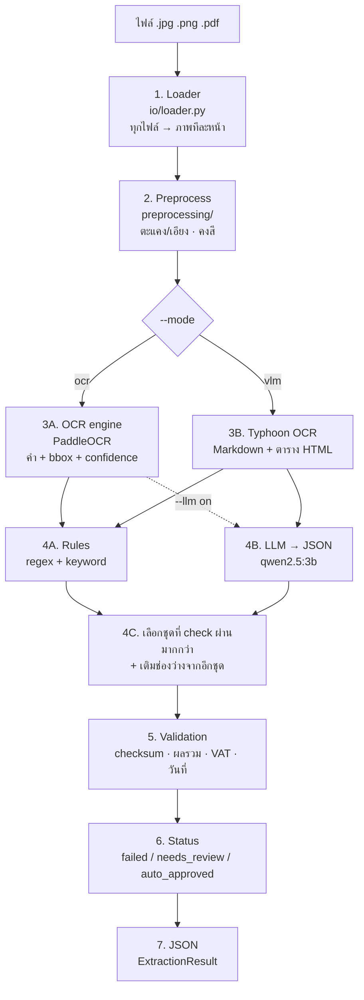
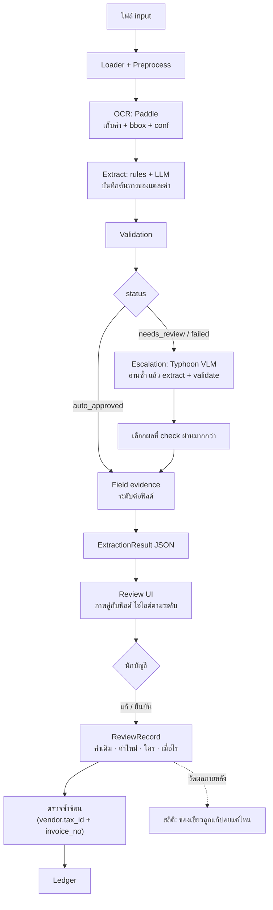
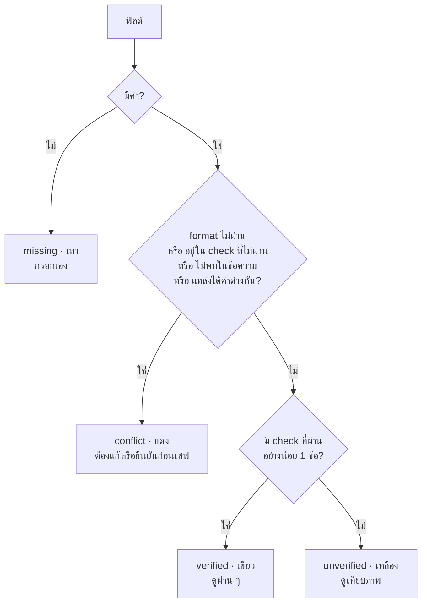
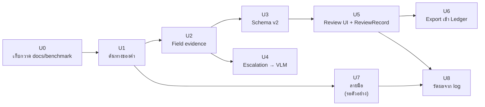

# หลักการของระบบ, Best Solution และแผนอัปเดต

เอกสารนี้รวมทุกอย่างที่ตัดสินใจแล้วไว้ที่เดียว: ระบบทำอะไร ทำงานอย่างไรในเชิงเทคนิค แนวทางที่เลือก
(และเหตุผลที่ไม่เลือกทางอื่น) และแผน implement สำหรับอัปเดตโปรเจกต์

รายละเอียดแต่ละขั้นของ pipeline อยู่ในไฟล์ `01`–`06` ส่วนเรื่องลายมืออยู่ใน
[07-handwriting-and-field-confidence.md](07-handwriting-and-field-confidence.md)

> สถานะ: หัวข้อ 1–3 อธิบายระบบที่มีอยู่จริงตอนนี้ หัวข้อ 4–6 เป็นแนวทางและแผน ยังไม่ได้ implement
> ยกเว้นที่ระบุว่า "ทำแล้ว" (ทำแล้ว: Schema v2, ต้นทางระดับ rules/LLM, `field_evidence` ดูหัวข้อ U1–U3)

---

## 1. โจทย์ของโปรเจกต์

สกัดฟิลด์จากเอกสารการเงินไทย (ใบกำกับภาษี ใบเสร็จ invoice) ที่ **ไม่มีแบบฟอร์มตายตัว**
ส่งให้เจ้าหน้าที่บัญชีตรวจและแก้ไขก่อนบันทึกเข้า Ledger

| ข้อกำหนด | ผลต่อการออกแบบ |
|---|---|
| เอกสารไม่มี pattern ตายตัว | ใช้ทั้ง rules และ LLM แล้วให้การตรวจตัวเลขเป็นกรรมการ |
| ผลไปใช้ทำบัญชีจริง | ทุกเอกสารต้องผ่านคนตรวจ (Human-in-the-loop) ก่อนเข้า Ledger |
| คนตรวจต้องรู้ว่าดูช่องไหนก่อน | ทุกฟิลด์มีระดับความน่าเชื่อถือกำกับ และ UI ไฮไลต์ช่องที่น่าสงสัย |
| ฟอร์มพิมพ์ที่กรอกด้วยมือ | ต้องรู้ว่าฟิลด์ไหนมาจากลายมือ และไม่ให้ฟิลด์นั้นดูน่าเชื่อเกินจริง |
| ยังไม่มีข้อมูลเฉลย | ห้ามตั้งน้ำหนักหรือ threshold เอง ใช้กฎที่อธิบายได้แทน |

---

## 2. สถาปัตยกรรมปัจจุบัน



### 2.1 เทคนิคแต่ละขั้น (สรุป)

| ขั้น | เทคนิคหลัก | ทำไม |
|---|---|---|
| 1 Loader | render PDF ด้วย `pypdfium2` ที่ 300 DPI, อ่านภาพด้วย `np.fromfile` + `cv2.imdecode` | เส้นทางเดียวสำหรับทุกไฟล์ ไม่เสี่ยงกับ text layer ที่เพี้ยน และอ่าน path ภาษาไทยบน Windows ได้ |
| 2 Preprocess | upscale (INTER_CUBIC), orientation (Paddle doc-orientation), deskew (projection profile ±15°) — คงสี, denoise/CLAHE/binarize ปิดเป็นค่าตั้งต้น | แก้เฉพาะเรขาคณิต เพราะไม่ทิ้งข้อมูล ส่วนขั้นที่ลดข้อมูลวัดแล้วไม่ช่วย: ภาพเทาทำให้ Paddle ไม่เจอบรรทัดในภาพสแกนบางใบ, Otsu ทิ้งตัวอักษรสีอ่อน (ดู `02`) |
| 3A OCR | โมเดลสำเร็จรูป (Paddle `th_PP-OCRv5_mobile_rec`), จัดคำเป็นบรรทัดจาก bbox, เว้นวรรคเฉพาะช่องว่างจริงในภาพ, แก้ `ํา` → `ำ` | ภาษาไทยไม่เว้นวรรค และ OCR มักแตกสระอำ |
| 3B VLM | Typhoon OCR ผ่าน Ollama native API (`num_ctx` 16384) | อ่านตารางและ layout ได้ดี แต่ไม่มี bbox และไม่มี confidence ต่อคำ |
| 4A Rules | จำแนกบรรทัดยอดเงินจากคำเจาะจงไปคำกว้าง, regex ยอดเงินต้องมีทศนิยม 2 ตำแหน่ง/จุลภาค, แปลง พ.ศ. | เร็ว อธิบายได้ แต่เปราะกับ layout ใหม่ |
| 4B LLM | ส่ง JSON Schema ของ `InvoiceData` + ข้อความ, บังคับ JSON, normalize แล้ว validate ด้วย pydantic | ทนกับ layout แปลก แต่สลับฟิลด์หรือแต่งค่าได้ |
| 4C เลือกผล | คะแนน = check ผ่าน − ไม่ผ่าน | ใช้ความสอดคล้องของตัวเลขเป็นกรรมการ ไม่ต้องมีเฉลย |
| 5 Validation | checksum เลขภาษี, Σitems, ส่วนลด, ก่อน VAT + VAT = รวม, VAT rate, ช่วงวันที่ (คลาดได้ ±0.02) | ตัวเลขในเอกสารเป็นพยานให้กันเอง "ตรวจไม่ได้" คืน `null` ไม่นับว่าไม่ผ่าน |
| 6 Status | กฎ ไม่ใช่คะแนนถ่วงน้ำหนัก | ไม่มีข้อมูลรองรับน้ำหนักหรือเกณฑ์ตัด |

### 2.2 ข้อจำกัดของระบบปัจจุบัน

1. **สถานะเป็นของทั้งเอกสาร** คนตรวจไม่รู้ว่าช่องไหนน่าสงสัย
2. **ต้นทางของค่าหายระหว่างทาง** `read_page` ส่งต่อแค่ข้อความ ฟิลด์จึงไม่รู้ว่ามาจากคำไหน ใช้ confidence รายฟิลด์ไม่ได้
3. **ผู้ใช้เลือกโหมดเอง** ไม่มีการส่งต่อเอกสารที่ยากไปยัง VLM อัตโนมัติ
4. **ไม่มี UI ตรวจทาน** และไม่มีบันทึกการแก้ไข
5. **ยอดเงินเป็น `float`** ซึ่งปัดเศษเพี้ยนได้ ไม่เหมาะกับการลง Ledger
6. **ลายมือ** ยังไม่มีตัวตรวจหรือวิธีอ่านเฉพาะ (ดู `07`)

---

## 3. Data Contract: `schemas/invoice.schema.json`

### 3.1 ไฟล์นี้มาจากไหน

ไฟล์ **ไม่ได้เขียนด้วยมือ** แต่ generate จากโค้ด:

```
src/fin_extractor/schema.py  (Pydantic models)
        │  python -m fin_extractor schema
        │  → ExtractionResult.model_json_schema()   (cli.py → cmd_schema)
        ▼
schemas/invoice.schema.json  (JSON Schema)
```

ดังนั้น **แหล่งความจริงคือ `schema.py`** ถ้าแก้ JSON ตรงๆ จะถูกเขียนทับเมื่อ generate ใหม่
ต้องแก้ `schema.py` แล้วรันคำสั่ง `schema` ทุกครั้ง

### 3.2 ใช้ทำอะไร

| ผู้ใช้ | ใช้อย่างไร |
|---|---|
| ระบบปลายทาง (บัญชี, UI) | เป็นสเปกว่า JSON ที่ได้รับหน้าตาแบบไหน |
| ตัวโปรเจกต์เอง | pydantic ตรวจชนิดข้อมูลตอนสร้างผล เช่น `tax_id` ต้องตรง `^\d{13}$` |
| LLM (ขั้น 4B) | `llm_extractor.py` ส่ง JSON Schema ของ `InvoiceData` ไปใน prompt ให้ LLM ตอบตามโครงนี้ `description` ของแต่ละฟิลด์จึงเป็นคำสั่งถึง LLM ด้วย |

### 3.3 โครงสร้าง

```
ExtractionResult                       ผลของ 1 หน้า  (required: source_file, engine, data, status)
├── schema_version                     "2.1"
├── source_file, page, engine          มาจากไหน ใช้ engine อะไร
├── data: InvoiceData                  ข้อมูลธุรกิจ (ทุกฟิลด์เป็น null ได้)
│   ├── document_type
│   ├── vendor, buyer: Party           name, tax_id (^\d{13}$), branch, address
│   ├── book_no, invoice_no, date (ISO ค.ศ.), currency (THB)
│   ├── items: [LineItem]              description (required), quantity, unit_price, amount
│   ├── subtotal, discount, amount_before_vat, vat_rate, vat_amount, total_amount   (Decimal → JSON เป็นสตริง)
│   └── extra_fields: [ExtraField]     label + value ข้อมูลที่เอกสารพิมพ์ไว้แต่ schema ไม่มีช่อง (หัก ณ ที่จ่าย, เลขที่ PO ฯลฯ)
├── checks: [ValidationCheck]          name, passed (true/false/null), detail, fields (ฟิลด์ที่ check ใช้จริง)
├── field_evidence                     {คีย์ฟิลด์: FieldEvidence} ระดับ missing/conflict/verified/unverified
├── ocr_confidence                     ค่าเฉลี่ยจาก engine (VLM เป็น null)
├── missing_fields                     ฟิลด์สำคัญที่หาไม่เจอ
├── handwritten_fields                 ฟิลด์ที่มาจากลายมือ (ทำแล้ว แต่ pipeline ยังไม่ได้เติมค่า)
├── status
└── raw_text
```

### 3.4 ฟิลด์คิดมาจากอะไร

ในโค้ดและเอกสารเดิมไม่ได้บันทึกว่าเลือกฟิลด์จากแหล่งไหน สิ่งที่อ่านได้จากโครงสร้างคือ

1. **รายการในใบกำกับภาษีเต็มรูป** ตามประมวลรัษฎากร มาตรา 86/4 ซึ่งกำหนดให้มี: คำว่า "ใบกำกับภาษี",
   ชื่อ ที่อยู่ และเลขประจำตัวผู้เสียภาษีของผู้ออก, ชื่อและที่อยู่ของผู้ซื้อ, เลขที่ (และเล่มที่ถ้ามี),
   ชื่อ ชนิด ปริมาณ และมูลค่าของสินค้าหรือบริการ, ภาษีมูลค่าเพิ่มแยกจากมูลค่า, วันที่ออก
   และประกาศอธิบดีที่เพิ่มเลขผู้เสียภาษีของผู้ซื้อและสำนักงานใหญ่/สาขา
   (ควรตรวจกับตัวบทและประกาศฉบับปัจจุบันก่อนอ้างอิงอย่างเป็นทางการ)
2. **ความสัมพันธ์ของยอดเงิน** ที่ขั้น validation ต้องใช้: `subtotal`, `discount`, `amount_before_vat`,
   `vat_rate`, `vat_amount`, `total_amount` แยกกันเพื่อให้ตรวจ subtotal − discount = ก่อน VAT,
   ก่อน VAT + VAT = รวม ได้
3. **หลักการออกแบบ** คือแยกข้อมูลธุรกิจ (`data`) ออกจากผลตรวจ (`checks`, `status`),
   ทุกฟิลด์ว่างได้เพื่อตอบว่า "ไม่เจอ" แทนการเดา, วันที่เป็น ISO ค.ศ. เสมอ และ `extra="ignore"`
   ตัดฟิลด์เกินที่ LLM ตอบมา

### 3.5 ช่องว่างของ schema เทียบกับงานบัญชี

| ช่องว่าง | ผลกระทบ | ข้อเสนอ |
|---|---|---|
| ยอดเงินเป็น `float` | ปัดเศษเพี้ยน ไม่ตรงทุกสตางค์ | **ทำแล้ว** `Decimal` (JSON เป็นสตริง) ยอดเงิน 5 ช่องและ `items[].amount` ปัดเป็น 2 ตำแหน่ง (สตางค์ของบาท) ส่วน `vat_rate`, `quantity`, `unit_price` เป็น Decimal ที่ไม่ปัด |
| ไม่มี "เล่มที่" | บิลเล่มที่กรอกมือมีทั้งเล่มที่และเลขที่ ใช้กันเอกสารซ้ำ | **ทำแล้วเฉพาะ schema** เพิ่ม `book_no` แล้ว แต่ rules ยังไม่มี regex จับค่านี้ (ค่าจะมาจาก LLM เท่านั้น) |
| ไม่มีหลักฐานรายฟิลด์ | UI ไฮไลต์รายช่องไม่ได้ | **ทำแล้ว** `field_evidence` (หัวข้อ 4.3) |
| ไม่มีเวอร์ชันของ schema | ระบบปลายทางไม่รู้ว่าโครงเปลี่ยน | **ทำแล้ว** `schema_version` = `"2.1"` |
| ไม่มีบันทึกการตรวจทาน | ไม่มี audit trail ว่าใครแก้อะไร | แยกเป็นโครง `ReviewRecord` (หัวข้อ 4.5) ไม่ใส่ใน `ExtractionResult` |

### 3.6 schema ตายตัวไหม: แกนกลางตายตัว ส่วนที่เหลือยืดหยุ่น (schema 2.1)

เอกสารการเงินแต่ละชนิดมีข้อมูลไม่เหมือนกัน (บางใบไม่มีชื่อลูกค้า, ใบเสร็จหัก ณ ที่จ่ายมีภาษีที่หัก, 50 ทวิไม่มียอดรวมแบบใบกำกับ)
schema จึงแยกเป็นสามชั้น

| ชั้น | ทำอะไร | สถานะ |
|---|---|---|
| ฟิลด์แกนกลาง | ชื่อและชนิดตายตัว ทุกช่องเป็น `null` ได้ (ชื่อลูกค้าไม่มี = `null` ไม่ล้ม) | ทำแล้ว |
| `extra_fields` | เก็บคู่ ป้าย-ค่า ตามที่เอกสารพิมพ์ ที่ไม่มีช่องใน schema แทนการตัดทิ้ง | ทำแล้ว (2.1) |
| ฟิลด์เฉพาะชนิดเอกสาร | กำหนดชุดฟิลด์ต่อชนิด (เช่น หัก ณ ที่จ่ายเป็นฟิลด์จริง ไม่ใช่แค่ใน `extra_fields`) | **ยังไม่ทำ** ต้องมีรายการชนิดที่ฝ่ายบัญชียืนยัน |

**`extra_fields`:** LLM เป็นผู้กรอก (rules ไม่รู้จักป้ายที่ไม่รู้ล่วงหน้า) prompt สั่งให้ใส่เฉพาะข้อมูลที่ไม่มีช่องอยู่แล้ว
ลองกับสแกนจริงสองใบ (โหมด vlm, qwen2.5:3b): ใบ 001306 ได้ "หัก ณ ที่จ่าย 3 %: 60.00" และ "ยอดชำระ: 1,940.00" ซึ่งก่อนหน้านี้หายไปทั้งคู่
ข้อจำกัดที่เห็น
- LLM 3B ตอบป้ายซ้ำเป็นค่า (ช่องว่างของแบบฟอร์ม เช่น `ผู้จัดการ: ผู้จัดการ`) ระบบกรองกรณีค่า = ป้ายทิ้ง
- LLM 3B ยังใส่ข้อมูลที่มีช่องอยู่แล้วลง `extra_fields` ซ้ำได้ (001317: `รวมเงิน 7,500.00` ซ้ำกับ `subtotal`) ยังไม่มีกฎกรองเพราะต้องจับคู่ป้ายกับฟิลด์ ควรลองรุ่นที่ใหญ่ขึ้น (`llm_extractor.model`)
- ผล LLM ไม่เหมือนเดิมทุกรอบ ใบ 001317 รันสองครั้งได้ `invoice_no` ครั้งแรกมี ครั้งที่สองไม่มี และสถานะเปลี่ยนจาก `auto_approved` เป็น `needs_review`
- evidence ของ `extra_fields[i]` เป็น `unverified` เสมอ (ไม่มี check ยืนยัน) หรือ `conflict` ถ้าค่าไม่ปรากฏในข้อความ ป้ายอยู่ที่ `data.extra_fields[i].label`

**`not_applicable`:** แยก "เอกสารชนิดนี้ไม่มีฟิลด์นี้" ออกจาก "ควรมีแต่หาไม่เจอ" (`missing`)
ใช้ตาราง `document_types` ใน `configs/default.yaml` (ชนิดเอกสาร → รายการฟิลด์ที่ไม่มี) ฟิลด์ที่ไม่มีจะไม่นับใน `missing_fields`
และถ้า `total_amount` ไม่มีสำหรับชนิดนั้น เอกสารจะไม่ถูก `failed` เพราะขาดยอดรวม
**ตารางตั้งต้นว่าง** ระบบจึงทำงานเหมือนเดิมทุกประการจนกว่าจะกรอก ไม่ได้เดารายชื่อเอง ต้องให้ฝ่ายบัญชียืนยันว่าชนิดไหนไม่มีฟิลด์ไหน
ข้อควรระวัง: ชื่อชนิดต้องตรงกับ `data.document_type` ที่สกัดได้ ซึ่ง rules ให้ค่าคงที่ (`tax_invoice`, `receipt`, ...) แต่ LLM ตอบข้อความอิสระ
(เช่น `หนังสือรับรองการหักภาษี ณ ที่จ่าย`) จึงอาจต้องใส่หลายชื่อต่อชนิด หรือทำ normalize ชนิดเอกสารเพิ่มภายหลัง

---

## 4. Best Solution

### 4.1 สรุปแนวทาง

| เรื่อง | แนวทางที่เลือก | ทางที่ไม่เลือก และเหตุผล |
|---|---|---|
| อ่านข้อความ | Paddle เป็นหลัก ส่งต่อไป VLM เฉพาะใบที่ไม่ผ่าน (escalation) | ใช้ VLM ทุกใบ: ช้ากว่ามาก / ให้ผู้ใช้เลือกโหมด: ไม่รู้ล่วงหน้าว่าใบไหนยาก |
| สกัดฟิลด์ | rules + LLM ให้ validation เป็นกรรมการ (เหมือนเดิม) | — |
| confidence รายฟิลด์ | **ระดับหลักฐาน 4 ระดับ** จาก regex + cross-check + ต้นทาง + ความตรงกันของแหล่ง | คะแนนถ่วงน้ำหนัก: น้ำหนักไม่มีที่มา / ความน่าจะเป็นที่ calibrate แล้ว: ต้องสร้างเฉลย ไม่คุ้มเพราะทุกใบมีคนตรวจอยู่แล้ว |
| ตรวจทาน | UI Review & Edit ทุกเอกสารก่อนเข้า Ledger | อนุมัติอัตโนมัติ: งานบัญชีต้องมีคนรับผิดชอบ |
| เฉลย | ไม่สร้างแยก ใช้บันทึกการแก้ไขจาก UI | ให้คนเฉลยล่วงหน้า: ภาระสูง ไม่จำเป็นต่อการไฮไลต์ |
| ลายมือ | ภาพสี + ครอปช่องให้ VLM อ่าน, ฟิลด์ลายมือที่ไม่มี check ไม่เป็นสีเขียว | Fine-tune OCR: ต้องมีข้อมูลจำนวนมาก |

### 4.2 สถาปัตยกรรมเป้าหมาย



ทุกเอกสาร **ต้องผ่าน Review UI** สถานะ `auto_approved` จึงไม่ได้แปลว่าข้ามคน แต่ใช้จัดลำดับคิว
(ใบที่มีปัญหาขึ้นก่อน) และตัดสินว่าต้องส่งไป VLM หรือไม่

### 4.3 Field evidence: confidence รายฟิลด์

#### สัญญาณ (ไม่ต้องใช้เฉลย)

| สัญญาณ | คิดอย่างไร |
|---|---|
| `format_valid` | ผ่าน regex/schema: เลขภาษี 13 หลัก + checksum, วันที่ parse ได้และอยู่ในช่วง, ยอดเงินเป็นตัวเลข |
| `checks_passed`, `checks_failed` | check ที่ฟิลด์นี้เกี่ยวข้อง (ตารางด้านล่าง) ที่ผ่านและไม่ผ่าน |
| `grounded` | ค่าที่สกัดได้ (หลัง normalize) อยู่ในข้อความ OCR หรือไม่ ใช้จับ LLM แต่งค่า |
| `sources_agree` | rules กับ LLM (หรือ OCR กับ VLM) ได้ค่าเดียวกันหรือไม่ เป็น `null` ถ้ามีแหล่งเดียว |
| `handwritten` | มาจากลายมือหรือไม่ |
| `model_conf` | min ของ confidence ต่อคำที่ประกอบเป็นค่านั้น รายงานไว้ดู ไม่ใช้ตัดสิน เพราะยังไม่ได้ calibrate |

ฟิลด์ที่ check แต่ละข้อเกี่ยวข้อง:

| check | ฟิลด์ |
|---|---|
| `vendor_tax_id_checksum` | `vendor.tax_id` |
| `buyer_tax_id_checksum` | `buyer.tax_id` |
| `items_sum` | `items[].amount`, ยอดที่ใช้เทียบ (`subtotal` หรือก่อน VAT หรือยอดรวม) |
| `discount` | `subtotal`, `discount`, ก่อน VAT หรือยอดรวม |
| `before_vat_plus_vat` | `amount_before_vat`, `vat_amount`, `total_amount` |
| `vat_rate` | `vat_amount`, `vat_rate`, `amount_before_vat` (หรือ `total_amount`) |

`date_range` ไม่นับเป็นตัวยืนยัน เพราะตรวจแค่ว่าวันที่สมเหตุสมผล ไม่ได้ยืนยันว่าอ่านถูกวัน

#### กฎตัดสินระดับ (ตรวจจากบนลงล่าง ข้อแรกที่ตรงคือคำตอบ)



ผลที่ตามมา:
- ชื่อผู้ขาย เลขที่เอกสาร วันที่ ไม่มี check ยืนยัน จึง **เป็นเขียวไม่ได้** สูงสุดคือเหลือง
- ถ้า check ไม่ผ่าน ทุกฟิลด์ในสูตรนั้นเป็นแดง เพราะไม่รู้ว่าช่องไหนผิด UI ต้องแสดงสูตรให้เห็น
  เช่น `44.45 + 3.11 = 47.56 ≠ 47.65`
- ไม่มีน้ำหนักหรือ threshold ที่ตั้งขึ้นเอง ทุกเงื่อนไขเป็นจริง/เท็จ

ถ้าสเปกบังคับว่าต้องแสดงตัวเลข ให้ใช้ **check ที่ผ่าน / check ที่ใช้กับฟิลด์นั้นได้** (เช่น 2/2)
ฟิลด์ที่ไม่มี check แสดงว่า "ไม่มีตัวยืนยัน" ไม่ใช่ 0% หรือ 100%

#### รูปแบบ output

```json
"field_evidence": {
  "total_amount": {
    "level": "verified",
    "format_valid": true,
    "checks_passed": ["before_vat_plus_vat", "items_sum"],
    "checks_failed": [],
    "grounded": true,
    "sources_agree": true,
    "handwritten": false,
    "model_conf": 0.97,
    "source": "rules"
  }
}
```

(ค่าตัวเลขเป็นตัวอย่างรูปแบบ ไม่ใช่ผลวัด)

#### สถานะ implement (ทำแล้ว: `validation/evidence.py`, `pipeline.extract_traced`)

ผลจริงของ BITKUB-001 โหมด ocr: ยอดเงินและเลขภาษีเป็น `verified`, ชื่อผู้ขาย/วันที่/รายการ `unverified`, `invoice_no` `missing`

สิ่งที่ต่างจากร่างข้างบนหรือยังไม่ครบ ต้องรู้ก่อนใช้ผล
- `checks[].fields` ให้ฟิลด์ที่ check ใช้จริง ไม่ใช้ตารางตายตัว เพราะ `items_sum` เทียบกับ subtotal หรือยอดก่อน VAT หรือยอดรวมตัวแรกที่มี
  และ `discount` ผ่านเมื่อตรงกับตัวใดตัวหนึ่ง ส่วน `vat_rate` นับฟิลด์ `vat_rate` เป็นตัวถูกยืนยันเฉพาะเมื่อเอกสารระบุอัตราเอง
  (ถ้าใช้ค่าตั้งต้นของระบบ ไม่ได้ยืนยันอะไรที่อ่านมา)
- `grounded`: ยอดเงินเทียบกับตัวเลขทุกตัวในข้อความ, อัตรา VAT เทียบกับ `n%`, เลขภาษีและวันที่เทียบกับที่ parse ได้ในข้อความ,
  ชื่อ/ที่อยู่/เลขที่เอกสารเทียบแบบตัดช่องว่างและ `|` ฟิลด์ที่ไม่ตรวจ (เป็น `null`): `document_type`, `vendor.branch`, `items[].description`
  เพราะค่าถูกแปลงหรือประกอบจากหลายบรรทัด ไม่ใช่ข้อความตรง ๆ ยอดเงินที่ไม่ปรากฏในข้อความจึงเป็น `conflict`
  แม้สูตรจะผ่าน (อาจเตือนเกินจริงเมื่อ LLM ใส่ VAT 7% ที่เอกสารไม่ได้พิมพ์)
- `sources_agree`: เทียบ rules กับ LLM ด้วยการเท่ากันตรง ๆ หลัง normalize (ตัดช่องว่างในข้อความ ไม่ใช้ความคล้ายแบบมีเกณฑ์)
  เป็น `null` เมื่อมีแหล่งเดียว และ **รายการสินค้าไม่เทียบรายตัว** เพราะสองแหล่งแบ่งรายการไม่ตรงกัน (ใช้ `items_sum` ยืนยันแทน)
- โหมด vlm: rules และ LLM อ่านจาก Markdown ของ Typhoon ชุดเดียวกัน `grounded` และ `sources_agree` จึงยืนยัน *การสกัด* ไม่ได้ยืนยันว่า VLM *อ่านภาพ* ถูก
  การเทียบ OCR กับ VLM เป็นสองแหล่งอิสระ ต้องรอ escalation (U4)
- `handwritten` เป็น `null` เว้นแต่ฟิลด์อยู่ใน `handwritten_fields` (ยังไม่มีตัวตรวจลายมือ) · `model_conf` เป็น `null` เสมอ (ยังไม่ส่ง confidence ระดับคำมาถึงขั้นสกัด) ·
  `decide_status` ยังไม่อิงระดับรายฟิลด์

### 4.4 Escalation: OCR ก่อน แล้วค่อย VLM

1. รัน Paddle + rules (+ LLM ถ้าเปิด) ตามปกติ
2. ถ้า status เป็น `needs_review` หรือ `failed` ให้รัน Typhoon กับหน้านั้นซ้ำ
3. เลือกผลด้วยกฎเดียวกับ 4C (check ผ่าน − ไม่ผ่าน) แล้วเติมช่องว่างจากอีกชุด
4. ถ้าสองทางได้ค่าต่างกัน ฟิลด์นั้นเป็น `sources_agree = false` → แดง

ใช้ status ที่มีอยู่เป็นตัวตัดสิน จึงไม่ต้องตั้ง threshold ใหม่
ข้อเสีย: ใบที่ผ่านทาง OCR ไม่ได้ถูก VLM ตรวจซ้ำ ซึ่งยอมรับได้เพราะทุกใบมีคนตรวจ

### 4.5 Review UI และบันทึกการแก้ไข

**หน้าจอ:** ภาพเอกสารด้านหนึ่ง ฟิลด์อีกด้าน ฟิลด์มีสีตามระดับ คลิกฟิลด์แล้วชี้ตำแหน่งบนภาพ
(ใช้ bbox จากต้นทางของค่า ทำได้เฉพาะเส้นทาง OCR)

**กฎของหน้าจอ:**
- ฟิลด์แดงต้องแก้หรือกดยืนยันทีละช่องก่อนเซฟ
- แสดงสูตรของ check ที่ไม่ผ่าน
- เมื่อแก้ค่า ให้รัน validation ใหม่ทันที เพื่อให้นักบัญชีเห็นว่าสูตรลงตัวแล้ว
- ก่อนเซฟ ตรวจว่า `vendor.tax_id` + `invoice_no` (+ `book_no`) ซ้ำกับรายการใน Ledger หรือไม่

**ReviewRecord** (เก็บแยกจาก `ExtractionResult`):

```json
{
  "document_id": "...",
  "reviewer": "...",
  "reviewed_at": "2026-11-06T10:00:00+07:00",
  "fields": {
    "total_amount": {"extracted": "47.65", "saved": "47.56", "level_shown": "conflict", "action": "edited"}
  },
  "result": "saved_to_ledger"
}
```

ใช้สองอย่าง:
1. **Audit trail** ของงานบัญชี ว่าใครแก้อะไรเมื่อไร
2. **เฉลยที่ได้มาฟรี** ใช้วัดว่าระดับสีทำงานจริงไหม ตัวชี้วัดที่สำคัญที่สุดคือ
   **ช่องเขียวถูกแก้บ่อยแค่ไหน** ถ้าบ่อย แปลว่ากฎหลวม นักบัญชีที่เชื่อสีเขียวจะปล่อยค่าผิดเข้า Ledger

### 4.6 ลายมือ

สรุปจาก `07` (ตัวอย่างเอกสารที่คาด: ฟอร์มพิมพ์กรอกมือเป็นส่วนใหญ่ มีลายเซ็นบ้าง)

- ภาพที่มีลายมือใช้ preprocessing ชุดเดียวกัน (คงสี ไม่ binarize) และไม่มีการลบเส้นตารางแล้ว เพราะเส้นปากกาทับเส้นตาราง
- ครอปบริเวณลายมือแล้วให้ VLM อ่านทีละช่อง พร้อม prompt เฉพาะชนิดฟิลด์ และให้ตอบ "อ่านไม่ออก" ได้
- ฟิลด์ลายมือใช้กฎระดับเดียวกัน ยอดเงินลายมือที่ cross-check ผ่านเป็นเขียวได้
- การเลือกวิธีตรวจบริเวณลายมือต้องรอดูตัวอย่างจริงก่อน

---

## 5. หลักการที่ใช้ตัดสินใจ

1. **ไม่เดาตัวเลข** น้ำหนัก threshold และเกณฑ์ทุกตัวต้องมีที่มาหรือวัดจากข้อมูล
   ถ้ายังไม่มีข้อมูล ใช้กฎจริง/เท็จที่อธิบายได้
2. **ตัวเลขในเอกสารเป็นพยานให้กันเอง** หลักฐานที่น่าเชื่อที่สุดคือ cross-check ไม่ใช่ confidence ของโมเดล
3. **ไม่เจอดีกว่าเดา** ฟิลด์ว่างได้เสมอ check ที่ข้อมูลไม่พอคืน `null`
4. **ระบบช่วยคน ไม่ได้แทนคน** confidence มีไว้บอกว่าดูช่องไหนก่อน ทุกใบผ่านนักบัญชี
5. **schema คือสัญญา** แก้ที่ `schema.py` เท่านั้น และเพิ่ม `schema_version` เมื่อโครงเปลี่ยน

---

## 6. Implement Plan

ลำดับเรียงตามการพึ่งพากัน เฟสที่ไม่ต้องใช้ข้อมูลตัวอย่างทำได้ทันที



### U0: เก็บกวาดเอกสารและ benchmark

| งาน | ไฟล์ |
|---|---|
| ลบข้อความ "น้ำหนัก 0.5 ในขั้นที่ 6" | `docs/05-validation-output.md` บรรทัด 17 |
| แก้ "`ocr_confidence` ใช้ในขั้นคิดคะแนน" และคะแนนสถานะเช่น `needs_review 0.84` ที่มาจากระบบรุ่นเก่า | `docs/03-text-reading.md` บรรทัด 73, 82 |
| ทำให้ค่าคลาดยอดเงินใน benchmark (0.011) ตรงกับ config (0.02) หรือบันทึกเหตุผลที่ต่างกัน และบันทึกที่มาของ fuzzy 0.9 สำหรับชื่อผู้ขาย | `scripts/benchmark.py:243, 250` |

**เสร็จเมื่อ:** เอกสารตรงกับโค้ด และค่าคงที่ใน benchmark มีที่มา

### U1: ติดตามต้นทางของค่า

| งาน | ไฟล์ |
|---|---|
| `read_page` ส่ง `OCRLine` (คำ + bbox + conf) ต่อไปแทนข้อความล้วน | `pipeline.py` |
| rules คืนค่าพร้อมต้นทาง (เลขบรรทัด + ช่วงตัวอักษร) | `extraction/rule_extractor.py`, `patterns.py` |
| ค่าจาก LLM จับคู่กลับหาข้อความ OCR (ค้นสตริงหลัง normalize) ไม่เจอ = `grounded: false` | `extraction/llm_extractor.py` |
| `fill_missing` บันทึกว่าแต่ละฟิลด์มาจาก rules หรือ LLM | `pipeline.py` |
| `model_conf` = min confidence ของคำที่ทับช่วงของค่า | ใหม่ |

**เสร็จเมื่อ:** ทุกฟิลด์ที่มีค่ารู้ว่ามาจากแหล่งไหนและคำไหน (โหมด OCR) มีเทสต์จากข้อความ BITKUB

**สถานะ:** ทำแล้วเฉพาะ *ต้นทางระดับตัวสกัด* (`rules` หรือ `llm` ต่อฟิลด์ และการเทียบสองแหล่ง ใน `pipeline.extract_traced`) ·
ยังไม่ทำ: ส่ง `OCRLine` ต่อ, เลขบรรทัด/ช่วงตัวอักษรของค่า, `model_conf`

### U2: Field evidence

| งาน | ไฟล์ |
|---|---|
| ตาราง check → ฟิลด์ (หัวข้อ 4.3) ขยายจาก `CORROBORATING_CHECKS` ที่มีอยู่ | `validation/scoring.py` |
| คำนวณสัญญาณและระดับตามกฎใน 4.3 | `validation/` (ไฟล์ใหม่ เช่น `evidence.py`) |
| status ของเอกสารคำนวณต่อจากระดับรายฟิลด์ (ฟิลด์สำคัญเป็นแดงหรือเทา → `needs_review`) | `validation/scoring.py` |
| เทสต์: check ไม่ผ่าน → ทุกฟิลด์ในสูตรเป็นแดง; ชื่อผู้ขายไม่เป็นเขียว; แหล่งไม่ตรงกัน → แดง | `tests/` |

**เสร็จเมื่อ:** เทสต์ครอบทุกกิ่งของกฎใน 4.3 และผลกับ BITKUB อธิบายได้ทุกช่อง

**สถานะ:** ทำแล้ว ยกเว้นข้อ "status คำนวณต่อจากระดับรายฟิลด์" (`decide_status` ยังใช้กฎเดิม) เทสต์อยู่ใน `tests/test_evidence.py`

### U3: Schema v2

| งาน | หมายเหตุ |
|---|---|
| เพิ่ม `FieldEvidence`, `field_evidence`, `schema_version` | |
| เพิ่ม `book_no` | ต้องเพิ่ม regex ใน rules และคำอธิบายใน prompt ของ LLM |
| ยอดเงินเป็น `Decimal` (JSON เป็นสตริง) | **breaking change** ต้องตกลงกับระบบปลายทางก่อน validation ปรับให้ใช้ `Decimal` |
| generate `schemas/invoice.schema.json` ใหม่ และอัปเดต `docs/05` | |

**เสร็จเมื่อ:** schema ใหม่ผ่านเทสต์ทั้งหมด ระบบปลายทางรับรู้การเปลี่ยนแปลง

**สถานะ:** ทำแล้ว (`schema_version` 2.0, `Decimal`, `book_no`, `field_evidence`, `schemas/invoice.schema.json` generate ใหม่) ·
เพิ่มใน 2.1: `extra_fields` และระดับ `not_applicable` (ดูหัวข้อ "schema ตายตัวไหม" ท้าย 3.5) ·
ยังไม่ทำ: regex `book_no` ใน rules · ยังไม่มีระบบปลายทางที่ต้องแจ้ง การเปลี่ยน `float` → `Decimal` ตกลงกับผู้ดูแลโปรเจกต์แล้ว

### U4: Escalation ไป VLM

| งาน | ไฟล์ |
|---|---|
| โหมด `--mode auto`: OCR ก่อน แล้ว VLM เมื่อ status ไม่ใช่ `auto_approved` | `pipeline.py`, `cli.py` |
| รวมผลสองทาง + `sources_agree` | `pipeline.py` |
| `engine` บันทึกว่าใช้ทางไหนบ้าง | `pipeline.py` |
| benchmark รายงานว่ากี่ใบถูกส่งไป VLM และผลดีขึ้นหรือไม่ | `scripts/benchmark.py` |

**เสร็จเมื่อ:** บนชุด benchmark ใบที่ส่งไป VLM มีผลไม่แย่ลง และรายงานจำนวนใบที่ส่งไปพร้อมเวลาที่เพิ่ม

### U5: Review UI และ ReviewRecord

ต้องตัดสินใจก่อน: เทคโนโลยีของ UI (เว็บภายใน หรือเครื่องมือที่ทีมบัญชีใช้อยู่แล้ว) และที่เก็บข้อมูล

| งาน |
|---|
| แสดงภาพคู่กับฟิลด์ สีตามระดับ คลิกแล้วชี้ bbox |
| ฟิลด์แดงต้องแก้หรือยืนยันก่อนเซฟ, แสดงสูตรของ check ที่ไม่ผ่าน |
| แก้ค่าแล้ว validation รันใหม่ทันที |
| คิวเรียงตาม status (`failed` → `needs_review` → `auto_approved`) |
| ตรวจเอกสารซ้ำก่อนเซฟ |
| บันทึก `ReviewRecord` ทุกครั้งที่เซฟ |

**เสร็จเมื่อ:** นักบัญชีตรวจและเซฟเอกสารได้ครบวงจร และทุกการเซฟมี ReviewRecord

### U6: Export เข้า Ledger

ต้องตกลงรูปแบบกับฝ่ายบัญชี (ไฟล์นำเข้า หรือ API ของระบบบัญชี)
**เงื่อนไข:** export ได้เฉพาะเอกสารที่มี ReviewRecord ที่เซฟแล้ว

### U7: ลายมือ

ทำตามเฟสใน `07` หลังมีตัวอย่างจริง: ตรวจบริเวณลายมือ → ครอปให้ VLM อ่าน → จัดการลายเซ็น
ตั้งค่า `handwritten` ใน field evidence

### U8: วัดผลจาก ReviewRecord

| ตัวชี้วัด | ใช้ตัดสินอะไร |
|---|---|
| สัดส่วนฟิลด์ที่ถูกแก้ แยกตามระดับสี | ถ้าช่องเขียวถูกแก้บ่อย กฎหลวม ต้องแก้ |
| สัดส่วนฟิลด์แดงที่นักบัญชียืนยันโดยไม่แก้ | ถ้าสูง กฎเข้มเกิน นักบัญชีจะเริ่มไม่สนใจสีแดง |
| ฟิลด์ที่ถูกแก้บ่อยที่สุด | เลือกว่าจะปรับ rules หรือ prompt ตรงไหน |
| ใบที่ส่งไป VLM เทียบกับไม่ส่ง | ดูว่า escalation คุ้มกับเวลาที่เพิ่มไหม |

ถ้าวันหนึ่งต้องการให้ระบบข้ามการตรวจบางฟิลด์ ข้อมูลนี้ใช้ calibrate เป็นความน่าจะเป็นได้

### U9: Decision model (concept)

เพิ่ม decision model (Jev หรือ Laya) ในท่อนหลัง ระหว่าง field evidence กับ Review UI
ใช้แนะนำรหัสบัญชี จัดลำดับคิว หรือชี้ฟิลด์ที่น่าจะผิดเพิ่มเติม โดยทำให้สีเข้มขึ้นได้แต่ห้ามผ่อนลง
ต้องมี U2 และ U5 ก่อน และเริ่มจาก shadow mode รายละเอียดอยู่ใน [09-decision-model.md](09-decision-model.md)

### ทำได้ทันทีโดยไม่ต้องรอข้อมูลหรือการตัดสินใจภายนอก

U0, U1, U2, U4 และส่วน `FieldEvidence`/`schema_version` ของ U3

### ต้องตัดสินใจหรือรอก่อน

| เรื่อง | ต้องการ | บล็อก |
|---|---|---|
| เปลี่ยนยอดเงินเป็น `Decimal` | ตกลงกับระบบปลายทาง | U3 บางส่วน |
| เทคโนโลยี UI และที่เก็บข้อมูล | ทีม/หัวหน้างาน | U5 |
| รูปแบบนำเข้า Ledger | ฝ่ายบัญชี | U6 |
| ตัวอย่างลายมือจริง | ฝั่งผู้ใช้ | U7 |
| ใช้ Typhoon API บน cloud ได้ไหม (เอกสารการเงินออกนอกเครื่อง) | นโยบายข้อมูล | U4 ถ้า local ช้าเกินไป |
