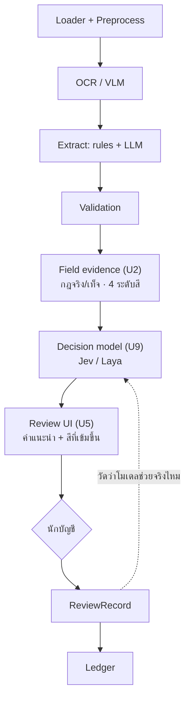
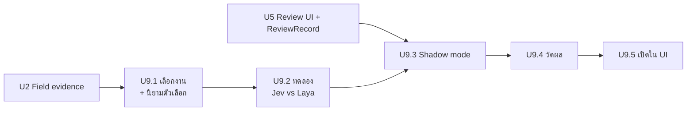

# Decision Model (concept)

แนวคิดการเพิ่ม decision model (Jev หรือ Laya) เข้าในระบบ เป็นเฟส U9 ต่อจากแผนใน
[08-solution-and-roadmap.md](08-solution-and-roadmap.md)

> แผนเรื่องใช้ decision model ช่วยทำ confidence รายฟิลด์ พร้อมข้อแย้งและตัวชี้วัด อยู่ที่ [11-decision-engine-confidence-plan.md](11-decision-engine-confidence-plan.md)

> สถานะ: concept ยังไม่ได้ implement และยังไม่ได้ทดลองกับโมเดลจริง
> ข้อมูลเกี่ยวกับ Jev และ Laya มาจากบล็อกและไดเรกทอรีเป็นส่วนใหญ่ (หัวข้อ "แหล่งข้อมูล")
> ต้องตรวจกับ model card และเอกสารทางการก่อนตัดสินใจ

## 1. Decision model คืออะไร

โมเดลที่ **ไม่สร้างข้อความ** แต่รับสถานะที่เป็นโครงสร้างพร้อมคำถามที่กำหนดตัวเลือกไว้ล่วงหน้า
แล้วคืนคำตอบพร้อมความน่าจะเป็นของแต่ละตัวเลือก

```
input:  state = {ฟิลด์ที่สกัดได้, ผล check, ระดับหลักฐาน}
        question = "หมวดค่าใช้จ่ายคืออะไร"  options = [ค่าเดินทาง, ค่าวัสดุ, ...]
output: {ค่าเดินทาง: p1, ค่าวัสดุ: p2, ...}
```

ต่างจาก LLM ตรงที่ตอบได้แค่ตัวเลือกที่กำหนด จึงไม่แต่งค่าใหม่ขึ้นมา แต่ **ยังตอบผิดได้**
รูปแบบที่ถูกต้องไม่ได้รับประกันว่าคำตอบถูก

## 2. ตัวเลือกที่พิจารณา

| | Jev | Laya |
|---|---|---|
| ผู้พัฒนา | TypeSafe AI | Convai Innovations |
| รูปแบบ | บริการบน cloud (early access ราว ก.ย. 2026) | open-weight, Apache 2.0, รันในเครื่องได้ |
| ขนาด | ไม่เปิดเผย | ราว 421M (English), 322M (multilingual) |
| ชนิดคำถาม | Choice, Score, Yes/No | typed decisions |
| ภาษาไทย | ยังไม่พบข้อมูล | มีรุ่น multilingual ต้องทดสอบภาษาไทย |
| ข้อมูลออกนอกเครื่อง | ใช่ | ไม่ (ถ้ารัน local) |
| ข้อควรระวังที่มีรายงาน | ถูกหลอกให้ตัดสินผิดได้ถ้าข้อมูลเข้าถูกดัดแปลง | รุ่นฐานแบบ zero-shot แม่นกว่าการสุ่มไม่มาก ตัวเลขที่ดีมาจากรุ่นที่ fine-tune แล้ว |

ตัวเลขความแม่นที่อ้างกันมาจากการวัดของผู้พัฒนาเองบน benchmark ทั่วไป ไม่ได้บอกว่าจะทำได้ดีแค่ไหน
กับเอกสารบัญชีไทย ต้องวัดเองในเฟส U9.4

ถ้าเอกสารการเงินส่งออกนอกเครื่องไม่ได้ Laya ที่รันในเครื่องเป็นตัวเลือกเดียว

## 3. ตำแหน่งใน pipeline: ท่อนหลัง

### ทำไมไม่ใช่ท่อนหน้า

- ก่อน OCR มีแค่ภาพ แต่ decision model รับสถานะที่เป็นโครงสร้างหรือข้อความ ไม่ได้รับภาพ
- การเลือกว่าจะส่งเอกสารไป VLM หรือไม่ มีกฎจาก status อยู่แล้ว (U4) ซึ่งอธิบายได้และไม่ต้องใช้โมเดล

### ทำไมเป็นท่อนหลัง

หลัง validation และ field evidence (U2) ระบบมีสถานะครบ คือค่าแต่ละฟิลด์ ผล check สัญญาณหลักฐาน
และระดับสี ซึ่งตรงกับรูปแบบ input ที่ decision model ต้องการ



## 4. งานที่ใช้ได้

เรียงจากเสี่ยงน้อยไปมาก

| # | งาน | ชนิดคำถาม | input | output ใน UI |
|---|---|---|---|---|
| 1 | แนะนำรหัสบัญชี (GL account) / หมวดค่าใช้จ่าย | Choice จากผังบัญชี | ผู้ขาย, รายการสินค้า, ประเภทเอกสาร | ค่าแนะนำในช่องรหัสบัญชี นักบัญชียืนยันหรือเปลี่ยน |
| 2 | จัดลำดับคิวตรวจ | Score | status, จำนวนฟิลด์แดง/เหลือง, ยอดเงิน | ลำดับในคิว |
| 3 | ชี้ฟิลด์ที่น่าจะผิดเพิ่มเติม | Yes/No ต่อฟิลด์ | ค่าฟิลด์, สัญญาณหลักฐาน | เปลี่ยนเขียว/เหลืองเป็นแดง |
| 4 | ค่าผิดปกติเทียบประวัติผู้ขาย | Score | ยอดและรายการเทียบกับรายการเดิมของผู้ขาย | ป้ายเตือน |

- **ข้อ 1** น่าจะได้ประโยชน์มากที่สุด เพราะระบบยังไม่มีส่วนนี้ และเป็นงานที่นักบัญชีต้องทำทุกใบ
- **ข้อ 4** ต้องมีประวัติจาก Ledger ก่อน

## 5. กฎที่ต้องยึด

1. **ทำให้เข้มขึ้นได้ ห้ามผ่อนลง**
   โมเดลเปลี่ยนเขียวหรือเหลืองเป็นแดงได้ แต่ห้ามเปลี่ยนแดงเป็นเขียว
   checksum ไม่ผ่านหรือสูตรไม่ลงตัวเป็นหลักฐานที่ชัดกว่าความน่าจะเป็นจากโมเดล
2. **ไม่ข้ามคน**
   ทุกใบยังผ่านนักบัญชี คำตอบของโมเดลเป็นคำแนะนำ ไม่ถูกเซฟอัตโนมัติ
3. **ไม่ตั้ง threshold แบบเดา**
   ความน่าจะเป็นที่โมเดลคืนมายังไม่ calibrate กับงานนี้ เกณฑ์อย่าง "ต่ำกว่า 0.7 ให้แดง"
   ต้องเลือกจากผลวัดใน U9.4
4. **ข้อความในเอกสารเป็นข้อมูลที่ไว้ใจไม่ได้**
   ใบแจ้งหนี้อาจมีข้อความที่จงใจหลอก ให้ป้อนฟิลด์ที่สกัดแล้วกับผล check
   ไม่ป้อนข้อความดิบทั้งหน้า
5. **นโยบายข้อมูลมาก่อน**
   ใช้บริการ cloud (Jev) ได้ก็ต่อเมื่อนโยบายอนุญาตให้ส่งเอกสารการเงินออกนอกเครื่อง
6. **มีทางถอย**
   ถ้าโมเดลล่มหรือตอบไม่ได้ ระบบต้องทำงานต่อได้ด้วยระดับหลักฐานจาก U2 ตามปกติ

## 6. แผน U9

ต้องมี U2 (สถานะที่ป้อนโมเดล) และ U5 (ReviewRecord สำหรับวัดผล) ก่อน



| ขั้น | งาน | เสร็จเมื่อ |
|---|---|---|
| U9.1 | เลือกงานแรก (แนะนำข้อ 1 หรือ 2) และนิยามตัวเลือก เช่น ผังบัญชีที่ใช้จริง | ฝ่ายบัญชียืนยันรายการตัวเลือก |
| U9.2 | ทดลอง Jev กับ Laya บนเอกสารชุดเดียวกัน ดูภาษาไทย การรันในเครื่อง ความเร็ว และนโยบายข้อมูล | ได้ตัวที่จะใช้พร้อมเหตุผลที่บันทึกไว้ |
| U9.3 | Shadow mode: รันโมเดลกับทุกเอกสาร แต่ไม่แสดงใน UI บันทึกคำตอบคู่กับ ReviewRecord | มีข้อมูลเทียบคำตอบของโมเดลกับสิ่งที่นักบัญชีทำจริง |
| U9.4 | วัดผลจากข้อมูล U9.3 | ตัดสินจากตัวเลขที่วัดได้ว่าจะเปิดใช้ไหม และถ้าใช้ threshold เท่าไร |
| U9.5 | เปิดใน UI เป็นคำแนะนำ และวัดต่อเนื่องเหมือน U8 | นักบัญชีเห็นคำแนะนำและแก้ได้ |

### ตัวชี้วัดใน U9.4

| งาน | วัดอะไร |
|---|---|
| แนะนำรหัสบัญชี | สัดส่วนที่คำแนะนำตรงกับรหัสที่นักบัญชีเซฟ แยกตามระดับความน่าจะเป็นที่โมเดลให้ |
| จัดลำดับคิว | ใบที่ถูกจัดไว้ต้นคิวถูกแก้บ่อยกว่าใบท้ายคิวจริงไหม |
| ชี้ฟิลด์ที่น่าจะผิด | ฟิลด์ที่โมเดลชี้ถูกนักบัญชีแก้บ่อยแค่ไหน เทียบกับฟิลด์ที่ไม่ได้ชี้ |
| ทุกงาน | ความน่าจะเป็นที่โมเดลให้ตรงกับสัดส่วนที่ถูกจริงไหม (reliability diagram) |

ถ้าผลไม่ดีกว่าการไม่ใช้โมเดล ให้หยุดที่ U9.4 ไม่ต้องเปิดใช้

## 7. จุดตัดสินใจที่ยังเปิดอยู่

| เรื่อง | ต้องการ |
|---|---|
| ส่งเอกสารการเงินไปบริการ cloud ได้ไหม | นโยบายข้อมูลขององค์กร |
| ผังบัญชีและหมวดค่าใช้จ่ายที่ใช้จริง | ฝ่ายบัญชี |
| งานแรกที่จะทำ | ทีมและฝ่ายบัญชี |
| Laya รองรับภาษาไทยดีพอไหม | ทดลองใน U9.2 |

## แหล่งข้อมูล

ค้นเมื่อ 2026-11-06 ส่วนใหญ่เป็นบล็อกและไดเรกทอรี ไม่ใช่เอกสารทางการของผู้พัฒนา

- [Laya AI: the open 33ms decision model that can't hallucinate](https://www.eesel.ai/blog/laya-ai)
- [Laya System 1 decision model](https://www.i-scoop.eu/laya-system-1-decision-model/)
- [Laya decision model on Vercel AI Gateway](https://vercel.com/changelog/laya-decision-model-now-available-on-ai-gateway-free-through-october-31)
- [Laya Models by ConvAI Innovations](https://www.llmreference.com/model-family/laya)
- [Laya on Runware](https://runware.ai/models/laya)
- [Jev vs LLMs: When AI moves from generation to decision-making](https://towardsdatascience.com/jev-vs-llms-when-ai-moves-from-generation-to-decision-making/)
- [An introduction to Jev](https://levelup.gitconnected.com/an-introduction-to-jev-1d9e35a257c5)
- [Jev AI (Olostep)](https://www.olostep.com/blog/jev-ai)
- [Arthur Goldstuck: New decision tool shakes up AI](https://www.businessday.co.za/business-times/2026-10-10-arthur-goldstuck-new-decision-tool-shakes-up-ai/)
