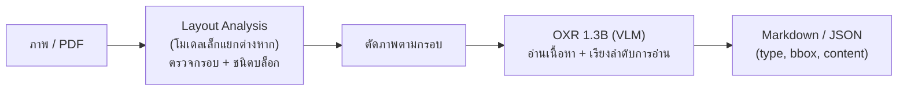

# OXR (SoMarkAI/OXR): ตัวอ่านเอกสารที่ลองแล้ว

เอกสารนี้อธิบายว่า OXR คืออะไร ทำงานอย่างไร ทำไมจึงน่าลอง และสรุปผลที่ **วัดจริงกับภาษาไทยในโปรเจกต์นี้**
ส่วนที่มาจาก README/FAQ ของ OXR ระบุว่า "ผู้พัฒนาอ้าง" ส่วนที่วัดเองระบุตัวเลขและสคริปต์ที่ใช้

> **สรุปสั้น:** OXR อ่านตัวเลขและตัวอักษรละตินได้ แต่ **ข้อความภาษาไทยผิดเกือบทั้งหมด** (CER มัธยฐาน 0.70 เทียบกับ Paddle 0.002 / Typhoon 0.007)
> และแต่งอักษรจีนใส่ในผลทุกใบ จึง **ไม่เหมาะเป็นตัวอ่านหลักของเอกสารภาษาไทย** ตอนนี้ ผู้พัฒนาก็ระบุเองว่าไม่ได้ฝึกภาษาไทย
>
> **รันในเครื่องได้จริงบน GPU 6GB** (Docker + WSL2 ด้วยค่าที่ปรับเอง ดูหัวข้อ 5) ข้อมูลไม่ออกนอกเครื่อง
> ผลกับสแกนจริง 18 ใบ (หัวข้อ 6.2): อักษรจีนโผล่ 17 ใบ, 4 ใบวนซ้ำจนผลยาวผิดปกติและใช้เวลา 4–5 นาทีต่อหน้า
> รันเต็ม pipeline เทียบกัน (หัวข้อ 6.3 บน 15 ใบที่ทุก engine มีผล): OXR `failed` 12/15 ใบ เทียบ Paddle 2 และ Typhoon 0 และได้ `total_amount` 3 ใบ (Paddle 10, Typhoon 11)
> ตรวจแล้วว่าไม่ใช่เพราะใช้ผิดวิธี (หัวข้อ 6.4): บรรทัดไทยสะอาดบรรทัดเดียวส่งเข้าโมเดลตรง ๆ ก็ยังอ่านไม่ได้ และไม่มีตัวเลือกภาษา

## 1. OXR คืออะไร

- OXR = Optical Everything Recognition โมเดลเปิดจากทีม SoMark แปลง PDF/ภาพเอกสารเป็น **Markdown หรือ JSON พร้อมพิกัดกรอบ (bbox) และลำดับการอ่าน**
- ตัวโมเดลเป็น VLM ขนาด **1.3B พารามิเตอร์** (OXR-1.0, BF16) ฝึกจากศูนย์ (ไม่ได้ต่อยอดโมเดลอื่น)
- ผู้พัฒนาอ้างว่าได้อันดับ 1 บน olmOCR-bench (87.84), OmniDocBench (97.18) และ DocParsingBench (87.76) และเร็วราว 0.99 หน้า/วินาที (บน GPU 96GB)
  ตัวเลขทั้งหมดเป็นผลที่ผู้พัฒนาวัดเอง (snapshot 5 ต.ค. 2026) **ยังไม่มีผลแยกรายภาษา** ตามที่ FAQ ระบุ
- ใบอนุญาต: Apache 2.0 ดัดแปลง ใช้เชิงพาณิชย์ได้ แต่ถ้ารายได้หรือเงินทุนรวมเกิน 2 ล้านดอลลาร์สหรัฐ ต้องขอสัญญาแยก และต้องแสดง "Powered by SoMark OXR" เมื่อให้บริการบุคคลที่สาม

## 2. หลักการทำงาน

OXR ไม่ใช่โมเดลเดียว แต่เป็นสองส่วนต่อกัน



1. **Layout Analysis** (แยกและเปลี่ยนตัวได้) หาว่าหน้านี้มีบล็อกอะไรบ้าง ที่ไหน ชนิดอะไร (13 ชนิด เช่น Title, Text, Table, Formula, Stamp, Caption)
2. **OXR** อ่านเนื้อหาของแต่ละบล็อก (ตารางเป็น HTML, สูตรเป็น LaTeX) และจัดลำดับการอ่านในขั้นเดียวกัน
3. **RSI loop** (Recursive Self-Improvement) เป็นเทคนิคตอนฝึก: ให้โมเดลหาตัวอย่างที่ตัวเองตอบผิดหรืออ่อน แล้วเสริมข้อมูลตรงนั้นโดยไม่ต้องมีคนทำ label โค้ดฝึกไม่เปิดเผย
   (ไม่ใช่การเรียนรู้จากเอกสารของเราตอนใช้งาน)

**ดูภาพแต่ละขั้น** (นำเข้า → preprocess → กรอบ layout → ลำดับการอ่าน → ข้อความของแต่ละบล็อก): `scripts/visualize_oxr.py <เลขไฟล์>` สร้างรายงาน HTML ในเครื่องจากผลดิบที่เก็บไว้ (ไม่รัน OXR ใหม่) ที่ `data/output/visualize/oxr/<เลขไฟล์>/index.html`

**รายงานภาพเรื่องความไม่แม่นของ OXR กับภาษาไทย** (กราฟความน่าจะเป็นของ token, จำนวน token แยกภาษา, ภาพเทียบบล็อกเดียวกันของแต่ละ engine, ภาษากับอักษรจีนที่หลุด): `scripts/explain_oxr.py` สร้างที่ `data/output/visualize/oxr_why/index.html`

ตัวโมเดลไม่ **สกัด field** (วันที่ ยอดเงิน เลขที่) เอง ต้องเอาผลไปให้ LLM หรือ rules ทำต่อ เหมือนที่ Typhoon ในโปรเจกต์นี้ต้องมีขั้นที่ 4

## 3. ทำไมจึงน่าลอง

| เหตุผล | ใช้กับโปรเจกต์นี้ได้อย่างไร |
|---|---|
| ได้ **bbox + ชนิดบล็อก + ลำดับการอ่าน** ในผลเดียว | Typhoon ไม่มี bbox (ดู [ขั้นที่ 3](03-text-reading.md)) ถ้าได้ bbox จะทำ confidence/ไฮไลต์รายฟิลด์ได้ ([07](07-handwriting-and-field-confidence.md)) |
| ตารางเป็น HTML ที่ผู้พัฒนาอ้างว่าแม่น (Tables 93.05 บน olmOCR-bench) | รายการสินค้าในใบกำกับภาษีคือตาราง |
| โมเดลเล็ก (1.3B) เร็ว | Typhoon 3B ช้ามากบน GPU 6GB ของเครื่องนี้ (~330 วินาที/หน้าในชุด CER) |
| ติดตั้งในเครื่องได้ ไม่ส่งข้อมูลออกนอก (self-host) | เอกสารการเงินมีข้อมูลภาษี |
| Layout แยกเปลี่ยนได้ | ใช้ layout ตัวอื่นที่เก่งเอกสารไทยได้ |

## 4. ข้อดีและข้อเสีย

**ข้อดี (จากเอกสารผู้พัฒนา + ที่วัดได้)**
- ให้โครงสร้างครบ: bbox, ชนิดบล็อก, ลำดับการอ่าน, ตารางเป็น HTML
- ตัวเลข ตัวอักษรละติน และเลขที่เอกสาร อ่านได้ดีในที่วัด (invoice_no ถูก 21/21, ยอดย่อย 21/21)
- ขนาดเล็ก และเร็วเมื่อไม่ติดคิว (`api_ms` ≈ 1.4–1.7 วินาที/หน้าในใบที่อ่านได้ปกติ)

**ข้อเสีย**
- **ภาษาไทยไม่รองรับ:** FAQ ระบุว่าฝึกจากจีน+อังกฤษเป็นหลัก ภาษาอื่น "ไม่รับประกัน" ผลที่วัดตรงกับข้อนี้ (หัวข้อ 6)
- **ต้องใช้ GPU ใหญ่บน Linux:** แนะนำ VRAM 24GB, NVIDIA รองรับ BF16, CUDA 13, Python 3.12, vLLM 0.25.1 (ต้องติดตั้ง plugin แยก)
  ไม่มี Ollama/GGUF/Windows อย่างเป็นทางการ เครื่องนี้ (RTX 4050 Laptop 6GB, Windows) **รันได้แต่ต้องปรับค่าเอง** (หัวข้อ 5)
  ใช้ image 19.3GB + weights 3GB และต้องลด context เหลือ 8192 / `max_tokens` 3072 ซึ่งอาจตัดผลของหน้าที่ยาว
  สตาร์ตใช้เวลาราว 3–5 นาที และบางหน้าใช้เวลา 4–5 นาทีเมื่อโมเดลวนซ้ำ
- **ไม่เน้นภาพถ่าย/ภาพสแกนเก่า** (Old Scans 59.32 ในตารางผู้พัฒนาเอง) เอกสารสแกนของโปรเจกต์นี้อยู่ในกลุ่มนี้
- ไม่ต่อตารางข้ามหน้า, ไม่สกัด field, ไม่รับไฟล์ Office/GIF/HEIC
- โมเดลที่แต่งข้อความ (hallucinate) ได้: ที่วัดเจอทั้งอักษรจีนที่ไม่อยู่ในภาพ และการวนซ้ำไม่จบ (หัวข้อ 6)
- free API ไม่เหมาะกับข้อมูลจริง: เป็นบริการของบุคคลที่สาม ไม่รับประกันเสถียรภาพ และ FAQ ระบุว่านำข้อมูลไปปรับปรุงโมเดล

## 5. ติดตั้งและวิธีใช้

### ทางที่ 1 (ใช้กับข้อมูลจริงได้): self-host ในเครื่อง บน Windows + WSL2 + GPU 6GB

ทดสอบแล้วบน RTX 4050 Laptop 6GB, Docker Desktop (WSL2), driver 596.49 ใช้ image ของ OXR (base = `vllm/vllm-openai:v0.25.1`)
**อย่าวาง clone/weights ใน repo นี้** (weights 3GB, image 19.3GB) เก็บไว้โฟลเดอร์อื่น

```powershell
git clone --depth 1 https://github.com/SoMarkAI/OXR.git; cd OXR
pip install -U huggingface_hub; hf download SoMarkAI/OXR-1.0 --local-dir ..\models\OXR-1.0
docker build -f docker/Dockerfile.allinone -t oxr-1.0 .

docker run -d --name oxr --gpus all --ipc=host -p 127.0.0.1:8000:8000 `
  -e VLLM_USE_V2_MODEL_RUNNER=0 `
  -e VLLM_GPU_MEMORY_UTILIZATION=0.78 -e VLLM_MAX_MODEL_LEN=8192 `
  -e DFINE_CUDA_GRAPH=0 `
  -e OXR__OXR_MODEL__MAX_TOKENS=3072 -e OXR__OXR_MODEL__MAX_CONCURRENCY=2 `
  -v "${PWD}\..\models\OXR-1.0:/models/oxr-model:ro" oxr-1.0
# รอสถานะ healthy (3–5 นาที)  ·  docker ps  ·  ปิด: docker rm -f oxr
```

ทำไมต้องปรับจากคำสั่งใน README (แต่ละค่ามาจากข้อความ error ที่เจอจริง)

| ค่าที่ตั้ง | ถ้าไม่ตั้ง | เหตุผล |
|---|---|---|
| `VLLM_USE_V2_MODEL_RUNNER=0` | vLLM ล้มด้วย `RuntimeError: UVA is not available` | WSL2 ไม่มี pinned memory แต่ model runner v2 ต้องใช้ UVA ใช้ runner รุ่นเก่าแทน (ยังไม่ได้เช็กว่ากระทบคุณภาพผลหรือไม่) |
| `VLLM_GPU_MEMORY_UTILIZATION=0.78` | ที่ 0.60 มี KV cache แค่ 0.31 GiB (ต้องการ 0.88 GiB สำหรับ 8192 token) ล้มตอนสตาร์ต | ที่ 0.78 ได้ KV cache 1.39 GiB (12,960 token) ใช้ VRAM รวม ~4.6GB รวม layout model ที่ค่าอื่นยังไม่ได้ลอง |
| `VLLM_MAX_MODEL_LEN=8192` | ค่าตั้งต้น 16384 ต้องใช้ KV cache มากกว่าที่ 6GB มี | หน้าที่ต้องการ context ยาวกว่านี้อาจถูกตัด |
| `OXR__OXR_MODEL__MAX_TOKENS=3072` | ทุกบล็อกได้ `400 Bad Request` แล้ว API คืน `code 1137` | ค่าตั้งต้น 8192 + token ของภาพ เกิน context 8192 |
| `OXR__OXR_MODEL__MAX_CONCURRENCY=2` | (ค่าตั้งต้น 16) | KV cache เล็ก ลดจำนวนคำขอพร้อมกัน |
| `DFINE_CUDA_GRAPH=0` | (ค่าตั้งต้น 1) | ประหยัด VRAM ของ layout model ยังไม่ได้วัดว่าจำเป็นหรือไม่ |

เรียกใช้ (ข้อมูลไม่ออกนอกเครื่อง ผูกพอร์ตกับ 127.0.0.1 เท่านั้น):

```powershell
curl.exe --fail-with-body http://127.0.0.1:8000/v1/parse/sync `
  -F "file=@data/raw/synthetic/00_baseline.jpg" -F "api_key=dummy" `
  -F "output_formats=markdown" -F "output_formats=json"
```

รับ PDF ได้โดยตรง (สแกนจริงส่งเป็น `.pdf` ได้เลยไม่ต้องแปลงเป็นภาพ) เดโมอยู่ที่ `http://127.0.0.1:8000/demo`

### ทางที่ 2 (เฉพาะข้อมูลสมมติ): free hosted API

```powershell
curl.exe --fail-with-body https://free-oxr.somark.ai/api/v1/parse/sync `
  -F "file=@data/raw/synthetic/00_baseline.jpg" -F "api_key=dummy" `
  -F "output_formats=markdown" -F "output_formats=json"
```

ไม่ต้องมี key (ใส่ `dummy`) มีคิวและจำกัดอัตรา (ตอบ `429` ถ้าส่งถี่ — สคริปต์วัดรอแล้วลองใหม่เอง)
**ส่งได้เฉพาะภาพสังเคราะห์** ห้ามส่งสแกนจริงใน `data/raw/finance_doc_scan` เพราะนำข้อมูลไปปรับปรุงโมเดลและลบกลับไม่ได้

### วัดซ้ำในโปรเจกต์

```powershell
.venv\Scripts\python scripts\benchmark_oxr.py --preprocess   # ผ่าน preprocess ของโปรเจกต์ก่อน (เทียบ Paddle/Typhoon ได้ตรง)
.venv\Scripts\python scripts\benchmark_oxr.py                # ส่งภาพดิบ
```

สคริปต์นี้ชี้ไป **free API** (ค่าคงที่ `API` ในไฟล์) ใช้กับภาพสังเคราะห์เท่านั้น ผลดิบแคชที่ `data/output/oxr/` สรุปที่ `data/output/benchmarks/oxr_synthetic_*.json`
ผลกับสแกนจริงในหัวข้อ 6.2 ได้จากการส่ง PDF ไปที่ container ในเครื่อง (`http://127.0.0.1:8000`) ทีละไฟล์ เก็บที่ `data/output/oxr/real/` (ถูก gitignore)
ส่วนหัวข้อ 6.3 รันด้วย `.venv\Scripts\python scripts\extract_oxr.py data/raw/finance_doc_scan` (ปฏิเสธโฮสต์ที่ไม่ใช่ localhost) ได้ผลตาม schema ของโปรเจกต์ที่ `data/output/extract/finance_doc_scan__oxr-rules/`

## 6. ผลวัดกับภาษาไทย (ตัวอย่างประกอบ)

### 6.1 ชุดสังเคราะห์ 21 ใบ (ผ่าน free API)

ชุดวัด: ใบกำกับภาษีสังเคราะห์ 21 ใบ (เนื้อหาเดียวกัน เอียง/หมุน/สี/ตรา/สแกนต่างกัน) ใช้เฉลยและตัวคำนวณ CER ชุดเดียวกับ `scripts/benchmark_cer.py`
ส่งภาพที่ผ่าน preprocess ของโปรเจกต์แล้ว (หมุนตั้งตรงก่อน) เหมือนที่ Paddle/Typhoon ได้รับ

| | **OXR** | Paddle | Typhoon OCR |
|---|---|---|---|
| CER มัธยฐาน | **0.70** | 0.0024 | 0.0071 |
| CER เฉลี่ย | 6.18 (มีใบที่วนซ้ำ ทำให้เกิน 1) | 0.0137 | 0.0295 |
| ใบที่มีอักษรจีนโผล่มา | **21/21** | — | — |
| ชื่อผู้ขายภาษาไทยถูกเป๊ะ | **0/21** | — | — |
| เลขภาษี / เลขที่ / วันที่ | 16 / 21 / 19 จาก 21 | — | — |
| ยอดก่อนภาษี / VAT / ยอดรวม | 21 / 19 / 20 จาก 21 | — | — |

(Paddle/Typhoon: ค่าจาก `data/output/benchmarks/cer_synthetic_*.json` ซึ่งเป็นชุดและเฉลยเดียวกัน ไม่ได้วัด field รายตัวด้วยสคริปต์นี้)

### ตัวอย่าง: ใบ `00_baseline.jpg`

ภาพต้นฉบับมีข้อความ "ใบกำกับภาษี / TAX INVOICE", "บริษัท ตัวอย่างเทคโนโลยี จำกัด", เลขที่ `INV-2568-00127`, วันที่ `18/05/2568`, ตารางสินค้า 3 รายการ
OXR คืน (ตัดมาบางส่วน):

```text
# PygaxgPenก位置 / TAX INVOICE                         ← หัวเอกสารไทยกลายเป็นขยะ แต่ TAX INVOICE ถูก
我们的 INV-2568-00127                                  ← เลขที่ถูก แต่มี "我们的" (ภาพไม่มีอักษรจีน)
123 นn.n森ต่างย์ ...  วันที่ 18/05/2568                 ← ที่อยู่เป็นขยะ แต่ "วันที่ 18/05/2568" ถูก
... 0105561234560                                      ← เลขภาษีถูก ชื่อบริษัทหายไป
<table> ... 4,500.00 13,500.00 ... 32,700.00 2,289.00 34,989.00 </table>   ← ตัวเลขถูกหมด
```

ตัวเลขในตารางถูกครบ แต่หัวคอลัมน์และชื่อสินค้าไทยกลายเป็น "area/year", "state/region" (แต่งคำอังกฤษที่ไม่มีในภาพ)

### ตัวอย่าง: โหมดล้มเหลว

ใบที่เอียง +6° (`skew_+6.0.jpg`) โมเดลวนซ้ำ `HIBEN` เป็นพัน ๆ ครั้ง (ผลยาว 14,388 ตัวอักษร ใช้เวลา 48 วินาที) CER จึงเป็น 32.7
ใบ `combo_blue_rot90_skew+3_scan.jpg` มี `伍` ซ้ำ 4,000+ ตัว รวม 5 ใบจาก 21 ที่ CER เกิน 1
ถ้าใช้จริงต้องมีตัวตรวจผลวนซ้ำ (ความยาวผลผิดปกติ/ตัวอักษรซ้ำ) เพราะผลแบบนี้ไม่ได้ขึ้นเป็น error

### 6.2 สแกนจริง 18 ใบ (self-host ในเครื่อง ข้อมูลไม่ออกนอกเครื่อง)

ส่ง PDF ใน `data/raw/finance_doc_scan` ทั้ง 18 ใบ (1 หน้า/ไฟล์) ไปที่ container ในเครื่อง ตอบ `code 0` ครบ 18 ใบ
**ไม่มีเฉลยของสแกนจริง จึงวัด CER ไม่ได้** ตัวเลขข้างล่างเป็นอาการของผล ไม่ใช่ความแม่นยำ

| อาการ | ผล |
|---|---|
| ใบที่มีอักษรจีนที่ไม่ควรมี | **17/18** (ใบที่ไม่มีคือ 001315 ซึ่งผลสั้นมาก 807 ตัวอักษร) |
| ใบที่ผลยาวเกิน 10,000 ตัวอักษร | **4/18** (001307, 001311, 001321, 001323) ยาวสุด 52,073 ตัวอักษร ขณะที่ใบปกติ 800–5,000 |
| ใบที่มีข้อความซ้ำมาก (หน้าต่าง 20 ตัวอักษรเดียวกันซ้ำ ≈ 40% ขึ้นไปของผล) | 2/18 (001310, 001316) 001316 มีอักษรจีน 3,150 ตัวทั้งที่ผลยาวแค่ 7,571 ตัวอักษร |
| เวลาต่อหน้า | 4–322 วินาที มัธยฐาน ≈ 40 วินาที ใบที่ผลวนซ้ำใช้ 150–322 วินาที (จำกัดที่ `max_tokens` 3072) |
| เลขภาษี 13 หลักที่ผ่าน checksum | รวม 20 ค่า (ค้นจากผล markdown ทั้ง 18 ใบ) |

เรื่องเลขภาษี: ตัวเลข 20 ตรงกับค่าใน [ขั้นที่ 2](02-preprocessing.md) แต่ **นับด้วยวิธีต่างกัน และไม่ได้ตรวจว่าเป็นเลขชุดเดียวกัน** เทียบว่า OXR เท่ากับ Paddle ไม่ได้
ผลนี้บอกได้แค่ว่าเลขภาษีหลายค่าถูกอ่านออกมา (ในชุดสังเคราะห์ตัวเลขก็อ่านได้ดีกว่าข้อความไทย) ไม่ได้ตรวจยอดเงินและ field อื่นในสแกนจริง

เทียบ self-host กับ free API (ใบสังเคราะห์ `00_baseline.jpg` ใบเดียว): self-host (ส่งภาพดิบ) ได้หัวเอกสาร `PygaxgPenก位置 / TAX INVOICE` ตรงกับที่ free API ให้เมื่อส่งภาพที่ผ่าน preprocess
ส่วนที่ free API ให้เมื่อส่งภาพดิบเป็นข้อความอีกแบบ (`Pygakกบ{\text{音}}`) ซึ่งก็เป็นขยะเหมือนกัน สองฝั่งจึงเป็นขยะแบบเดียวกัน แต่ข้อความไม่ได้เหมือนกันทุกครั้ง (เทียบเพียงใบเดียว)

> หมายเหตุ: การรันในหัวข้อนี้ส่ง PDF ดิบ ไม่ผ่าน preprocess ของโปรเจกต์ ซึ่งไม่เท่ากับที่ Paddle/Typhoon ได้ จึงรันซ้ำแบบเท่ากันในหัวข้อ 6.3

### Schema ผลลัพธ์ของ OXR (`/v1/parse/sync`)

```text
{ code, message, warnings[],
  data: { task_id, error, metadata: {page_num, file_type, processing_time_ms},
          result: { file_name,
                    outputs: { markdown: str,
                               json: { pages: [ { page_num, page_size:{w,h}, merge_content_from_pre_page,
                                                  blocks: [ { idx, type, bbox:[x1,y1,x2,y2], content, format } ] } ] } } } } }
```

- `type`: Title, Text, Table (`format: "html"`), Picture ฯลฯ  ·  `idx` = ลำดับการอ่าน  ·  `bbox` เป็นพิกเซลของภาพหน้า (`page_size`)
- ถ้า error `code` ไม่เป็น 0 และ `data` เป็น `null` (เจอ `code 1137` เมื่อ vLLM ปฏิเสธคำขอ)
- เทียบกับ `ExtractionResult`: OXR คืนแค่ข้อความดิบ + bbox + ชนิดบล็อก ไม่มี field (`vendor`, `invoice_no`, `total_amount`) และไม่มี confidence ต่อคำ
  จึงใช้แทน Paddle/Typhoon ได้ในขั้นอ่านข้อความเท่านั้น ยังต้องผ่านขั้นสกัดและ validation ของโปรเจกต์ ส่วนที่ได้เพิ่มคือ `bbox` ของแต่ละบล็อก

### 6.3 รันเต็ม pipeline: OXR เทียบ Paddle และ Typhoon (อินพุตและขั้นสกัดเดียวกัน)

`scripts/extract_oxr.py` ส่งภาพที่ผ่าน loader + preprocess ของโปรเจกต์ไปที่ OXR ในเครื่อง แล้วเข้าขั้นสกัด rules + validation เดิม (ทางเดียวกับ Typhoon)
เทียบกับ Paddle+rules (`finance_doc_scan__ocr-rules`) และ Typhoon+rules (`finance_doc_scan__vlm-rules`) ผลอยู่ที่ `data/output/extract/finance_doc_scan__oxr-rules/`

> **เทียบบน 15 ใบเดียวกัน:** รัน OXR ถูกระบบหยุดที่ 15 จาก 18 ใบเพราะหน่วยความจำต่ำ (ไม่มี 001321, 001322, 001323) ทุกตัวเลขข้างล่างจึงนับเฉพาะ 15 ใบที่ทุก engine มีผล
> ทั้งสามชุดรันด้วยโค้ดเดียวกัน (มีโปรไฟล์ชนิดเอกสารแล้ว แต่ยังไม่มีการอ่านชื่อลูกค้าจากป้ายและ check ตามโปรไฟล์) ผลของรันที่ใช้ LLM ช่วย (`ocr-llm`) ไม่มีแล้ว ถูกลบและไม่ได้รันใหม่

| (15 ใบ) | Paddle + rules | Typhoon + rules | **OXR + rules** |
|---|---|---|---|
| `failed` / `needs_review` | 2 / 13 | 0 / 15 | **12 / 3** |
| มีค่า `vendor.tax_id` | 10 | 11 | 8 |
| มีค่า `invoice_no` | 8 | 10 | **4** |
| มีค่า `date` | 14 | 14 | 14 |
| มีค่า `total_amount` | 10 | 11 | **3** |
| มีค่า `vendor.name` | 10 | 13 | 8 |

ค่าที่ OXR สกัดได้ตรงกับอีกสองตัวหรือไม่ (เฉพาะที่ทั้งสองฝั่งมีค่า ไม่มีเฉลย จึงวัดได้แค่ "ตรงกัน" ไม่ใช่ "ถูก"):
`date` 10/13 (Paddle), 11/13 (Typhoon) · `vendor.tax_id` 5/8, 4/8 · `total_amount` 2/3, 2/3 · `invoice_no` 1/2, 3/3 · **`vendor.name` 0/6, 0/8** (ชื่อไทยไม่เคยตรงเลย)

- OXR **ไม่ดีกว่าทั้งสองตัวในทุก field** และมีใบ `failed` มากกว่าเท่าตัวหลายเท่า ไม่มี `auto_approved` ในทั้งสามชุด (โปรไฟล์ชนิดเอกสารยังเป็นฉบับร่าง อนุมัติอัตโนมัติไม่ได้ จึงเทียบ `auto_approved` ไม่ได้)
- ใบที่ผลเทียบกันได้ดีที่สุดคือเอกสารอังกฤษล้วน 001315: OXR อ่านข้อความครบ (หัวข้อ 6.2) แต่ rules ยังหา `total_amount` ไม่เจอ จึงไม่ได้ประโยชน์จากการอ่านที่ดีกว่า
- ข้อจำกัด: ไม่มีเฉลยของสแกนจริง ตัวเลขข้างบนเป็นจำนวนที่มีค่าและความตรงกันระหว่าง engine ไม่ใช่ความถูกต้อง และ OXR ไม่ส่ง `finish_reason` ผลที่วนซ้ำหรือถูกตัดจึงไม่ถูกตั้งธง `vlm_complete`
- ตัวเลขชุดก่อนหน้า (ครบ 18 ใบ) ถูกแทนที่ด้วยตารางนี้เพราะผลดิบเก่าถูกลบไปแล้ว ข้อสรุปไม่เปลี่ยน

### 6.4 ตรวจว่าใช้ผิดวิธีหรือไม่

| สมมติฐาน | วิธีตรวจ | ผล |
|---|---|---|
| ค่าที่ลดเพื่อให้พอ VRAM ทำให้พัง | free API ใช้ค่าเต็มของผู้พัฒนา (context 16384, runner v2) | พังแบบเดียวกัน (ไทยเป็นขยะ มีอักษรจีน วนซ้ำ) จึงไม่ใช่สาเหตุหลัก (ค่าที่ลดอาจตัดหน้ายาวหรือทำให้วนซ้ำเพิ่มได้ ไม่ได้แยกผลตรงนี้) |
| มีตัวเลือกภาษาหรือ prompt ที่ข้ามไป | ดู `/openapi.json` และ `oxr/model/prompts.py` | **ไม่มี** พารามิเตอร์ของ `/v1/parse/sync` คือ `file`, `api_key`, `output_formats`, `feature_config`, `extra`, `element_formats` (`feature_config` รองรับแค่ `keep_header_footer`) prompt ตายตัวเป็นภาษาอังกฤษ (`Recognize the content of the image.`) |
| layout/การตัดภาพทำให้เพี้ยน | ตัดบรรทัดไทยบรรทัดเดียว ("บริษัท ตัวอย่างเทคโนโลยี จำกัด") จากภาพสังเคราะห์ตามกรอบที่ OXR ให้เอง ส่งเข้า vLLM ตรงด้วย prompt เดียวกับที่ OXR ใช้ (ข้าม layout และ pipeline) | **ยังเป็นขยะ** ทั้งขนาดเดิม (`>Pิ่นท� ต่างย์)...`) และขยาย 2 เท่า (`>Pri策น tต่าง一位กีนกี ว伦กี`) |
| ส่งอินพุตไม่เหมือน Paddle | รันซ้ำผ่าน preprocess ของโปรเจกต์ (หัวข้อ 6.3) | ผลแย่กว่า Paddle/Typhoon ในทุก field |

ข้อสรุป: โมเดลอ่านภาษาไทยไม่ได้แม้ในบรรทัดเดียวที่สะอาด สอดคล้องกับที่ FAQ ระบุ (ฝึกจีน+อังกฤษเป็นหลัก) ไม่น่าเป็นเรื่องวิธีใช้
ยังไม่ได้ลอง: เรียก vLLM ตรงด้วย prompt อื่น (เช่น whole-page) และปรับ `temperature`/`repetition_penalty` (demo API มีพารามิเตอร์นี้) ซึ่งอาจลดการวนซ้ำ แต่ไม่น่าแก้ภาษาไทย

### ข้อจำกัดของการวัด (อ่านก่อนอ้างตัวเลข)

- **ภาพสังเคราะห์ ฟอนต์สะอาด เนื้อหาเดียวกันทุกใบ** เป็นการวัดเทมเพลตเดียว ไม่ใช่ความแม่นกับเอกสารจริง
- **รันครั้งเดียวทุกชุด** ความต่างของเวลา (ชุดสังเคราะห์ `api_ms` 1.4–60 วินาทีบน free API ที่มีคิว) ปนผลคิว/ความยาวผลเข้าไป ไม่ใช่ความเร็วโมเดลล้วน
  ไม่ได้ทดสอบว่าผลวนซ้ำเกิดซ้ำเมื่อส่งใบเดิมอีกครั้งหรือไม่
- **self-host ใช้ค่าที่ลดเพื่อให้พอ VRAM 6GB** (context 8192, `max_tokens` 3072, runner v2 ปิด) หน้าที่ต้องการผลยาวอาจถูกตัด ไม่ได้ลองค่าอื่น และไม่ได้เทียบผลชุดสังเคราะห์ทั้ง 21 ใบบน self-host (เทียบเฉพาะ `00_baseline.jpg`)
- ชุดสังเคราะห์ 6.1 วัดผ่าน free API ส่วนสแกนจริง 6.2 วัดบน self-host สองชุดนี้จึงเทียบตัวเลขข้ามกันตรง ๆ ไม่ได้
- สแกนจริงไม่มีเฉลย จึงไม่มี CER และไม่ได้วัดความถูกของ field
- ฟิลด์ที่ "ถูก" = ข้อความตรงเป๊ะหลัง normalize (ไม่ได้ผ่านขั้นสกัด field ของโปรเจกต์)

## 7. ข้อสรุปและการใช้งานต่อ

| คำถาม | คำตอบ |
|---|---|
| ใช้แทน Paddle/Typhoon เป็นตัวอ่านหลักได้ไหม | **ไม่** ภาษาไทยผิดเกือบหมดและแต่งอักษรจีน |
| มีส่วนไหนน่าใช้ | ตัวเลข/ตัวละตินในตาราง และ bbox+ลำดับการอ่าน ถ้าจะใช้ ให้เป็นตัวช่วยหา layout แล้วส่งภาพที่ตัดไปอ่านด้วย Paddle/Typhoon |
| ควรลองใหม่เมื่อไร | เมื่อมีเครื่อง GPU ≥ 24GB ที่ไม่ต้องลด context (ตรวจว่าผลวนซ้ำหายไหม ที่ 6GB ยังวนซ้ำ 4/18 ใบ) หรือเมื่อผู้พัฒนาประกาศรองรับไทยและมีผลแยกรายภาษา |
| ต้องทำอะไรก่อนใช้กับข้อมูลจริง | self-host เท่านั้น (หัวข้อ 5 ทางที่ 1) ห้ามใช้ free API |
| ถ้านำไปต่อ pipeline | ต้องมีตัวตรวจผลวนซ้ำ/อักษรจีนก่อนส่งเข้าขั้นสกัด และตั้ง timeout ต่อหน้า (บางหน้าใช้ 5 นาที) |

> ตัวเลือกที่ยังไม่ได้ลอง: ใช้เฉพาะ Layout Analysis ของ OXR (เปลี่ยนตัวได้ตามที่ผู้พัฒนาระบุ) ร่วมกับตัวอ่านเดิม service รันได้แล้วในเครื่องนี้ (หัวข้อ 5) แต่ยังไม่ได้ทดสอบส่วน layout แยกจาก OXR
