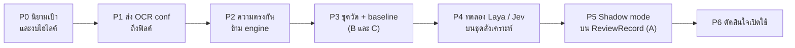

# แผน: decision engine กับ confidence รายฟิลด์

> สถานะ: **แผนและความเห็น ยังไม่มีโค้ด** เขียน 2026-11-11 ต่อจาก [09-decision-model.md](09-decision-model.md) (concept ของ Jev / Laya)
> และ [07-handwriting-and-field-confidence.md](07-handwriting-and-field-confidence.md) (แผน confidence รายฟิลด์)
> ไม่มีตัวเลขเกณฑ์ในเอกสารนี้โดยตั้งใจ ทุกเกณฑ์ต้องมาจากผลวัด (ดูหัวข้อ 7)

## 0. สรุปความเห็น

1. **ได้ แต่ decision engine ไม่ควรเป็นตัวสร้าง confidence หลัก** ควรเป็น *สัญญาณหนึ่ง* ที่ทำให้ระดับหลักฐานเข้มขึ้นได้อย่างเดียว (ตามกฎข้อ 1 ใน 09)
2. **สัญญาณที่ดีกว่าและถูกกว่ามีอยู่แล้วในระบบ** แต่ยังไม่ถูกส่งต่อ: confidence ระดับคำของ OCR (`model_conf` ยังเป็น null), ความตรงกันของหลาย engine (เรามีผล Paddle / Typhoon / OXR ของชุดเดียวกัน), ความตรงกันของ rules กับ LLM (`sources_agree`) ควรทำสามอย่างนี้ก่อน
3. **การวัดว่า confidence ดีไหมต้องมีเฉลยอย่างน้อยจำนวนน้อย** ซึ่งชนกับจุดยืนเดิมที่ไม่ให้ทำ ground truth (หัวข้อ 6 เสนอทางออกที่ไม่ต้องจ้างคน annotate)
4. **Jev ส่งข้อมูลออกนอกเครื่อง** ใช้กับสแกนจริงไม่ได้ตามข้อกำหนดเดิม ทดลองได้กับชุดสังเคราะห์เท่านั้น ส่วน Laya รันในเครื่องได้ แต่ยังไม่มีหลักฐานเรื่องภาษาไทย
5. **ทำเป็นขั้นที่มีจุดหยุด:** ถ้าโมเดลไม่ดีกว่าการไม่ใช้ในการวัดบนข้อมูลของเรา ก็หยุด ไม่เสียอะไร

## 1. ตอนนี้ระบบมีอะไร

`field_evidence` (schema 3.0, `validation/evidence.py`) ให้ระดับ 5 แบบ `missing` / `not_applicable` / `conflict` / `verified` / `unverified` จากกฎจริง/เท็จตามลำดับ ไม่มีน้ำหนักหรือ threshold

| สัญญาณ | สถานะ |
|---|---|
| format (เลขภาษี 13 หลัก + checksum) | ใช้อยู่ |
| check ที่ยืนยันค่าได้ (ผลรวม, VAT) | ใช้อยู่ |
| `grounded`: ค่าปรากฏในข้อความที่อ่านได้ | ใช้อยู่ แต่ยืนยันแค่ว่าสกัดตรงกับข้อความ ไม่ได้ยืนยันว่า OCR/VLM อ่านภาพถูก |
| `sources_agree`: rules กับ LLM | ใช้อยู่ (มีเมื่อรันทั้งสองแบบ) |
| `model_conf`: confidence ของ OCR | **null เสมอ** (Paddle มี confidence ต่อคำ แต่ไม่ถูกส่งถึงขั้นสกัด) |
| `handwritten` | **null** (ยังไม่มีตัวตรวจ) |
| ความตรงกันข้าม engine | **ยังไม่มีใน schema** |

ข้อจำกัดของระดับปัจจุบันคือฟิลด์ที่ไม่มี check ยืนยัน (ชื่อ, เลขที่ใบกำกับ, วันที่) จะเป็น `unverified` เกือบทั้งหมด จึงไม่ช่วยจัดลำดับว่าฟิลด์ไหนน่าสงสัยกว่ากัน นี่คือช่องที่ "ตัวเลข confidence" น่าจะเติมได้

## 2. decision engine สร้าง confidence ได้ไหม และเหตุผลที่แย้ง

ถ้าถามเป็น Yes/No ต่อฟิลด์ ("ค่านี้ถูกต้องไหม") โมเดลจะคืนความน่าจะเป็นออกมา ซึ่งใช้เป็นสัญญาณได้ในทางเทคนิค แต่มีเหตุผลที่ไม่ควรให้เป็นตัวหลัก

| # | ข้อแย้ง | รายละเอียด |
|---|---|---|
| 1 | **โมเดลไม่เห็นภาพ** | ข้อผิดพลาดหลักของเราคืออ่านภาพผิด (เลขหลักเดียว, ลายมือ, ตัวอักษรไทยใกล้กัน) decision model เห็นแค่ค่าที่สกัดแล้วกับผล check จึงบอกไม่ได้ว่า "1" ควรเป็น "7" มันตัดสินได้แต่ความสมเหตุสมผลของค่า (เช่น ชื่อผู้ซื้อเป็นคำป้าย, ผู้ซื้อกับผู้ขายสลับกัน) ซึ่งเป็นข้อผิดพลาดอีกประเภท |
| 2 | **ความน่าจะเป็นยังไม่ calibrate** | ความมั่นใจที่โมเดลรายงานไม่ได้แปลว่าถูกตามสัดส่วนนั้น ต้องวัดเอง (09 ข้อ 3) และโมเดลภาษาโดยทั่วไปมั่นใจเกินจริงได้ |
| 3 | **ภาษาไทยไม่มีหลักฐาน** | Laya มีรุ่น multilingual แต่ไม่พบผลวัดภาษาไทย Jev ไม่พบข้อมูลเรื่องไทยเลย ต้องวัดเอง |
| 4 | **ตัวเลขที่อ้างกันเชื่อไม่ได้** | จากการค้นเมื่อ 2026-11-11: ไม่พบการประเมินอิสระของ Jev หรือ Laya บนงานสกัดเอกสาร บทความเปรียบเทียบที่เจอระบุว่าตัวเลขของ Jev ถูกยืมมาจากการวัดอื่น ชุดและ prompt ต่างกัน จึงเทียบกันตรง ๆ ไม่ได้ และมีรีวิวหนึ่งว่าหาโปรไฟล์บริษัท/API/ราคาของ Laya แบบแยกเดี่ยวไม่เจอ (ขัดกับแหล่งที่ 09 อ้าง ต้องตรวจกับ model card ทางการ) |
| 5 | **รุ่นฐานแบบ zero-shot อ่อน** | 09 บันทึกว่าตัวเลขที่ดีมาจากรุ่นที่ fine-tune แล้ว ซึ่งต้องมีเฉลยของเรา |
| 6 | **ซ้ำกับสิ่งที่กฎทำได้** | งานเชิงความสมเหตุสมผลหลายอย่างเขียนเป็นกฎได้ (ผู้ซื้อ = ผู้ขาย, ชื่อตรงกับป้ายเช่น `Customer name`) และอธิบายได้กว่า ใช้โมเดลเมื่อกฎเขียนไม่ได้เท่านั้น |
| 7 | **ความเสี่ยงต่อการถูกหลอก** | 09 ระบุแล้วว่าข้อมูลเข้าที่ถูกดัดแปลงทำให้ตัดสินผิดได้ ต้องป้อนเฉพาะฟิลด์ที่สกัดแล้ว ไม่ป้อนข้อความดิบทั้งหน้า |

**ที่ decision engine ช่วยได้จริง (ใช้เป็นสัญญาณเสริม):**
- ชี้ความไม่สมเหตุสมผลของค่า (บทบาทผู้ซื้อ/ผู้ขายสลับ, ชื่อที่เป็นป้าย, รายการที่ไม่เข้ากับประเภทเอกสาร)
- เป็นตัวรวมสัญญาณหลายตัวให้เป็นลำดับความน่าสงสัย *เมื่อมีเฉลยพอจะเรียนรู้การรวม* (ก่อนหน้านั้นการรวมคือการเดาน้ำหนัก)
- จัดลำดับคิวตรวจ (งานข้อ 2 ใน 09)

## 3. สัญญาณที่ควรทำก่อน (ไม่ต้องใช้โมเดลใหม่)

ทำเป็นหลักฐานแยกต่อฟิลด์ ไม่รวมเป็นตัวเลขเดียว (ตามแนวทางใน 07 §5)

| สัญญาณ | ทำอย่างไร | ข้อควรระวัง |
|---|---|---|
| **OCR confidence ต่อคำ** (`model_conf`) | ส่ง `OCRResult` ที่มีคำ+conf ถึงขั้นสกัด หรือจับค่ากลับหาคำด้วยการค้นสตริง ถ้าหาไม่เจอให้เป็น `None` ไม่ใช่ 0 รวมด้วยค่าต่ำสุดตามเหตุผลเชิงตรรกะว่าผิดหลักเดียวก็ผิดทั้งค่า | ต้องวัดว่า conf ของ Paddle สัมพันธ์กับความถูกจริงไหม (07 ข้อ 4: ถ้าไม่สัมพันธ์ให้เลิกใช้) VLM ไม่มี conf ตั้งแต่ต้น |
| **ความตรงกันข้าม engine** | เทียบค่าฟิลด์เดียวกันจาก Paddle, Typhoon, OXR (ผลทั้งสามชุดของสแกนจริง 18 ใบมีอยู่แล้ว) ตรงกัน = สัญญาณหนุน ต่างกัน = ให้ดูเทียบภาพ | engine ใช้ภาพ preprocess ชุดเดียวกัน จึงพลาดพร้อมกันได้ (ตรงกันไม่ได้แปลว่าถูก) และต้องทำให้ค่า normalize ก่อนเทียบ (`compare_file.py` ทำแล้ว) การรัน 2–3 engine ต่อเอกสารมีต้นทุน GPU/เวลา จึงควรเป็นของเอกสารที่ถูกยกระดับเท่านั้น |
| **rules กับ LLM ตรงกันไหม** | มีแล้ว (`sources_agree`) | LLM กับ rules อ่านข้อความเดียวกัน ตรงกันไม่ได้ยืนยันการอ่านภาพ |
| **logprobs ของ VLM** | ตรวจว่า Ollama/Typhoon endpoint คืน logprobs ได้ไหม (07 ข้อ 3) | ยังไม่ทราบว่ารองรับ ถ้าไม่รองรับก็ข้าม |
| **ตัวตรวจลายมือ** | อยู่ในแผน 07 เฟส 3 | ไม่เกี่ยวกับ decision engine |

ผลลัพธ์ขั้นนี้คือ `FieldEvidence` ที่มี `model_conf` และ `engines_agree` เพิ่ม และกฎระดับสีที่ใช้สัญญาณเหล่านี้ (กฎจริง/เท็จ ไม่มี threshold ที่เดา เว้นแต่ได้จากการวัดในขั้น P3)

## 4. ตัวชี้วัดที่แนะนำ

แยกเป็น 4 ชั้น เพราะคำถามต่างกัน และอย่าสรุปด้วยตัวเลขเดียว

### 4.1 ค่าที่สกัดถูกไหม (วัดตัวสกัด ไม่ใช่ confidence)
- **exact match รายฟิลด์** หลัง normalize (เลขภาษี, เลขที่ใบกำกับ, วันที่, ยอดสามตัว) แยกรายฟิลด์ ไม่เฉลี่ยรวม
- **CER / normalized edit distance** สำหรับฟิลด์ข้อความ (ชื่อ, ที่อยู่) ใช้ตัวเดียวกับ `scripts/benchmark_cer.py`
- นับ **ฟิลด์ที่ว่าง** แยกจากฟิลด์ที่ผิด (ว่างปลอดภัยกว่าผิด)

### 4.2 confidence ใช้แยกถูกจากผิดได้ดีแค่ไหน
- **AUROC / AUPRC** ของการแยก "ฟิลด์ผิด" จาก "ฟิลด์ถูก" (AUPRC เหมาะกว่าเมื่อฟิลด์ผิดเป็นส่วนน้อย)
- **risk–coverage curve:** ถ้าเรียงฟิลด์ตามความมั่นใจแล้วเอาเฉพาะส่วนบนสุด อัตราผิดเป็นเท่าไรที่สัดส่วนครอบคลุมต่าง ๆ
- **ECE และ reliability diagram** ดูว่าความน่าจะเป็นตรงกับสัดส่วนที่ถูกจริงไหม (ใช้เมื่อสัญญาณเป็นความน่าจะเป็น เช่น ของโมเดล) ถ้าตัวอย่างน้อยจะแกว่งมาก ให้รายงานเป็นรูปและช่วงความเชื่อมั่นแทนตัวเลขเดียว

### 4.3 ประโยชน์ต่อนักบัญชี (HITL ตรงกับจุดประสงค์จริง)
Confidence มีไว้ไฮไลต์ฟิลด์ที่ต้องดูเป็นพิเศษ ไม่ใช่ข้ามการตรวจ (นักบัญชีตรวจทุกใบอยู่แล้ว) จึงวัดด้วย:
- **recall ของฟิลด์ผิดที่ถูกไฮไลต์** และ **precision ของที่ไฮไลต์** ที่งบจำนวนฟิลด์ไฮไลต์ที่ฝ่ายบัญชีรับได้ต่อใบ (งบนี้ต้องให้ฝ่ายบัญชีบอก ไม่เดา)
- **ฟิลด์ผิดที่ถูกแสดงเป็น `verified`** (ผิดที่อันตรายที่สุด) ต้องแยกนับ เป้าคือเป็นศูนย์หรือใกล้ศูนย์ และทุกกรณีต้องไล่หาสาเหตุ
- **สัดส่วนฟิลด์ `unverified` ที่ถูก** ช่วยบอกว่าสีนี้เตือนเกินไปหรือเปล่า

### 4.4 ต้นทุน
เวลาต่อเอกสาร, GPU/RAM, ราคา (ถ้า cloud) เทียบกับการรันกฎอย่างเดียว

### วิธีเปรียบเทียบ
- **เทียบกับ baseline ระดับหลักฐานปัจจุบันเสมอ** ("ไม่ใช้โมเดล") ผ่านเมื่อดีขึ้นอย่างมีนัยสำคัญบนตัวชี้วัดในข้อ 4.2–4.3 เท่านั้น
- ชุดข้อมูลเล็ก (สแกนจริง 18 ใบ) ให้ใช้ **paired bootstrap** รายงานช่วงความเชื่อมั่นของส่วนต่าง ถ้าช่วงคร่อมศูนย์ให้ถือว่ายังไม่พิสูจน์ว่าดีขึ้น
- รายงานแยกตามชนิดเอกสาร (โปรไฟล์) เพราะชนิดต่างกันผิดคนละแบบ

## 5. ภาระเฉลย: ขัดกับจุดยืนเดิม

เดิมกำหนดไว้ว่าไม่ให้ annotator ทำ ground truth เพื่อคำนวณ confidence ส่วน 4.2 และ 4.3 ต้องรู้ว่าฟิลด์ไหนถูกจริง จึงมีสามทาง

| ทาง | ข้อดี | ข้อเสีย |
|---|---|---|
| **A. ใช้ ReviewRecord จากการแก้ของนักบัญชี** (07/08 เฟส U5, U8) ฟรีและตรงกับการใช้งานจริง | ไม่ต้องจ้างคน ได้ตามปริมาณงานจริง | ยังไม่มี Review UI ดังนั้นยังวัดไม่ได้ในตอนนี้ และ "ถูกนักบัญชีแก้" ไม่เท่ากับ "ผิด" เสมอ |
| **B. เฉลยก้อนเล็ก อ่านจากภาพเอง เฉพาะฟิลด์สำคัญ** เช่นที่ทำไว้ใน `data/etc/compare/<เลขไฟล์>/reference.json` (มี 1312, 1313, 1315 และชุดอังกฤษ) | ทำเองได้ ไม่ต้องมี annotator เป็นชุด ใช้เป็นชุดตรวจสอบ ไม่ใช่ชุดเรียน | จำนวนน้อย ใช้ได้แค่ตรวจว่าสัญญาณทำงานผิดปกติหรือไม่ ไม่พอจะ calibrate |
| **C. ชุดสังเคราะห์ที่มีเฉลยอยู่แล้ว** (`data/raw/synthetic/truth.json`) และฉีดข้อผิดพลาดเอง | ฟรี ปริมาณมาก ส่งขึ้น cloud ได้ | ไม่ใช่การกระจายของเอกสารจริง ผลไม่ย้ายมาตรง ๆ ใช้เลือกโมเดล ไม่ใช่ตั้งเกณฑ์ |

คำแนะนำ: ทดลองเลือกโมเดลด้วย C, ตรวจความเพี้ยนด้วย B, ตั้งเกณฑ์และเปิดใช้จริงเมื่อมี A เท่านั้น

ห้ามใช้ "ผลตรงกันของหลาย engine" เป็นเฉลยแทน เพราะ engine ใช้ภาพชุดเดียวกันและพลาดพร้อมกันได้ ซึ่งทำให้วัดวนลูป

## 6. แผนเป็นขั้น

| ขั้น | งาน | เสร็จเมื่อ | จุดหยุด |
|---|---|---|---|
| P0 | นิยาม "ผิด" ต่อฟิลด์ (ตัวเลข exact, ข้อความตามค่า normalize) และขอให้ฝ่ายบัญชีบอกงบฟิลด์ไฮไลต์ต่อใบ | มีเอกสารนิยามที่ฝ่ายบัญชียืนยัน | |
| P1 | ติดตามต้นทางของค่า จับค่ากลับหาคำ ใส่ `model_conf` ใน `FieldEvidence` (07 เฟส 1.5) | ฟิลด์ที่หาคำเจอมี `model_conf` ที่เหลือเป็น null | ถ้าหาคำไม่เจอเป็นส่วนใหญ่ ให้ทบทวนวิธีจับคู่ก่อนไปต่อ |
| P2 | เพิ่ม `engines_agree` จากผลหลาย engine ที่มีอยู่ (ทำแบบออฟไลน์ก่อน เป็นสคริปต์วัด ยังไม่เข้า pipeline) | มีตารางว่าฟิลด์ไหนตรง/ต่างระหว่าง engine ในสแกนจริง 18 ใบ | |
| P3 | สร้างชุดวัดจากทาง B และ C รัน baseline (ระดับปัจจุบัน) ด้วยตัวชี้วัด 4.1–4.3 | ได้ตัวเลข baseline พร้อมช่วงความเชื่อมั่น | ถ้า `verified` มีฟิลด์ผิดปะปน ให้แก้กฎก่อน อย่าเพิ่มโมเดล |
| P4 | ทดลอง Laya (multilingual) และ Jev บน **ชุดสังเคราะห์เท่านั้น** ถามเป็น Yes/No ต่อฟิลด์ ป้อนเฉพาะฟิลด์ที่สกัดแล้ว วัดตามข้อ 4.2 และเทียบกับ baseline | ได้ตัวที่ดีกว่า baseline หรือสรุปว่าไม่มี | **ถ้าไม่ดีกว่า baseline หยุด** ไม่ต้องทำ P5 |
| P5 | Shadow mode: รันโมเดลกับทุกเอกสาร ไม่แสดงใน UI เก็บคำตอบคู่กับ ReviewRecord (ทาง A) | มีข้อมูลเทียบกับการแก้จริง | ต้องรอ Review UI |
| P6 | วัดตามข้อ 4 บนข้อมูลจริง ตั้งเกณฑ์จากผลวัด ตัดสินใจเปิดใช้ | บันทึกผลและเหตุผลลง docs | ไม่ดีกว่า baseline = ไม่เปิดใช้ |

P0–P3 ไม่ต้องใช้โมเดลใหม่ จึงทำได้ทันทีและได้ประโยชน์แม้สุดท้ายจะไม่ใช้ decision engine

## 7. กฎที่ใช้ตลอด

- ทุกเกณฑ์ต้องมีแหล่ง (เอกสารทางการ) หรือมาจากผลวัดของโปรเจกต์นี้ ห้ามเดาน้ำหนัก/threshold (ข้อกำหนดของโปรเจกต์: ห้ามเดาตัวเลข)
- สัญญาณจากโมเดลทำให้เข้มขึ้นได้ ห้ามผ่อนลง (เขียว/เหลือง → แดงได้ แดง → เขียวไม่ได้) และทุกใบยังผ่านนักบัญชี
- ฟิลด์ที่ไม่มี check ยืนยัน (ชื่อ, เลขที่ใบกำกับ, วันที่) ห้ามขึ้น `verified` เพราะโมเดลบอกว่า "น่าจะถูก"
- ระบบต้องทำงานต่อด้วยระดับหลักฐานเดิมถ้าโมเดลล่ม
- สแกนจริงห้ามออกนอกเครื่อง: Jev (cloud) ใช้กับชุดสังเคราะห์เท่านั้นจนกว่านโยบายข้อมูลจะอนุญาต
- ความน่าจะเป็นที่โมเดลคืนมาไม่ใช่ความน่าจะเป็นที่ถูกต้องจนกว่าจะ calibrate กับข้อมูลของเรา

## 8. ความเสี่ยง

| ความเสี่ยง | ผลกระทบ | ทางลด |
|---|---|---|
| ผลดีบนชุดสังเคราะห์แต่ไม่ย้ายมาสแกนจริง | เปิดใช้แล้วไม่ช่วย | ใช้ P4 เลือกโมเดลเท่านั้น ตั้งเกณฑ์ด้วยข้อมูลจริงจาก P5–P6 |
| ฟิลด์ผิดแต่เขียว (verified) | นักบัญชีตรวจข้าม | นับแยกใน P3, P6 และไล่ทุกกรณี |
| ผล VLM/LLM ไม่ซ้ำกันทุกรอบ | วัดเทียบรอบต่อรอบไม่ตรง | เก็บข้อความดิบแล้วสกัดซ้ำ (`--reuse-raw`) วัดซ้ำหลายรอบแล้วรายงานช่วง |
| ตัวอย่างน้อย (18 ใบ) | ตัวเลขแกว่ง สรุปเกินจริง | ช่วงความเชื่อมั่น, ไม่สรุปด้วยตัวเลขเดียว, แยกตามชนิดเอกสารเฉพาะที่ตัวอย่างพอ |
| ข้อมูลเข้าที่จงใจหลอกโมเดล | ตัดสินผิด | ป้อนเฉพาะฟิลด์ที่สกัดแล้ว ห้ามผ่อนระดับ |
| เครื่องหน่วยความจำจำกัด (เคยดับตอนรันหนัก) | รันทดลองไม่ได้ | รันทีละโมเดล ใช้ CPU/ข้อความดิบที่เก็บไว้ ตรวจแรมก่อนรัน |

## 9. สิ่งที่ยังต้องตัดสินใจ (ไม่ได้บล็อกการเริ่ม P0–P3)

| เรื่อง | ต้องการจาก |
|---|---|
| งบจำนวนฟิลด์ที่ไฮไลต์ได้ต่อใบ (ใช้ตั้งตัวชี้วัด 4.3) | ฝ่ายบัญชี |
| นโยบายข้อมูล: ส่งเอกสารจริงไป cloud (Jev) ได้ไหม | องค์กร |
| ยอมให้ทำเฉลยก้อนเล็ก (ทาง B เฉพาะฟิลด์สำคัญ) เป็นชุดตรวจสอบไหม | ผู้ใช้ |
| ตรวจ model card ทางการของ Laya/Jev (ขนาด, ภาษา, ใบอนุญาต) | ทำใน P4 ก่อนดาวน์โหลด |

## แหล่งข้อมูล

ค้นเมื่อ 2026-11-11 ส่วนใหญ่เป็นบล็อก ไม่ใช่เอกสารทางการ ใช้เป็นเหตุผลให้ต้องวัดเอง ไม่ใช่หลักฐานว่าดีหรือไม่ดี

- [laya vs jev benchmark ai startup moat (Wavect)](https://wavect.io/blog/laya-vs-jev-benchmark-ai-startup-moat/) ระบุว่าตัวเลข Jev ยืมจากการวัดอื่น
- [Jev vs Laya Head-to-Head](https://www.kunalganglani.com/blog/jev-vs-laya-head) และ [Layer3 Labs: laya vs jev](https://www.layer3labs.io/comparisons/laya-vs-jev)
- [TypeSafe: How Far Can Jev Go for Document Item Matching?](https://dev.classmethod.jp/en/articles/typesafe-jev-cross-match/) (วัดความแม่น ความเร็ว ราคา บนงานจับคู่รายการ ไม่ใช่การให้คะแนนความมั่นใจของฟิลด์)
- [Evaluating document extraction (Pulse)](https://www.runpulse.com/blog/evaluating-document-extraction) บทความเรื่องการประเมินการสกัดเอกสาร (แนวคิดเรื่องใช้ตัวชี้วัดหลายตัว ช่วงความเชื่อมั่น และ paired bootstrap ในเอกสารนี้เป็นแนวปฏิบัติทางสถิติทั่วไป ผมยังไม่ได้เปิดอ่านบทความเต็มเพื่อยืนยันว่าบทความนี้ระบุตรงกัน)
- แหล่งของ Laya/Jev ใน [09-decision-model.md](09-decision-model.md)
