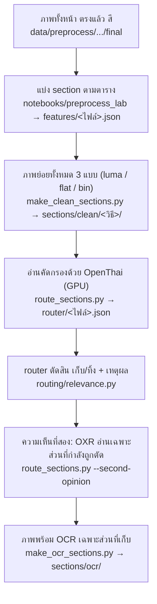

# Preprocess router: คัดภาพย่อย (section) ก่อนเข้า OCR

เอกสารอินพุตไม่มีแพทเทิร์นตายตัว ตำแหน่งบอกอะไรไม่ได้ จึงคัดส่วนของหน้าที่เกี่ยวกับข้อมูลการเงินด้วย **เนื้อหา** (ป้ายและค่า) ไม่ใช้ตำแหน่ง
ทำก่อนส่งเข้า OCR เพื่อลดข้อความรกที่ไม่ใช่ข้อมูลการเงิน (รายการประเภทเงินได้ เงื่อนไขท้ายใบ คำเตือน หมายเหตุท้ายฟอร์ม กล่องลายเซ็น)

> **หมายเหตุ (อัปเดต):** ขั้นคัดส่วนด้วย OCR ในเอกสารนี้ **ไม่อยู่ในสายงานปัจจุบัน** เพราะเตรียมภาพไม่ควรพึ่งการอ่านข้อความ (ตัวอ่านพลาดแล้วข้อมูลหายถาวร) สายงานที่ใช้อยู่และผลวัดอยู่ที่ [14-section-preprocess.md](14-section-preprocess.md) ส่วนที่ยังใช้ซ้ำได้คือขั้นโครงสร้าง (ตัดส่วนซ้ำ/กล่องครอบด้วย bbox)
> ตัวเลข 285/390 ส่วนข้างล่างมาจากผังแบบแตกช่องที่ไม่ใช้แล้ว และผลดิบถูกลบไปแล้ว
>
> **สถานะเดิม:** ใช้ได้กับชุด `finance_doc_scan` 18 ใบ ตรวจด้วยตาจริงแค่ 1307 (ภาพ overlay) ส่วนใบอื่นตรวจจากรายการส่วนที่ถูกตัดทิ้ง
> **ไม่มีเฉลย** จึงวัดความถูกต้องของการคัดไม่ได้ เกณฑ์ทุกตัวเป็นค่าทดลอง (ดูหัวข้อ "ข้อจำกัด")

## สายงาน



ผลทุกขั้นอยู่ใต้ `data/preprocess/<dataset>/<profile>/sections/` (`features/`, `clean/`, `router/`, `ocr/`) (พาธทั้งหมดมาจาก `DataPaths` ใน `paths.py`)

## กฎของ router (`src/fin_extractor/routing/relevance.py`)

ป้ายและรูปแบบค่าใช้ **ชุดเดียวกับ rules สกัด** (`rule_extractor.py`, `patterns.py`) และ alias ใน config ไม่คิดคำค้นเพิ่ม (ยกเว้นป้ายที่อยู่ ซึ่งมาจากฟิลด์ `address` ใน schema)
ตัวนี้ไม่เรียก OCR เอง รับข้อความที่ตัวอ่านคัดกรองอ่านได้เข้ามา จึงทดสอบได้โดยไม่ใช้ GPU (`tests/test_routing.py`)

**ขั้นโครงสร้าง** (ตัวแบ่ง section สร้างของซ้ำซ้อนให้)
- **ซ้ำ**: bbox ซ้อนกัน ≥ 90% → ตัดทิ้ง (ใน 18 ไฟล์ซ้ำ 80 จาก 390 ส่วน)
- **กล่องครอบ** (มีส่วนย่อยอยู่ข้างใน ≥ 2 ส่วน) → เก็บเป็น **residual**: ลบส่วนย่อยออกจากภาพ (ทาขาว) เหลือเฉพาะเนื้อหานอกส่วนย่อย
  ไม่ตัดทิ้งทั้งก้อน เพราะมีของนอกส่วนย่อย เช่น เลขที่หนังสือรับรองของ 50 ทวิ และป้าย "รวมเงินที่จ่ายและภาษีที่หักนำส่ง" (เจอจริง ตอนตัดทิ้งทั้งก้อนของสองอย่างนี้หาย)

**ขั้นเนื้อหา** (ข้อแรกที่ตรงเป็นคำตอบ) ตัดทิ้งเฉพาะข้อความร้อยแก้วยาวในภาพใหญ่ที่ไม่มีค่าและสกัดฟิลด์ไม่ได้

| ลำดับ | เงื่อนไข | ผล |
|---|---|---|
| 1 | มีค่าการเงิน (ยอดเงิน วันที่ เลขภาษี % หรือ **เศษตัวเลข**: ส่วนสั้นที่มีเลข ≥ 2 หลัก) | เก็บ (`data`) |
| 2 | rules สกัดฟิลด์ได้ ≥ 1 ฟิลด์จากข้อความของส่วนนี้ (ตัวสกัดจริงเป็นผู้ตัดสิน) | เก็บ (`contrib`) |
| 3 | ข้อความสั้น (≤ 64 ตัวอักษร ไม่นับช่องว่าง) | เก็บ (`short`) |
| 4 | ขึ้นต้นด้วยป้ายที่อยู่ | เก็บ (`label`) |
| 5 | ภาพเล็ก (≤ 25,000 px² ที่ขนาดสำเนาทำงาน) | เก็บ (`small`) |
| 6 | คอลัมน์ใต้หัวตารางรายการ | เก็บ (`companion`) |
| 7 | นอกนั้น | ตัดทิ้ง (`drop`) |

หลักคิด: **เลือกเก็บเกินดีกว่าทิ้งเกิน** ทิ้งผิดทำให้ข้อมูลหาย เก็บเกินแค่เสียเวลา OCR

### สิ่งที่ผิดระหว่างทำ (และกฎที่เพิ่มเพราะเหตุนั้น)

| เจอ | สาเหตุ | แก้ |
|---|---|---|
| ข้อความเงื่อนไขท้ายใบ 1309 ถูกนับเป็น "ป้าย" | regex ป้ายของ rules จับคำ "ลูกค้า" "สินค้า" "ส่วนลด" ในประโยคทั่วไป (ออกแบบมาใช้กับบรรทัดสั้น) | ป้ายต้องเป็นข้อความสั้น แล้วเปลี่ยนเป็นกฎข้อ 1–7 ด้านบน |
| ยอดภาษีที่หัก "60.00" ของ 50 ทวิ หาย | ฟอร์มแบ่งช่องบาท/สตางค์: `60` กับ `.00` คนละช่อง ตัวตรวจยอดต้องเห็นทศนิยมในที่เดียว | เศษตัวเลข |
| ชื่อลูกค้า "อลกค้า กฤตวิทย์ ..." (1312) ถูกตัด | ตัวอ่านอ่านป้ายเพี้ยนจึงไม่เจอป้าย | ข้อความสั้นเก็บเสมอ |
| ช่องเล็ก 280×200 ตอบประโยคไทยยาวมั่ว (1311) ถูกตัด | ภาพขนาดนั้นบรรจุข้อความยาวจริงไม่ได้ น่าจะเป็นช่องตัวเลข/ลายมือที่อ่านเพี้ยน | ภาพเล็กเก็บเสมอ |
| ภาพ overlay ส่วนที่เก็บเป็นสีเทา | ส่วนซ้ำ (bbox เดียวกัน) ถูกวาดทับ | วาดส่วนซ้ำก่อน |

## ความเห็นที่สอง (OXR)

ตัวอ่านคัดกรองภาษาไทยอ่านเพี้ยนได้ (ตัวอักษรเทาจางบนพื้นฟ้าของ 1317 ถูกอ่านเป็นประโยคมั่ว) จึงให้ **OXR** (อ่านตัวเลขดี ไม่รู้ไทย) อ่านเฉพาะส่วนที่ **กำลังถูกตัดทิ้ง**
ทั้งแบบ luma และ flat ถ้าเจอค่าการเงินให้กลับมาเก็บ ตรงกับแนวคิด "อ่านไทยก่อน ถ้าไม่ได้ค่อยใช้ตัวอื่น" โดยไม่ผสมภาษาในการอ่านครั้งเดียว

## ผลบนสแกน 18 ใบ (390 ส่วน)

| | จำนวน |
|---|---|
| เก็บ | **285** (ข้อมูล 116, ข้อความสั้น 117, ส่วนที่เหลือของกล่องครอบ 27, สกัดฟิลด์ได้ 16, คอลัมน์รายการ 4, ภาพเล็ก 4, ป้ายที่อยู่ 1) |
| ไม่เก็บ | 105 (ซ้ำ 80, ตัดทิ้งเพราะเป็นข้อความยาวไม่เกี่ยวกับการเงิน 25) |
| กู้กลับโดยความเห็นที่สอง | 1 จาก 26 ส่วนที่กำลังถูกตัด (1306 s13) |

ภาพพร้อม OCR 570 ภาพ รวม 55 MB (ภาพย่อยทั้งหมดก่อนคัด 146 MB)

ส่วนที่ถูกตัดทิ้ง 25 ส่วน (ตรวจรายการแล้ว): รายการประเภทเงินได้ของ 50 ทวิ (1307, 1311, 1321, 1323) และบางใบรวมหัวคอลัมน์, คำเตือน, "ขอรับรองว่า…",
หมายเหตุท้ายฟอร์ม, หัวสำเนา "ฉบับที่ 1 (สำหรับผู้ถูกหักภาษี…)", กล่องลายเซ็น (1317–1320, 1322), เงื่อนไขท้ายใบ, ตารางรายการส่วนที่ว่าง (1317 s02)

## ข้อจำกัด (อ่านก่อนอ้างตัวเลข)

- **ไม่มีเฉลย** วัดไม่ได้ว่าส่วนที่เก็บ/ทิ้งถูกกี่ % ที่ตรวจจริงมีแค่รายการส่วนที่ถูกตัด (ด้วยตา) ไม่ได้ตรวจทุกส่วนที่เก็บ
- ค่าทดลองทั้งหมด (`LABEL_MAX = 64`, `SMALL_AREA = 25,000`, `OVERLAP = 0.5`, `DUP_IOU = 0.9`, `CONTAINER_MIN = 2`) กำหนดจากสแกน 18 ใบนี้
  ช่องว่างระหว่างป้ายจริงที่ยาวที่สุด (62) กับข้อความไม่เกี่ยวข้องที่สั้นที่สุด (67) แคบมาก ใบประเภทอื่นอาจต้องปรับ
- ตัวอ่านคัดกรอง (OpenThai) อ่านภาพย่อยเล็กได้ไม่ดี (model card ระบุเอง) การตัดทิ้งส่วนใหญ่อาศัยข้อความที่อ่านได้ จึงมีความเสี่ยงที่ช่องข้อมูลจริงจะถูกอ่านเพี้ยนแล้วถูกตัด ภาพเล็กกับความเห็นที่สองลดความเสี่ยงนี้ แต่ไม่หมด
- กล่องครอบที่เป็นส่วน "residual" อาจมีขอบข้อความถูกตัดเล็กน้อยตรงรอยต่อกับส่วนย่อย (เห็นในภาพของ 1307)
- ยังไม่ได้เลือก "วิธีเตรียมภาพ" (luma / flat) ด้วยกฎ: ข้อมูล 5 ใบไม่พอ ตอนนี้เก็บทั้งสองแบบให้ตัวอ่านอ่านทั้งคู่แล้วรวมตัวเลข (วัดแล้วได้ 19/30 เทียบวิธีเดี่ยว 16–17/30)

## วิธีรัน

```bash
python -X utf8 scripts/make_clean_sections.py data/raw/finance_doc_scan        # ภาพย่อยทั้งหมด (CPU)
python -X utf8 scripts/route_sections.py data/raw/finance_doc_scan             # อ่านคัดกรอง (GPU ~10 นาที) + ตัดสิน
python -X utf8 scripts/route_sections.py data/raw/finance_doc_scan --second-opinion   # OXR อ่านส่วนที่กำลังถูกตัด (GPU)
python -X utf8 scripts/route_sections.py data/raw/finance_doc_scan --decide    # ปรับเกณฑ์แล้วตัดสินใหม่ (ไม่ใช้ GPU)
python -X utf8 scripts/make_ocr_sections.py data/raw/finance_doc_scan          # ภาพพร้อม OCR (CPU)
```

ผล: `data/preprocess/<dataset>/<profile>/sections/router/<ไฟล์>_overlay.png` (เขียว = เก็บ แดง = ตัดทิ้ง ม่วง = กล่องครอบ เทา = ซ้ำ) ให้ตรวจด้วยตา
และ `sections/ocr/<ไฟล์>/sNN_luma.png`, `sNN_flat.png`, `index.json` (บทบาทและเหตุผลของแต่ละส่วนที่เก็บ)
