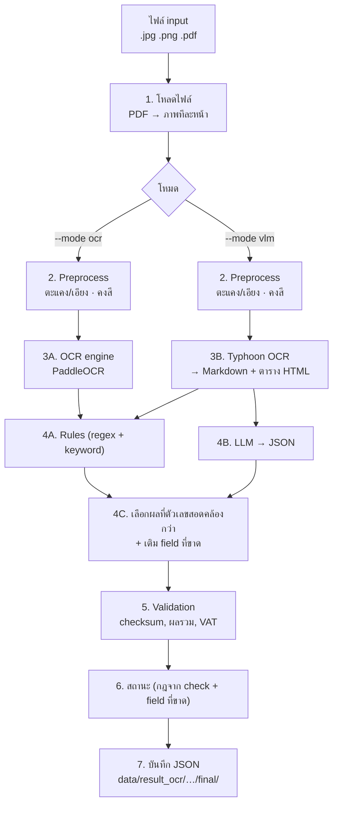

# fin-extractor: ขั้นตอนการทำงาน

ระบบรับภาพหรือ PDF ของเอกสารการเงิน (ใบกำกับภาษี ใบเสร็จ invoice) แล้วคืนผลเป็น JSON ตาม schema เดียวกันทุกครั้ง
ทำงาน 7 ขั้น โดยขั้นที่ 3–4 แยกเป็นสองทางตามโหมดที่เลือก

| ขั้น | ชื่อ | โค้ด | เอกสาร |
|---|---|---|---|
| 1 | เตรียมและโหลดไฟล์ | `io/loader.py` | [01-file-preparation.md](01-file-preparation.md) |
| 2 | Preprocess ภาพ | `preprocessing/` | [02-preprocessing.md](02-preprocessing.md) |
| 3 | อ่านข้อความ (OCR / VLM) | `ocr/`, `vlm/` | [03-text-reading.md](03-text-reading.md) |
| 4 | สกัด field | `extraction/`, `pipeline.py` | [04-extraction.md](04-extraction.md) |
| 5–7 | Validation, คะแนน, บันทึก JSON | `validation/`, `cli.py` | [05-validation-output.md](05-validation-output.md) |
| — | ติดตั้งและวิธีใช้ | | [06-usage.md](06-usage.md) |
| — | แผนรองรับลายมือและ confidence รายฟิลด์ | | [07-handwriting-and-field-confidence.md](07-handwriting-and-field-confidence.md) |
| — | หลักการระบบ, best solution และแผนอัปเดต | | [08-solution-and-roadmap.md](08-solution-and-roadmap.md) |
| — | Decision model (concept: Jev / Laya) | | [09-decision-model.md](09-decision-model.md) |
| — | OXR: ตัวอ่านเอกสารที่ลองแล้ว (หลักการ ข้อดีข้อเสีย ผลวัดภาษาไทย) | `scripts/benchmark_oxr.py`, `scripts/extract_oxr.py` | [10-oxr.md](10-oxr.md) |

## Workflow

## สองโหมดการทำงาน

| โหมด | ตัวอ่านข้อความ | ตัวสกัด field | เวลาต่อหน้า* | เหมาะกับ |
|---|---|---|---|---|
| `--mode ocr` | PaddleOCR | rules (เพิ่ม LLM ได้ด้วย `--llm on`) | ~5 วินาที (Paddle, GPU) | ใช้งานทั่วไป |
| `--mode vlm` | Typhoon OCR (`scb10x/typhoon-ocr1.5-3b`) | rules + LLM แล้วเลือกผลที่ดีกว่า | ~54 วินาที | ต้องการความแม่น เอกสารไม่มี pattern |

\* วัดจาก `data/raw/BITKUB-001.jpg` บนเครื่องที่พัฒนา

ผลกับสแกนจริง 18 ใบ (`data/raw/finance_doc_scan`) **รันใหม่เมื่อ 2026-11-11** ตามโครงข้อมูลใหม่ (ผลของรอบก่อนถูกแทนที่แล้ว ไม่มีชุด `ocr-llm`):
- **Paddle + rules** (`data/result_ocr/paddle/finance_doc_scan/final/rules/`): 15 `needs_review`, 3 `failed`, ไม่มี `auto_approved` ข้อความดิบ OCR และข้อมูลที่สกัดเหมือนรอบก่อนทุกใบ (18/18)
- **Typhoon + rules** (`data/result_ocr/typhoon/finance_doc_scan/final/rules/`): 18 `needs_review` (สกัดจากข้อความ Typhoon ชุดเดียวกับ LLM ด้วย `--reuse-raw` ไม่เรียก Typhoon ซ้ำ)
- **Typhoon + LLM** (`data/result_ocr/typhoon/finance_doc_scan/final/llm/`): 18 `needs_review` `buyer.name` มี 16 ใบ (rules ล้วน: Paddle 13, Typhoon 11)
- **ผลของ VLM/LLM ไม่ซ้ำกันทุกรอบ** (Typhoon สุ่มเล็กน้อย): ข้อความ Typhoon รอบใหม่ต่างจากรอบก่อนทั้ง 18 ใบ และรอบก่อนมี `auto_approved` 2 ใบ รอบนี้ 0 ส่วนผล rules ล้วนบนข้อความ Paddle ซ้ำได้เหมือนเดิม
- เทียบสถานะกับรอบเก่าตรง ๆ ไม่ได้: โปรไฟล์ชนิดเอกสารยังเป็นฉบับร่างและอนุมัติอัตโนมัติไม่ได้ ([08 หัวข้อ 3.6](08-solution-and-roadmap.md))
- ข้อสังเกตเรื่องค่าผิดของ LLM จากรอบ 2026-11-10 (แต่งตัวเลข แปลงปีผิด สลับผู้ขาย/ผู้ซื้อ ดู [ขั้นที่ 3](03-text-reading.md#ผลเทียบสองโหมดบนสแกนจริง-18-ใบ---mode-ocr-เทียบ---mode-vlm)) ยังไม่ได้ตรวจซ้ำกับรอบใหม่

ชุดนี้มีเอกสารหลายชนิดปนกัน (ใบกำกับภาษี, หนังสือรับรองหัก ณ ที่จ่าย, ใบสำคัญรับเงินลายมือ, ใบเสร็จศุลกากร)
และส่วนใหญ่ไม่ได้พลาดที่ preprocess ดู [ขั้นที่ 2](02-preprocessing.md#ผลวัดบนสแกนจริง)

ผลกับใบเสร็จตัวอย่าง:
- **โหมด vlm:** ได้ทุก field ถูกต้อง ผ่าน check ครบ 6 ข้อ
- **โหมด ocr (Paddle):** ได้ค่าครบ 6/6 รายการ 5/5 ผ่าน check 6/6
- **โหมด ocr (Tesseract, เลิกใช้แล้ว):** ยอดสรุปถูก แต่อ่านรายการได้ 2/5 (`needs_review`) — ผลเก่า ก่อนเหลือ Paddle ตัวเดียว

ไฟล์ที่ควบคุมลำดับทั้งหมดคือ `src/fin_extractor/pipeline.py` ค่าทุกตัวอ่านจาก `configs/default.yaml`

## หลักการออกแบบ

### 1. ทุกไฟล์ถือเป็นภาพ แล้วอ่านด้วย OCR

ไม่ว่าจะเป็นรูปถ่าย ภาพสแกน หรือ PDF ทุกอย่างถูกแปลงเป็นภาพทีละหน้าก่อน แล้วอ่านด้วย OCR/VLM
เป็นเส้นทางเดียว **รวมถึง PDF ที่มีข้อความฝังอยู่แล้ว (text layer)**

| ได้ | เสีย |
|---|---|
| เส้นทางเดียว ไม่ต้องแยกว่า PDF แบบไหน | PDF จากโปรแกรมช้ากว่าที่ควร (OCR แทนการอ่านข้อความตรง ๆ) |
| ไม่มีความเสี่ยงจาก text layer ที่เพี้ยน ([ดูขั้นที่ 1](01-file-preparation.md#pdf-ที่ข้างในเป็นภาพ)) | ความแม่นของ PDF จากโปรแกรมขึ้นกับ OCR ทั้งที่ข้อความจริงมีอยู่แล้ว |
| ทุกหน้าผ่าน preprocess / OCR / validation ชุดเดียวกัน | |

### 2. ทุก engine คืนผลรูปเดียวกัน

OCR ทุกตัวคืน `OCRResult` และผลสุดท้ายทุกเส้นทางคืน `ExtractionResult` ตาม schema
ระบบปลายทางไม่ต้องรู้ว่าข้างในใช้ engine ไหน และสลับ engine ได้โดยไม่ต้องแก้ขั้นอื่น

### 3. ตัวเลขต้องตรวจกันเองได้

เอกสารการเงินมีความสัมพันธ์ของตัวเลขในตัว (ก่อนภาษี + ภาษี = ยอดรวม) ระบบใช้ความสัมพันธ์นี้
จับ OCR ที่อ่านผิด **โดยไม่ต้องมีคำตอบที่ถูกมาเทียบ** และใช้ตัดสินว่าผลจาก rules หรือ LLM น่าเชื่อกว่า

### 4. ไม่เดาค่า

ไม่เจอให้ตอบ `null` ดีกว่าเดาค่าที่ดูเหมือนใช้ได้ เพราะคนตรวจจะปล่อยผ่าน
check ที่ข้อมูลไม่พอก็คืน `null` ไม่นับเป็นผ่านหรือไม่ผ่าน
