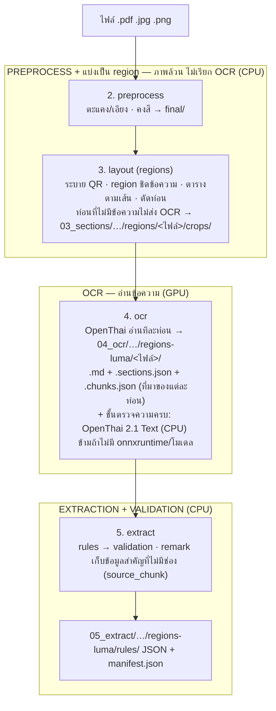

# fin-extractor: ขั้นตอนการทำงาน

ระบบรับภาพหรือ PDF ของเอกสารการเงิน (ใบกำกับภาษี ใบเสร็จ invoice) แล้วคืนผลเป็น JSON ตาม schema เดียวกันทุกครั้ง
เลขของเอกสารตรงกับเลขขั้นและโฟลเดอร์ข้อมูล (`data/01_input` … `data/05_extract`) เลขเดียวกัน = part เดียวกัน
คำสั่ง `preprocess` · `sections` · `extract` · `regions` · `compare` · `schema` ดู [00-setup-and-usage.md](00-setup-and-usage.md)

| ขั้น | เรื่อง | โค้ด | เอกสาร |
|---|---|---|---|
| — | ติดตั้งและวิธีใช้ (คำสั่ง, โครงเก็บผล, สคริปต์) | | [00-setup-and-usage.md](00-setup-and-usage.md) |
| — | หน้าเว็บลอง OCR ทีละขั้น (อัปโหลด 1 ไฟล์ ดูภาพ/ผลทุกขั้นจนได้ JSON) | `scripts/demo/` | [00-setup-and-usage.md](00-setup-and-usage.md) (หัวข้อ "หน้าเว็บลอง OCR ทีละขั้น") |
| 1 | เตรียมและโหลดไฟล์ | `io/loader.py` | [01-input.md](01-input.md) |
| 2 | Preprocess ภาพทั้งหน้า (ทิศ เอียง ขอบ) | `preprocessing/` | [02-preprocessing.md](02-preprocessing.md) |
| 3 | **ค่าตั้งต้นของ flow หลัก:** แบ่ง region / ตาราง → ช่อง → key/value + ระบาย QR (คำสั่ง `regions` · `sections` ใช้ผังนี้ตั้งแต่ 2026-11-24 ผลวัดรอบก่อนแย่กว่าผัง section ต้องวัดซ้ำกับเฉลย) | `sections/regions/`, `configs/regions/` | [03-regions.md](03-regions.md) |
| 3 | แบบเดิม (ไม่ใช่ค่าตั้งต้นแล้ว): แบ่งหน้าเป็น section แถบเต็มหน้า (`sections --layout sections`) | `sections/` | [03-sections.md](03-sections.md) |
| 4 | อ่านข้อความ: ตัวอ่านทุก engine ทางเดียวกัน (OpenThai 2.0 · OpenThai 2.1 Markdown/Text · Typhoon · Paddle) | `readers/`, `sections/read.py` | [04-ocr.md](04-ocr.md) |
| 4 | OpenThai 2.0 OCR: ตัวอ่านของ flow หลัก (หลักการ การต่อเข้า ผลวัด 18 ใบ) + OpenThai 2.1 Markdown/Text เทียบกัน + ชั้นตรวจความครบ (OpenThai Text ตรวจ + แนบข้อความเสริม §7) | `readers/openthai.py`, `readers/openthai_text.py`, `sections/coverage.py` | [04-openthai-ocr.md](04-openthai-ocr.md) |
| 5 | สกัด field: 5A rules · 5B LLM · 5C เลือกผล · 5D hybrid | `extraction/`, `pipeline.py` | [05-extraction.md](05-extraction.md) |
| 5 | 5E validation · 5F สถานะ · 5G บันทึก JSON | `validation/`, `cli.py` | [05-validation-output.md](05-validation-output.md) |
| — | หลักการระบบ, data contract (schema), best solution และ roadmap | `schema.py` | [06-design-and-roadmap.md](06-design-and-roadmap.md) |
| — | สถานะเทียบขอบเขตงาน 5 เฟส, ความเห็นต่อไอเดีย pipeline และแผนต่อ (เน้น preprocess → OCR → post-process) | | [10-project-status-and-plan.md](10-project-status-and-plan.md) |

**draft** (แผน/concept ยังไม่มีโค้ด)

| เรื่อง | เอกสาร |
|---|---|
| แผนรองรับลายมือและ confidence รายฟิลด์ | [draft-07-handwriting-and-field-confidence.md](draft-07-handwriting-and-field-confidence.md) |
| Decision model (concept: Jev / Laya) | [draft-08-decision-model.md](draft-08-decision-model.md) |
| แผน decision engine กับ confidence รายฟิลด์ (ความเห็น ข้อแย้ง ตัวชี้วัด) | [draft-09-decision-engine-confidence-plan.md](draft-09-decision-engine-confidence-plan.md) |
| แผน implement OpenThai-SystemOne (decision model ภาษาไทย รันในเครื่อง) | [draft-11-openthai-systemone-plan.md](draft-11-openthai-systemone-plan.md) |

OXR ลองแล้วอ่านภาษาไทยไม่ได้ จึงลบออก (โค้ดและบันทึกผลอยู่ในประวัติ git ถึง commit f6cc6eb)

## Workflow

**flow หลักสำหรับสแกนจริง** (`python -m fin_extractor sections <input>` = ห้าขั้นนี้ในคำสั่งเดียว ข้ามขั้นที่ผลยังใช้ได้ ไม่ใช้ OCR คัดส่วน) อยู่ในแผนภาพถัดไป ทุก engine (`--engine openthai|openthai21|openthai-text|typhoon|paddle`) ใช้ flow นี้ **ห้ามอ่านทั้งหน้า** (ไม่มีคำสั่งอ่านทั้งหน้าแล้ว)

ผังค่าตั้งต้นคือ regions ตั้งแต่ 2026-11-24 ([03-regions.md](03-regions.md)) ผลวัดเดิมของผัง section แบบเดิม (`--layout sections` ภาพ luma ขาดรวม 14 · flat 16 · bin 28 · regions 20 ไม่มีเฉลย) อยู่ใน [03-sections.md](03-sections.md) — ต้องวัดซ้ำกับเฉลย

### อ่านทั้งหน้าแบบเดิม (ลบแล้ว เก็บไว้เป็นประวัติ)

รุ่นก่อนมีสองโหมดที่อ่านทั้งหน้า (Paddle ทั้งหน้า + rules และ Typhoon ทั้งหน้า + rules/LLM เลือกผลที่ดีกว่า) ถอดออกแล้วเพราะห้ามอ่านทั้งหน้า
คำสั่ง ตัวเลือก และโฟลเดอร์ผลของรุ่นนั้นไม่มีในโค้ดแล้ว ผลวัดและข้อสังเกตเก็บเป็นประวัติใน [04-ocr.md](04-ocr.md)
สถานะของรอบสุดท้าย (สแกนจริง 18 ใบ รัน 2026-11-11 ไม่มีเฉลย): Paddle + rules 15 `check` / 3 `incomplete` · Paddle + LLM 15 `check` / 1 `incomplete` / 2 `ready` · Typhoon + rules 18 `check` · Typhoon + LLM 18 `check`

ชุดสแกนจริง 18 ใบมีเอกสารหลายชนิดปนกัน (ใบกำกับภาษี, หนังสือรับรองหัก ณ ที่จ่าย, ใบสำคัญรับเงินลายมือ, ใบเสร็จศุลกากร)
และส่วนใหญ่ไม่ได้พลาดที่ preprocess ดู [ขั้นที่ 2](02-preprocessing.md#ผลวัดบนสแกนจริง)

ลำดับขั้นของ flow หลักอยู่ที่ `cmd_sections` ใน `src/fin_extractor/cli.py` กับ `src/fin_extractor/sections/flow.py` ส่วน `src/fin_extractor/pipeline.py` (`FinanceOCRPipeline`) สกัด + ตรวจ + ตัดสินสถานะจากข้อความ ไม่อ่านภาพ ค่าอ่านจาก `configs/default.yaml` (ผัง regions: `configs/regions/`)

## หลักการออกแบบ

### 1. ทุกไฟล์ถือเป็นภาพ แล้วอ่านด้วย OCR

ไม่ว่าจะเป็นรูปถ่าย ภาพสแกน หรือ PDF ทุกอย่างถูกแปลงเป็นภาพทีละหน้าก่อน แล้วอ่านด้วย OCR/VLM
เป็นเส้นทางเดียว **รวมถึง PDF ที่มีข้อความฝังอยู่แล้ว (text layer)**

| ได้                                                                                                                                                  | เสีย                                                                                                                   |
| ------------------------------------------------------------------------------------------------------------------------------------------------------- | -------------------------------------------------------------------------------------------------------------------------- |
| เส้นทางเดียว ไม่ต้องแยกว่า PDF แบบไหน                                                                                    | PDF จากโปรแกรมช้ากว่าที่ควร (OCR แทนการอ่านข้อความตรง ๆ)                       |
| ไม่มีความเสี่ยงจาก text layer ที่เพี้ยน ([ดูขั้นที่ 1](01-input.md#pdf-ที่ข้างในเป็นภาพ)) | ความแม่นของ PDF จากโปรแกรมขึ้นกับ OCR ทั้งที่ข้อความจริงมีอยู่แล้ว |
| ทุกหน้าผ่าน preprocess / OCR / validation ชุดเดียวกัน                                                                             |                                                                                                                            |

### 2. ทุก engine คืนผลรูปเดียวกัน

ตัวอ่านทุกตัวคืน `ReadResult` (`readers/base.py`) และผลสุดท้ายทุกเส้นทางคืน `ExtractionResult` ตาม schema
ระบบปลายทางไม่ต้องรู้ว่าข้างในใช้ engine ไหน และสลับ engine ได้โดยไม่ต้องแก้ขั้นอื่น

### 3. ตัวเลขต้องตรวจกันเองได้

เอกสารการเงินมีความสัมพันธ์ของตัวเลขในตัว (ก่อนภาษี + ภาษี = ยอดรวม) ระบบใช้ความสัมพันธ์นี้
จับ OCR ที่อ่านผิด **โดยไม่ต้องมีคำตอบที่ถูกมาเทียบ** และใช้ตัดสินว่าผลจาก rules หรือ LLM น่าเชื่อกว่า

### 4. ไม่เดาค่า

ไม่เจอให้ตอบ `null` ดีกว่าเดาค่าที่ดูเหมือนใช้ได้ เพราะคนตรวจจะปล่อยผ่าน
check ที่ข้อมูลไม่พอก็คืน `null` ไม่นับเป็นผ่านหรือไม่ผ่าน
