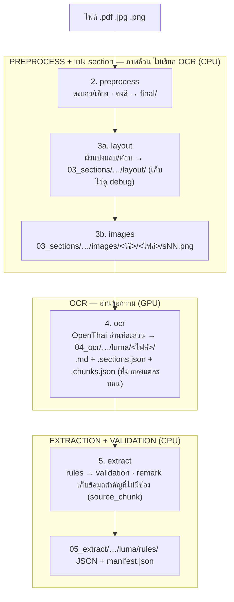
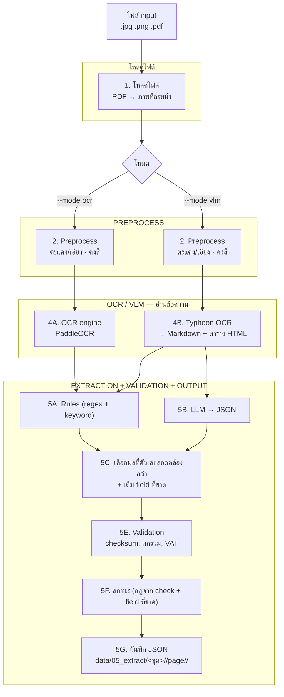

# fin-extractor: ขั้นตอนการทำงาน

ระบบรับภาพหรือ PDF ของเอกสารการเงิน (ใบกำกับภาษี ใบเสร็จ invoice) แล้วคืนผลเป็น JSON ตาม schema เดียวกันทุกครั้ง
เลขของเอกสารตรงกับเลขขั้นและโฟลเดอร์ข้อมูล (`data/01_input` … `data/05_extract`) เลขเดียวกัน = part เดียวกัน
คำสั่ง `preprocess` · `ocr` · `extract` · `sections` · `compare` · `schema` ดู [00-setup-and-usage.md](00-setup-and-usage.md)

| ขั้น | เรื่อง | โค้ด | เอกสาร |
|---|---|---|---|
| — | ติดตั้งและวิธีใช้ (คำสั่ง, โครงเก็บผล, สคริปต์) | | [00-setup-and-usage.md](00-setup-and-usage.md) |
| 1 | เตรียมและโหลดไฟล์ | `io/loader.py` | [01-input.md](01-input.md) |
| 2 | Preprocess ภาพทั้งหน้า (ทิศ เอียง ขอบ) | `preprocessing/` | [02-preprocessing.md](02-preprocessing.md) |
| 3 | แบ่งหน้าเป็น section ก่อน OCR (flow หลัก, ข้ามได้ถ้าอ่านทั้งหน้า) | `sections/` | [03-sections.md](03-sections.md) |
| 4 | อ่านข้อความ: 4A PaddleOCR · 4B VLM (Typhoon / OpenThai) | `ocr/`, `vlm/`, `sections/read.py` | [04-ocr.md](04-ocr.md) |
| 4 | OpenThai 2.0 OCR: ตัวอ่านของ flow หลัก (หลักการ การต่อเข้า ผลวัด 18 ใบ) | `vlm/openthai_ocr.py` | [04-openthai-ocr.md](04-openthai-ocr.md) |
| 5 | สกัด field: 5A rules · 5B LLM · 5C เลือกผล · 5D hybrid | `extraction/`, `pipeline.py` | [05-extraction.md](05-extraction.md) |
| 5 | 5E validation · 5F สถานะ · 5G บันทึก JSON | `validation/`, `cli.py` | [05-validation-output.md](05-validation-output.md) |
| — | หลักการระบบ, data contract (schema), best solution และ roadmap | `schema.py` | [06-design-and-roadmap.md](06-design-and-roadmap.md) |

**draft** (แผน/concept ยังไม่มีโค้ด)

| เรื่อง | เอกสาร |
|---|---|
| แผนรองรับลายมือและ confidence รายฟิลด์ | [draft-07-handwriting-and-field-confidence.md](draft-07-handwriting-and-field-confidence.md) |
| Decision model (concept: Jev / Laya) | [draft-08-decision-model.md](draft-08-decision-model.md) |
| แผน decision engine กับ confidence รายฟิลด์ (ความเห็น ข้อแย้ง ตัวชี้วัด) | [draft-09-decision-engine-confidence-plan.md](draft-09-decision-engine-confidence-plan.md) |

**archive** (ลองแล้วไม่ใช้ เก็บไว้เป็นหลักฐานผลวัด)

| เรื่อง | เอกสาร |
|---|---|
| OXR: ตัวอ่านเอกสารที่อ่านไทยไม่ได้ (โค้ด `scripts/ocr/oxr/`, `vlm/oxr_local.py`) | [archive/oxr.md](archive/oxr.md) |

## Workflow

**flow หลักสำหรับสแกนจริง** (`python -m fin_extractor sections <input>` = ห้าขั้นนี้ในคำสั่งเดียว ข้ามขั้นที่ผลยังใช้ได้ ไม่ใช้ OCR คัดส่วน) อยู่ในแผนภาพถัดไป ทุก engine (`--engine openthai|typhoon|paddle|oxr`) ใช้ flow นี้ **ห้ามอ่านทั้งหน้า** (คำสั่ง `ocr` ปิดแล้ว) ส่วนแผนภาพที่สองเป็นบันทึกของสองโหมดเดิมที่อ่านทั้งหน้า (ไม่ใช้แล้ว)

ค่าตั้งต้น `luma` (ฟิลด์ที่ขาดรวม 18 ใบ: luma 14 · flat 16 · bin 28 ไม่มีเฉลย) รายละเอียดและข้อจำกัดใน [03-sections.md](03-sections.md)

### สองโหมดเดิม (อ่านทั้งหน้า ปิดแล้ว เก็บไว้เป็นประวัติ)

## สองโหมดเดิม (ปิดแล้ว ตัวเลขเป็นบันทึกของรุ่นที่อ่านทั้งหน้า)

| โหมด       | ตัวอ่านข้อความ               | ตัวสกัด field                                 | เวลาต่อหน้า*       | เหมาะกับ                                              |
| -------------- | ------------------------------------------ | ---------------------------------------------------- | ----------------------------- | ------------------------------------------------------------- |
| `--mode ocr` | PaddleOCR                                  | rules (เพิ่ม LLM ได้ด้วย `--llm on`)   | ~5 วินาที (Paddle, GPU) | ใช้งานทั่วไป                                      |
| `--mode vlm` | Typhoon OCR (`scb10x/typhoon-ocr1.5-3b`) | rules + LLM แล้วเลือกผลที่ดีกว่า | ~54 วินาที              | ต้องการความแม่น เอกสารไม่มี pattern |

\* วัดจาก `data/01_input/BITKUB-001.jpg` บนเครื่องที่พัฒนา

ผลกับสแกนจริง 18 ใบ (`data/01_input/finance_doc_scan`) **รันใหม่เมื่อ 2026-11-11** ตามโครงข้อมูลใหม่ (ผลของรอบก่อนถูกแทนที่แล้ว) หมายเหตุ: ตอนนี้โฟลเดอร์ผล `paddle/` และ `typhoon/` ไม่อยู่ใน `data/` แล้ว (มีเฉพาะ `openthai/` ของ flow หลัก) ตัวเลขข้างล่างเป็นบันทึกของรอบนั้น สร้างใหม่ได้ด้วย `extract`:

- **Paddle + rules** (`data/05_extract/finance_doc_scan/paddle/page/rules/`): 15 `needs_review`, 3 `failed`, ไม่มี `auto_approved` ข้อความดิบ OCR และข้อมูลที่สกัดเหมือนรอบก่อนทุกใบ (18/18)
- **Paddle + LLM** (`data/05_extract/finance_doc_scan/paddle/page/llm/`): 15 `needs_review`, 1 `failed`, 2 `auto_approved` (001313, 001314 ซึ่งเป็น Tax Invoice อังกฤษใบเดียวกัน) `buyer.name` มี 17 ใบ สกัดจากข้อความ Paddle ชุดเดียวกับ Paddle + rules ด้วย `--llm on --reuse-raw` (ไม่เรียก Paddle ซ้ำ) รัน 2026-11-11
- **Typhoon + rules** (`data/05_extract/finance_doc_scan/typhoon/page/rules/`): 18 `needs_review` (สกัดจากข้อความ Typhoon ชุดเดียวกับ LLM ด้วย `--reuse-raw` ไม่เรียก Typhoon ซ้ำ)
- **Typhoon + LLM** (`data/05_extract/finance_doc_scan/typhoon/page/llm/`): 18 `needs_review` `buyer.name` มี 16 ใบ (rules ล้วน: Paddle 13, Typhoon 11)
- **ผลของ VLM/LLM ไม่ซ้ำกันทุกรอบ** (Typhoon สุ่มเล็กน้อย): ข้อความ Typhoon รอบใหม่ต่างจากรอบก่อนทั้ง 18 ใบ และรอบก่อนมี `auto_approved` 2 ใบ รอบนี้ 0 ส่วนผล rules ล้วนบนข้อความ Paddle ซ้ำได้เหมือนเดิม
- เทียบสถานะกับรอบเก่าตรง ๆ ไม่ได้: โปรไฟล์ชนิดเอกสารยังเป็นฉบับร่างและอนุมัติอัตโนมัติไม่ได้ ([06 หัวข้อ 3.6](06-design-and-roadmap.md))
- ข้อสังเกตเรื่องค่าผิดของ LLM จากรอบ 2026-11-10 (แต่งตัวเลข แปลงปีผิด สลับผู้ขาย/ผู้ซื้อ ดู [ขั้นที่ 4](04-ocr.md#ผลเทียบสองโหมดบนสแกนจริง-18-ใบ---mode-ocr-เทียบ---mode-vlm)) ยังไม่ได้ตรวจซ้ำกับรอบใหม่

ชุดนี้มีเอกสารหลายชนิดปนกัน (ใบกำกับภาษี, หนังสือรับรองหัก ณ ที่จ่าย, ใบสำคัญรับเงินลายมือ, ใบเสร็จศุลกากร)
และส่วนใหญ่ไม่ได้พลาดที่ preprocess ดู [ขั้นที่ 2](02-preprocessing.md#ผลวัดบนสแกนจริง)

ผลกับใบเสร็จตัวอย่าง:

- **โหมด vlm:** ได้ทุก field ถูกต้อง ผ่าน check ครบ 6 ข้อ
- **โหมด ocr (Paddle):** ได้ค่าครบ 6/6 รายการ 5/5 ผ่าน check 6/6

ไฟล์ที่ควบคุมลำดับทั้งหมดคือ `src/fin_extractor/pipeline.py` ค่าทุกตัวอ่านจาก `configs/default.yaml`

## หลักการออกแบบ

### 1. ทุกไฟล์ถือเป็นภาพ แล้วอ่านด้วย OCR

ไม่ว่าจะเป็นรูปถ่าย ภาพสแกน หรือ PDF ทุกอย่างถูกแปลงเป็นภาพทีละหน้าก่อน แล้วอ่านด้วย OCR/VLM
เป็นเส้นทางเดียว **รวมถึง PDF ที่มีข้อความฝังอยู่แล้ว (text layer)**

| ได้                                                                                                                                                  | เสีย                                                                                                                   |
| ------------------------------------------------------------------------------------------------------------------------------------------------------- | -------------------------------------------------------------------------------------------------------------------------- |
| เส้นทางเดียว ไม่ต้องแยกว่า PDF แบบไหน                                                                                    | PDF จากโปรแกรมช้ากว่าที่ควร (OCR แทนการอ่านข้อความตรง ๆ)                       |
| ไม่มีความเสี่ยงจาก text layer ที่เพี้ยน ([ดูขั้นที่ 1](01-input.md#pdf-ที่ข้างในเป็นภาพ)) | ความแม่นของ PDF จากโปรแกรมขึ้นกับ OCR ทั้งที่ข้อความจริงมีอยู่แล้ว |
| ทุกหน้าผ่าน preprocess / OCR / validation ชุดเดียวกัน                                                                             |                                                                                                                            |

### 2. ทุก engine คืนผลรูปเดียวกัน

OCR ทุกตัวคืน `OCRResult` และผลสุดท้ายทุกเส้นทางคืน `ExtractionResult` ตาม schema
ระบบปลายทางไม่ต้องรู้ว่าข้างในใช้ engine ไหน และสลับ engine ได้โดยไม่ต้องแก้ขั้นอื่น

### 3. ตัวเลขต้องตรวจกันเองได้

เอกสารการเงินมีความสัมพันธ์ของตัวเลขในตัว (ก่อนภาษี + ภาษี = ยอดรวม) ระบบใช้ความสัมพันธ์นี้
จับ OCR ที่อ่านผิด **โดยไม่ต้องมีคำตอบที่ถูกมาเทียบ** และใช้ตัดสินว่าผลจาก rules หรือ LLM น่าเชื่อกว่า

### 4. ไม่เดาค่า

ไม่เจอให้ตอบ `null` ดีกว่าเดาค่าที่ดูเหมือนใช้ได้ เพราะคนตรวจจะปล่อยผ่าน
check ที่ข้อมูลไม่พอก็คืน `null` ไม่นับเป็นผ่านหรือไม่ผ่าน
