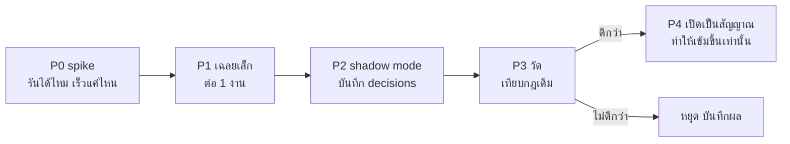

# แผน implement: OpenThai-SystemOne เป็น decision model

> สถานะ: **แผน ยังไม่มีโค้ด** เขียน 2026-11-24 ต่อจาก [draft-08-decision-model.md](draft-08-decision-model.md) (concept: Jev / Laya) และ
> [draft-09-decision-engine-confidence-plan.md](draft-09-decision-engine-confidence-plan.md) (ข้อแย้ง ตัวชี้วัด แผนเป็นขั้น)
> ข้อมูลโมเดลทั้งหมดมาจาก model card ทางการ (หัวข้อ "แหล่งข้อมูล") ยังไม่ได้รันโมเดลจริงในเครื่องนี้
> ไม่มีตัวเลขเกณฑ์ในเอกสารนี้โดยตั้งใจ ทุกเกณฑ์ต้องมาจากผลวัดในขั้น P3
>
> **ปรับแผน 2026-11-26** (branch `exp/decision-engine`) หลังงานวันเดียวกัน: schema 4.0 ใช้ `review` แทน `field_evidence` ·
> ผัง regions ไม่ใช้ template/ชื่อไฟล์แล้ว ทำให้โปรไฟล์ของ 18 ใบถูกทุกใบ (T1 แบบเดิมไม่มีที่ให้ดีขึ้น ดูหัวข้อ 4 และ 6) ·
> ได้รายการชนิดเอกสารจากผู้ใช้เป็นเฉลยของ T1 · ผู้ใช้อนุญาตให้โหลดโมเดล (ดูหัวข้อ 9)

## 0. สรุป

1. **OpenThai-SystemOne (iApp) เป็นตัวเลือกที่สามที่ตรงโจทย์ draft-08 มากที่สุด:** decision model แบบเดียวกับ Jev (คำถาม choice / score / yes-no คืนความน่าจะเป็น ไม่สร้างข้อความ) แต่ **open-weight Apache-2.0 รันในเครื่องได้** และ **ฝึกภาษาไทยต่อ ~5B token** พร้อมผลวัดชุดไทยที่เปิดเผย
2. ปิดข้อแย้งของ draft-09 ได้สองข้อ: ข้อ 3 (ภาษาไทยไม่มีหลักฐาน) และข้อจำกัดเรื่องส่งข้อมูลออกนอกเครื่อง (Jev) **ข้อแย้งที่ยังอยู่ครบ:** ข้อ 1 โมเดลไม่เห็นภาพ ข้อ 2 ความน่าจะเป็นยังไม่ calibrate กับงานของเรา และข้อ 6 งานที่กฎทำได้ให้ใช้กฎ
3. **ไม่ใช้กับเลขคณิตหรือการอ่านภาพ** (model card ระบุเองว่าไม่ใช่ reasoning model ไม่ทำเลขคณิต) ตัวตรวจผลรวม/VAT/checksum ยังเป็นกฎเหมือนเดิม
4. งานแรกที่เสนอ: **จำแนกชนิดเอกสารตามที่พิมพ์บนเอกสาร** (เสี่ยงต่ำ มีเฉลยจากผู้ใช้แล้ว มีกฎเดิมให้เทียบ) ตามด้วย **ตรวจความสมเหตุสมผลของค่า** แบบทำให้เข้มขึ้นได้อย่างเดียว
5. ทำเป็นขั้นมีจุดหยุดแบบ draft-09: spike → เฉลยเล็ก ๆ → shadow mode → วัด → เปิดใช้ ถ้าไม่ดีกว่ากฎเดิมก็หยุด

## 1. ตัวโมเดล (จาก model card)

| | |
|---|---|
| ผู้พัฒนา / สัญญาอนุญาต | iApp (โครงการ OpenThai เดิมชื่อ OpenThaiGPT) · Apache-2.0 · ระบุว่าได้แรงบันดาลใจจาก Jev แต่ไม่เกี่ยวข้องกับ TypeSafe AI |
| ขนาด / ฐาน | 0.8B · text tower ของ Qwen3.5-0.8B-Base (ตัด vision ออก) ฝึกต่อด้วยข้อความไทย ~5B token · LM head ถูกแทนด้วย decision head 256 ช่อง (ช่อง 255 = **abstain**) |
| input / output | **ข้อความล้วน** (state เป็นข้อความหรือ JSON) · คืนคำตอบ + ความน่าจะเป็นของทุกตัวเลือก + confidence ไม่สร้าง token |
| ชนิดคำถาม | `choice` (ไม่เกิน 255 ตัวเลือก) · `score` (2–10 ระดับ คืนค่าถ่วงความน่าจะเป็น) · `noul` (yes/no คืน p(yes)) |
| context | การ์ดระบุ 64k token ต่อคำขอ |
| น้ำหนัก | BF16 `model.safetensors` 1.51 GB · GGUF Q8_0 / Q4_K_M / BF16 อยู่ใน repo `iapp/OpenThai-SystemOne-Ollama` |
| วิธีรัน | แพ็กเกจ `openthai-systemone` (`SystemOneClient` / server `POST /v1/systemone`) · transformers `trust_remote_code=True` · Ollama ≥ 0.35 (`/v1/systemone`) |
| calibration | temperature scaling (Brier) การ์ดบอกให้เชื่อ confidence ได้ **บนชุดไทยและงาน NLI/topic** ECE ชุดไทย ≤ 0.05 · ชุดอังกฤษ median 0.15 |
| ความเร็วที่อ้าง | ~40 ms บน H100 · 154 ms บน MacBook M3 Max (คำถาม 3 ข้อ) **ไม่ได้ระบุ VRAM/CPU** |

ผลวัดของผู้พัฒนา (zero-shot, ความแม่น) ที่เกี่ยวกับเรา: MASSIVE-th intent 60 ทาง 90.0 · Prachathai topic (choice) 98.1 · XNLI-th 77.1 · SIB-200 ไทย 77.9 ·
**จุดอ่อน:** banking77 (77 ทาง อังกฤษ) 45.4 · Wisesight 51.6 · summary relevance 21.7 · ไม่มีชุดเอกสารการเงิน/บัญชี/ภาษีเลย
ตัวเลขทั้งหมดเป็นของผู้พัฒนาเองบน benchmark ทั่วไป ไม่บอกว่าจะทำได้กับเอกสารของเรา (เหตุผลเดียวกับ draft-08 หัวข้อ 2)

## 2. ทำไมน่าสนใจสำหรับโปรเจกต์นี้

| ประเด็นใน draft-08/09 | OpenThai-SystemOne |
|---|---|
| ข้อมูลออกนอกเครื่องไม่ได้ (Jev ตกไป) | รันในเครื่องได้ทั้ง transformers และ Ollama |
| ภาษาไทยไม่มีหลักฐาน (Laya) | ฝึกไทยต่อ มีผลวัดชุดไทยแยกให้ดู |
| ต้องมีทางถอยเมื่อโมเดลตอบไม่ได้ | มีช่อง **abstain** ในตัว (ตรงกับ HITL: ไม่แน่ใจ = ส่งคน) |
| รูปแบบคำถาม Choice / Score / Yes-No ที่ draft-08 ออกแบบไว้ | ตรงกันทุกชนิด (API แบบเดียวกับ Jev) ออกแบบใน draft-08 ใช้ได้เลย |
| ขนาดต้องพอเครื่อง (RTX 4050 6 GB, เคยดับตอนงาน GPU หนัก) | 0.8B · น้ำหนัก 1.5 GB · มี Q4/Q8 ให้ลองบน CPU ผ่าน Ollama (ใช้อยู่แล้วกับ typhoon) |

## 3. ข้อจำกัดที่กำหนดว่าใช้ทำอะไรไม่ได้

- **ไม่เห็นภาพ:** บอกไม่ได้ว่า OCR อ่าน "1" เป็น "7" ตัดสินได้แค่ความสมเหตุสมผลของค่าที่สกัดแล้ว (draft-09 ข้อแย้ง 1)
- **ไม่ทำเลขคณิต/หลายขั้น:** ห้ามใช้แทน `validation/checks.py`
- **ลำดับตัวเลือกมีผล:** การ์ดวัดไว้ (v0.2) ว่าคำตอบพลิก 5–12% เมื่อสลับลำดับตัวเลือก (≤ 10 ตัวเลือก) มีโหมด `order_invariant` / `permutations` ลดปัญหา
- **รุ่น Ollama ต่างจากรุ่นหลัก:** รองรับ 2–26 ตัวเลือก **ไม่มี order-invariant และไม่มี abstain** ถ้าจะใช้ abstain ต้องใช้แพ็กเกจ Python / transformers
- **งานจำแนกละเอียดหลายหมวดยังอ่อน** (banking77 45.4) การแนะนำรหัสบัญชีที่มีหลายสิบหมวดจึงต้องวัดก่อน ไม่ควรเป็นงานแรก
- **confidence calibrate กับชุดของผู้พัฒนา ไม่ใช่ของเรา:** ห้ามตั้งเกณฑ์อย่าง "p < x ให้แดง" จนกว่าจะวัด (กฎข้อ 3 ของ draft-08)
- ข้อความในเอกสารไว้ใจไม่ได้ (prompt injection): ป้อนฟิลด์ที่สกัดแล้ว และถ้าจำเป็นต้องใช้ข้อความ ให้ป้อนเฉพาะบรรทัดที่เกี่ยวข้อง ไม่ป้อนทั้งหน้า

## 4. งานที่เสนอ (เรียงจากเสี่ยงน้อย)

ทุกงานเป็น **คำแนะนำหรือสัญญาณที่ทำให้เข้มขึ้นได้อย่างเดียว** ไม่เปลี่ยนค่าที่สกัด ไม่ผ่อนระดับหลักฐาน ไม่ข้ามนักบัญชี

| # | งาน | คำถาม | state ที่ป้อน | เทียบกับอะไร (baseline) | ปัญหาจริงที่เจอ |
|---|---|---|---|---|---|
| T1 | จำแนกชนิดเอกสาร | `choice` สองชุดตัวเลือก: (ก) ชนิดตามที่พิมพ์บนเอกสาร จากรายการของผู้ใช้ · (ข) โปรไฟล์ใน `document_types` + `generic` | ข้อความท่อนแรกของหน้า (ท่อน `s00` ใน `.md` = region บนสุดของผัง เป็นขอบเขตตามโครงหน้า ไม่ใช่จำนวนบรรทัดที่เลือกเอง) + ฟิลด์ที่สกัดได้ ไม่ป้อนทั้งหน้า | (ก) `document_type` ของ rules (ตอบได้ 4 ค่า) · (ข) `doctypes.classify` | (ก) rules: 1312 ไม่ได้ชนิด · 1317/1318 ได้ tax_invoice แต่เอกสารเป็นใบเสร็จรับเงิน · ส่วนใหญ่ได้ครึ่งเดียวของชนิดรวม · (ข) หลังเลิก template โปรไฟล์ของ 18 ใบถูกทุกใบ จึงวัดได้แค่ว่าโมเดลไม่แย่กว่า |
| T2 | ค่าสมเหตุสมผลไหม | `noul` ต่อฟิลด์ข้อความ เช่น "ค่านี้เป็นชื่อบริษัท/บุคคลไหม" · "ผู้ซื้อกับผู้ขายสลับกันไหม" | ชื่อฟิลด์ + ค่า (+ ค่าฝั่งตรงข้ามสำหรับคำถามสลับบทบาท) | ระดับหลักฐานเดิม (`unverified`) | `vendor.name` ของ 50 ทวิ ติดข้อความคำแนะนำของฟอร์ม: 1321 = "(ให้ระบุว่าเป็น บุคคล นิติบุคคล บริษัท สมาคม หรือคณะบุคคล)" ทั้งช่อง · 1307/1323 = ชื่อบริษัทต่อด้วยข้อความเดียวกัน ทั้งหมดเป็น `unverified` เหมือนชื่อจริง |
| T3 | ป้ายยอดเงินที่กำกวมหมายถึงช่องไหน | `choice`: subtotal / amount_before_vat / vat_amount / total_amount / อื่น | ป้าย + บรรทัดข้างเคียงในส่วนสรุป | กฎ keyword + **การจัดยอดด้วยเลขคณิต** (ข้อเสนอแยก ยังไม่ทำ) | 1312 "รวมเป็นเงิน" = ยอดรวม แต่ 1306 "รวมเป็นเงิน Subtotal" = ยอดย่อย · ใช้เฉพาะเมื่อเลขคณิตตัดสินไม่ได้ **ห้ามทับผลที่เลขคณิตยืนยันแล้ว** |
| T4 | บรรทัดที่ไม่มีช่องรองรับควรไปช่องไหน | `choice`: ฟิลด์ใน schema/โปรไฟล์ + "เก็บเป็น remark" | บรรทัดเดียว + รายชื่อฟิลด์ | `extract_unmapped` (ทุกบรรทัดไป remark) | ข้อมูลสำคัญที่ตกไป remark |
| T5 | แนะนำรหัสบัญชี (งานข้อ 1 ของ draft-08) | `choice` จากผังบัญชี | ผู้ขาย + รายการสินค้า + ชนิดเอกสาร | — (ยังไม่มีในระบบ) | **ติดผังบัญชีจริงจากฝ่ายบัญชี** และจุดอ่อน banking77 |

**ไม่ทำ:** ตรวจผลรวม/VAT (กฎทำแล้ว แม่นกว่า) · แก้ข้อความ OCR · อ่านข้อความทั้งหน้าแทน rules · ตัดสิน `status` แทน `decide_status`

## 5. การออกแบบในโค้ด

```
src/fin_extractor/decision/
    __init__.py       make_decider(cfg) → Decider | None   (ปิดอยู่ = None, ระบบทำงานเหมือนเดิม)
    client.py         Decider.ask(state: dict, questions: dict) → {key: Decision}
                      backend "systemone" (แพ็กเกจ openthai-systemone, รองรับ abstain/order_invariant) | "ollama" (/v1/systemone)
    questions.py      สร้าง state + คำถามของแต่ละงาน (T1–T4) จาก ExtractionResult — ที่เดียวที่กำหนดว่าป้อนอะไรเข้าโมเดล
```

- **จุดเรียก:** หลัง `FinanceOCRPipeline.build_result` (ขั้น extract ซึ่งเป็น CPU และไม่มี Paddle ใน process จึงไม่ชนเรื่อง cuDNN) รันซ้ำจากผลที่เก็บไว้ได้เหมือนคำสั่ง `extract`
- **schema (เพิ่มแบบไม่บังคับ):** `ExtractionResult.decisions: list[Decision]` โดย `Decision = {task, key, type, answer, probabilities, confidence, abstained, model, order_invariant}` ผลเก่าที่ไม่มีคีย์นี้ยังอ่านได้ (schema 4.x)
- **shadow mode เป็นค่าตั้งต้นเมื่อเปิด:** บันทึก `decisions` อย่างเดียว ไม่แตะ `review` หรือ `status` จนกว่าจะผ่าน P3
- **หลังผ่าน P3 (ถ้าผ่าน):** สัญญาณเข้า `build_field_evidence` (→ `review_from_evidence`) ได้ทางเดียวคือทำให้เข้มขึ้น (เช่น `unverified` → `conflict` เมื่อ T2 ตอบว่าไม่สมเหตุสมผล) ด้วยเกณฑ์ที่เลือกจากผลวัด abstain = ไม่เปลี่ยนอะไร
- **config** (`configs/default.yaml`):
  ```yaml
  decision:
    enabled: false              # ปิดเป็นค่าตั้งต้น
    backend: systemone          # systemone | ollama
    model: iapp/OpenThai-SystemOne
    device: cpu                 # ลอง CPU ก่อน (เครื่องเคยดับตอนงาน GPU หนัก) วัดเวลาใน P0
    order_invariant: true       # ใช้ได้เฉพาะ backend systemone
    tasks: [doc_type]           # เปิดทีละงาน
  ```
- **ทางถอย:** โหลดโมเดลไม่ได้ / timeout / ตอบผิดรูปแบบ → ไม่มี `decisions` และไม่ล้ม pipeline (กฎข้อ 6 ของ draft-08)
- **หน้าเว็บ demo:** เพิ่มการ์ด "decision model (shadow)" หลังขั้น 8 แสดงคำถาม state ที่ป้อน ความน่าจะเป็นของทุกตัวเลือก และผลเทียบกับกฎ (หน้าเว็บมีตัวเลือกสกัด rules/hybrid/winner อยู่แล้ว การ์ดนี้แยกจากตัวเลือกนั้น)

## 6. แผนเป็นขั้น



| ขั้น | งาน | เสร็จเมื่อ |
|---|---|---|
| **P0 spike** (ไม่แตะ `src/`) | สคริปต์ใน `scripts/eval/` รันโมเดลบน CPU กับผลสกัดที่เก็บไว้ของ 18 ใบ (ไม่ต้อง OCR ใหม่) ลองทั้ง backend systemone และ ollama Q8/Q4 วัดเวลาต่อคำถาม หน่วยความจำ และดูคำตอบ T1 ด้วยตา | บันทึกตัวเลขเวลา/หน่วยความจำจริงของเครื่องนี้ และตัดสินว่า backend ไหน (abstain/order-invariant มีจริงไหมตามที่การ์ดบอก) |
| **P1 เฉลย** | **T1: มีแล้ว** ผู้ใช้ให้ชนิดของ 18 ใบตามที่พิมพ์บนเอกสาร (แชต 2026-11-26) ยังต้องให้ผู้ใช้ยืนยัน 2 เรื่องก่อนวัด: (1) รายการปนหมายเหตุกับชนิด ("ENG ล้วน", "ลายมือ") และชื่อรวมหลายชนิด จะนับคำตอบแบบไหนว่าถูก (2) 1315/1316 ผู้ใช้ระบุว่าใบเสร็จ ส่วนโปรไฟล์ `customs_receipt` เป็นการจัดของระบบเอง · **T2/T3: ยังไม่มีแหล่งเฉลย** ไฟล์ Excel ตรวจผลตอนนี้เป็นหัวคอลัมน์เปล่า และผู้ใช้จะกรอกเฉพาะค่าที่ขาด ซึ่งไม่ได้บอกว่าค่าที่ระบบได้ "ผิด" ไหม (สิ่งที่ T2 วัด) ต้องให้ผู้ใช้ติ๊กถูก/ผิดเฉพาะฟิลด์ที่เป็นคำถาม T2 หรือเลื่อน T2 | มีเฉลยของงานที่จะวัด และระบุว่าใครยืนยัน |
| **P2 shadow** | `decision/` + `decisions` ใน schema + เทส (backend ปลอมที่คืนคำตอบตายตัว ไม่โหลดโมเดลใน pytest) + การ์ดในหน้าเว็บ | `extract --decision on` เขียน `decisions` โดยผลอื่นเหมือนเดิมทุกไบต์ |
| **P3 วัด** | ตัวชี้วัดหัวข้อ 7 บน 18 ใบ (เล็กมาก ให้รายงานเป็นจำนวนใบ ไม่ใช่เปอร์เซ็นต์ลอย ๆ) | ตัดสินจากตัวเลขว่าเปิดงานไหน และถ้าเปิด ใช้เกณฑ์เท่าไร พร้อมบันทึกที่มา |
| **P4 เปิด** | ต่อสัญญาณเข้า `build_field_evidence` แบบทำให้เข้มขึ้นเท่านั้น · วัดต่อเมื่อมีเอกสารใหม่ | นักบัญชีเห็นสัญญาณใน Review UI และการแก้ของนักบัญชีถูกเก็บไว้เทียบ (draft-08 U9.5) |

## 7. ตัวชี้วัด (P3)

| งาน | วัดอะไร | baseline |
|---|---|---|
| T1 | จำนวนใบที่ชนิดถูก · ใบที่กฎผิดแต่โมเดลถูก และกลับกัน · จำนวน abstain · **(ก) ชุดตัวเลือกไม่เท่ากัน:** rules ตอบได้ 4 ค่า (tax_invoice/receipt/invoice/quotation) ส่วนโมเดลเลือกจากรายการของผู้ใช้ ต้องรายงานแยกว่าใบไหน rules ตอบไม่ได้เพราะไม่มีตัวเลือก | (ก) `document_type` ของ rules · (ข) `doctypes.classify` |
| T2 | ในฟิลด์ที่โมเดลชี้ว่าไม่สมเหตุสมผล ผิดจริงกี่ฟิลด์ (เทียบเฉลย) · ฟิลด์ผิดที่โมเดลไม่ชี้ | ระดับหลักฐานเดิม |
| T3 | ป้ายกำกวมที่โมเดลจัดถูก · **จำนวนครั้งที่ขัดกับผลเลขคณิต** (ต้องเป็น 0 หลังกฎ "ห้ามทับเลขคณิต") | กฎ keyword + เลขคณิต |
| ทุกงาน | คำตอบพลิกเมื่อสลับลำดับตัวเลือก (มี/ไม่มี order-invariant) · confidence ตรงกับสัดส่วนที่ถูกไหม (reliability diagram แบบหยาบ เพราะตัวอย่างน้อย) · เวลา/หน่วยความจำต่อใบ | — |

ถ้าโมเดลไม่ดีกว่า baseline ในงานนั้น ให้หยุดงานนั้นที่ P3 (draft-08 หัวข้อ 6)

## 8. ความเสี่ยง

| ความเสี่ยง | ลดอย่างไร |
|---|---|
| ตัวอย่าง 18 ใบน้อยเกินจะสรุป | รายงานเป็นจำนวนใบ ระบุว่าเป็นหลักฐานเบื้องต้น เก็บการแก้จากนักบัญชีเพิ่มใน P4 |
| ความเร็วบน CPU ของเครื่องนี้ไม่พอ | วัดใน P0 ก่อนลงมือ ถ้าต้องใช้ GPU ให้รันทีละไฟล์และแจ้งก่อน |
| ผล shadow ถูกใช้ตัดสินก่อนวัด | `decisions` ไม่แตะ `field_evidence`/`status` ในโค้ด จนกว่าจะเปิด P4 ชัดเจน |
| prompt injection จากข้อความในเอกสาร | `questions.py` ป้อนเฉพาะฟิลด์/บรรทัดที่เกี่ยวข้อง มีเทสยืนยันว่าไม่ป้อน `raw_text` ทั้งหน้า |
| โมเดลอัปเดตแล้วผลเปลี่ยน | ล็อก revision ของโมเดลใน config และบันทึกใน `Decision.model` |

## 9. สิ่งที่ต้องตัดสินใจ

| เรื่อง | ใคร |
|---|---|
| งานแรก (เสนอ T1 แล้ว T2) | ทีม |
| ผังบัญชีจริงสำหรับ T5 | ฝ่ายบัญชี |
| ~~ยอมให้โหลดโมเดลจาก Hugging Face (1.5 GB) หรือ Ollama ลงเครื่องไหม~~ | **ตัดสินแล้ว 2026-11-26:** ผู้ใช้อ่าน license (Apache-2.0 ไม่ gated) และขนาดแล้วให้ทำต่อ |
| T1 นับชนิดรวม/หมายเหตุอย่างไร และ 1315/1316 เป็นชนิดไหน | ผู้ใช้ (ก่อน P3) |
| T2 ใช้เฉลยจากไหน | ผู้ใช้ |

## แหล่งข้อมูล

อ่านเมื่อ 2026-11-24

- [iapp/OpenThai-SystemOne (model card)](https://huggingface.co/iapp/OpenThai-SystemOne)
- [ไฟล์ในรีโป (Files and versions)](https://huggingface.co/iapp/OpenThai-SystemOne/tree/main)
- [config.json](https://huggingface.co/iapp/OpenThai-SystemOne/raw/main/config.json)
- ยังไม่ได้อ่าน: `modeling.py` / `formatting.py` (วิธีจัด prompt จริง) และ repo GGUF `iapp/OpenThai-SystemOne-Ollama` — อ่านใน P0
